# 다이얼로그 기능

언어:

- 한국어 (이 페이지)
- 日本語: [dialog.ja.md](dialog.ja.md)
- English: [dialog.md](dialog.md)

← [매뉴얼 상단으로 돌아가기](index.ko.md)

---

## 목차

- [Android](#android)
  - [AndroidDialogManager](#androiddialogmanager)
    - [기본 다이얼로그](#기본-다이얼로그)
    - [확인 다이얼로그](#확인-다이얼로그)
    - [단일 선택 다이얼로그](#단일-선택-다이얼로그)
    - [다중 선택 다이얼로그](#다중-선택-다이얼로그)
    - [입력 다이얼로그](#입력-다이얼로그)
    - [로그인 다이얼로그](#로그인-다이얼로그)
    - [코루틴으로 기다리기](#코루틴으로-기다리기)
    - [뒤로 가기나 바깥 탭으로 닫기](#뒤로-가기나-바깥-탭으로-닫기)
    - [다이얼로그 취소](#다이얼로그-취소)
  - [C ABI](#c-abi)
    - [알림 다이얼로그와 확인 다이얼로그](#알림-다이얼로그와-확인-다이얼로그)
    - [선택 목록 다이얼로그](#선택-목록-다이얼로그)
    - [입력 다이얼로그와 로그인 다이얼로그](#입력-다이얼로그와-로그인-다이얼로그)
- [iOS](#ios)
  - [IosDialogManager](#iosdialogmanager)
    - [기본 다이얼로그](#기본-다이얼로그-1)
    - [확인 다이얼로그](#확인-다이얼로그-1)
    - [파괴적 다이얼로그](#파괴적-다이얼로그)
    - [액션 시트](#액션-시트)
    - [입력 다이얼로그](#입력-다이얼로그-1)
    - [로그인 다이얼로그](#로그인-다이얼로그-1)
    - [하나의 요청에 하나의 결과](#하나의-요청에-하나의-결과)
    - [표시할 뷰 컨트롤러 선택](#표시할-뷰-컨트롤러-선택)
    - [다이얼로그 취소](#다이얼로그-취소-1)
  - [C ABI](#c-abi-1)
    - [알림, 확인, 파괴적 다이얼로그](#알림-확인-파괴적-다이얼로그)
    - [액션 시트](#액션-시트-1)
    - [입력 다이얼로그와 로그인 다이얼로그](#입력-다이얼로그와-로그인-다이얼로그-1)
- [Windows](#windows)
  - [NativeToolkit::Dialog](#nativetoolkitdialog)
    - [ShowAlert - 기본 다이얼로그](#showalert---기본-다이얼로그)
    - [ShowOpenFile - 파일 선택 다이얼로그](#showopenfile---파일-선택-다이얼로그)
    - [ShowOpenFiles - 다중 파일 선택 다이얼로그](#showopenfiles---다중-파일-선택-다이얼로그)
    - [ShowPickFolder - 폴더 선택 다이얼로그](#showpickfolder---폴더-선택-다이얼로그)
    - [ShowPickFolders - 다중 폴더 선택 다이얼로그](#showpickfolders---다중-폴더-선택-다이얼로그)
    - [ShowSaveFile - 저장 다이얼로그](#showsavefile---저장-다이얼로그)
  - [C ABI](#c-abi-2)
    - [메시지 박스](#메시지-박스)
    - [파일 선택](#파일-선택)
    - [폴더 선택](#폴더-선택)
- [macOS](#macos)
  - [MacDialogManager](#macdialogmanager)

---

## Android

Android 라이브러리는 같은 다이얼로그를 두 가지 공개 API로 제공합니다. 구현은 하나이며, 샘플 앱은 Kotlin API를 사용합니다.

| API | 이름 | 패키지 / 헤더 | AAR(Maven 좌표) |
|---|---|---|---|
| Kotlin API | `AndroidDialogManager` | `com.jonghyunkim.nativetoolkit.dialog` | `android-native-toolkit-2.0.0.aar`(`io.github.kimjh4941:android-native-toolkit:2.0.0`) |
| C ABI | `ntk_dialog_*` | `<NativeToolkitC/Dialog.h>` | `android-native-toolkit-capi-2.0.0.aar`(`io.github.kimjh4941:android-native-toolkit-capi:2.0.0`) |

- 라이브러리에는 minSdk 31과 compileSdk 36이 필요합니다. Kotlin 앱에는 Kotlin 2.1 이상이 필요합니다.
- 1.x 라이브러리용으로 작성한 코드는 패키지 이름과 API가 바뀌었으므로 수정해야 합니다. [Android 라이브러리를 2.0.0으로 마이그레이션](index.ko.md#android-라이브러리를-200으로-마이그레이션)을 참고해 주세요. `AndroidDialogFragment`와 그 리스너는 `com.jonghyunkim.nativetoolkit.dialog`에서 계속 공개되지만, 새 코드에서는 `AndroidDialogManager`를 사용해 주세요.

### AndroidDialogManager

- `AndroidDialogManager.getInstance(context)`는 프로세스 전체에서 하나인 인스턴스를 반환합니다. `Context`는 어떤 것이든 상관없으며, 보관되지 않습니다.
- Activity나 `FragmentManager`는 전달하지 않습니다. 다이얼로그는 앱의 포그라운드 Activity에 표시됩니다. 그 Activity가 `FragmentActivity`가 아닌 경우(예: 일반 `ComponentActivity`나 게임의 Activity), 라이브러리가 다이얼로그를 담을 투명한 Activity를 직접 엽니다.
- 앱이 포그라운드에 있어야 합니다. 백그라운드에서 호출하면 요청은 `DialogResult.Failed(DialogError.NOT_FOREGROUND)`로 끝납니다.
- 라이브러리는 앱 시작 시 androidx.startup으로 스스로 초기화하므로, 먼저 호출할 것은 없습니다. Startup 이니셜라이저를 제거한 앱은 첫 Activity의 `onCreate`에서 그 Activity를 전달해 `LibraryRuntime.ensureInitialized(activity)`(`com.jonghyunkim.nativetoolkit.common.runtime`)를 호출합니다. 그 전까지 요청은 `DialogResult.Failed(DialogError.NOT_INITIALIZED)`로 끝납니다. 애플리케이션 컨텍스트만 전달하면 라이브러리는 이미 화면에 있는 Activity를 알지 못하므로, 다음 Activity가 시작될 때까지 다이얼로그는 `DialogError.NOT_FOREGROUND`로 끝납니다.
- `show(request, onResult)`는 어느 스레드에서든 호출할 수 있습니다. 반환값은 `cancel`에 전달하는 요청 ID(`Long`)입니다. `onResult`는 메인 스레드에서 정확히 한 번 호출되며, `show` 안에서 호출되는 일은 없습니다.
- 다이얼로그는 화면 회전 같은 구성 변경 후에도 유지됩니다. 라이브러리가 다이얼로그를 복원하며, 결과는 같은 `onResult`로 전달됩니다.
- 잘못된 요청(빈 항목 목록, 항목 수와 크기가 다른 `checked` 목록, 범위를 벗어난 `checkedIndex`)을 전달하면 `show`는 `IllegalArgumentException`을 던집니다.

결과는 다음 네 가지 `DialogResult` 중 하나입니다.

| 결과 | 반환되는 경우 |
|---|---|
| `DialogResult.Button(which, text, value)` | 사용자가 버튼을 누른 경우입니다. `which`는 `DialogButton.POSITIVE` 또는 `DialogButton.NEGATIVE`이고, `text`는 그 레이블입니다 |
| `DialogResult.Dismissed` | 사용자가 뒤로 가기나 바깥 탭으로 다이얼로그를 닫은 경우입니다(`DialogOptions`가 허용한 경우만) |
| `DialogResult.Canceled(reason)` | 응답 없이 요청이 끝난 경우입니다. `cancel` 후에는 `CancelReason.REQUESTED`, 다이얼로그를 표시하던 Activity가 완전히 소멸된 경우에는 `CancelReason.HOST_DESTROYED`입니다 |
| `DialogResult.Failed(error)` | 다이얼로그를 표시할 수 없었던 경우입니다. `DialogError.NOT_INITIALIZED`, `NOT_FOREGROUND`, `HOST_START_FAILED`(투명한 Activity가 시작되지 않음), `SHOW_FAILED` 중 하나입니다 |

`Button.value`는 사용자가 입력한 내용을 담습니다. 부정 버튼에서는 항상 `DialogValue.None`입니다. `DialogValue.Text`와 `DialogValue.Login`은 `toString()`에서 내용을 숨기므로, 결과를 출력해도 사용자가 입력한 내용은 로그에 남지 않습니다.

| 요청 | 긍정 버튼의 `value` |
|---|---|
| `DialogRequest.Alert`, `DialogRequest.Confirm` | `DialogValue.None` |
| `DialogRequest.SingleChoice` | `DialogValue.SingleChoice(index)`. 아무것도 선택하지 않은 경우 `index`는 `null`입니다 |
| `DialogRequest.MultiChoice` | `DialogValue.MultiChoice(checked)`. 항목마다 `Boolean` 하나입니다 |
| `DialogRequest.TextInput` | `DialogValue.Text(text)` |
| `DialogRequest.Login` | `DialogValue.Login(username, password)` |

#### 기본 다이얼로그

- 메시지와 버튼 하나를 표시합니다.

```kotlin
import com.jonghyunkim.nativetoolkit.dialog.AndroidDialogManager
import com.jonghyunkim.nativetoolkit.dialog.domain.model.DialogOptions
import com.jonghyunkim.nativetoolkit.dialog.domain.model.DialogRequest
import com.jonghyunkim.nativetoolkit.dialog.domain.model.DialogResult

// Context는 어떤 것이든 상관없습니다. 보관되지 않습니다.
val manager = AndroidDialogManager.getInstance(context)

val request = DialogRequest.Alert(
    // 제목을 설정합니다. 필수 항목입니다.
    title = "Hello from Android",
    // 메시지를 설정합니다. 필수 항목입니다.
    message = "This is a native Android dialog!",
    // 버튼 텍스트를 설정합니다. 미설정 시 "OK"가 사용됩니다.
    buttonText = "OK",
    // 뒤로 가기와 바깥 탭으로 다이얼로그를 닫을지 설정합니다. 미설정 시 둘 다 닫힙니다.
    options = DialogOptions(cancelable = false, cancelableOnTouchOutside = false)
)

// cancel()에 전달하는 요청 ID를 반환합니다.
// 요청이 잘못된 경우 IllegalArgumentException을 던집니다.
val requestId = manager.show(request) { result ->
    // 메인 스레드에서 한 번만 호출됩니다.
    when (result) {
        is DialogResult.Button -> Log.d(TAG, "button: ${result.which} (${result.text})")
        DialogResult.Dismissed -> Log.d(TAG, "Dismissed")
        is DialogResult.Canceled -> Log.d(TAG, "Canceled: ${result.reason}")
        is DialogResult.Failed -> Log.d(TAG, "Unavailable: ${result.error}")
    }
}
```

<p align="center">
    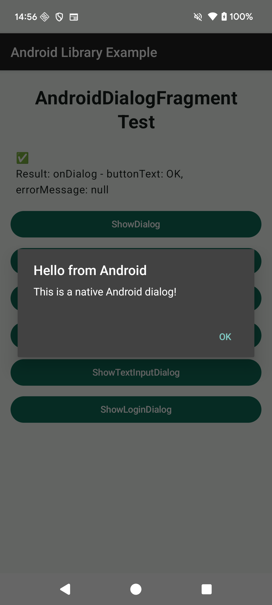
</p>

#### 확인 다이얼로그

- 메시지와 부정 버튼, 긍정 버튼을 표시합니다.

```kotlin
import com.jonghyunkim.nativetoolkit.dialog.AndroidDialogManager
import com.jonghyunkim.nativetoolkit.dialog.domain.model.DialogButton
import com.jonghyunkim.nativetoolkit.dialog.domain.model.DialogOptions
import com.jonghyunkim.nativetoolkit.dialog.domain.model.DialogRequest
import com.jonghyunkim.nativetoolkit.dialog.domain.model.DialogResult

val request = DialogRequest.Confirm(
    // 제목을 설정합니다. 필수 항목입니다.
    title = "Confirmation",
    // 메시지를 설정합니다. 필수 항목입니다.
    message = "Do you want to proceed with this action?",
    // 부정 버튼 텍스트를 설정합니다. 미설정 시 "No"가 사용됩니다.
    negativeText = "No",
    // 긍정 버튼 텍스트를 설정합니다. 미설정 시 "Yes"가 사용됩니다.
    positiveText = "Yes",
    options = DialogOptions(cancelable = false, cancelableOnTouchOutside = false)
)

AndroidDialogManager.getInstance(context).show(request) { result ->
    when (result) {
        is DialogResult.Button -> {
            if (result.which == DialogButton.POSITIVE) {
                // 사용자가 "Yes"를 눌렀습니다.
            }
        }
        else -> Log.d(TAG, "result: $result")
    }
}
```

<p align="center">
    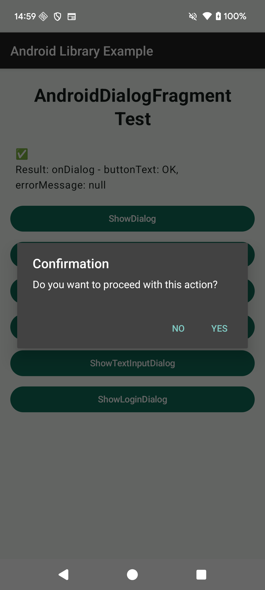
</p>

#### 단일 선택 다이얼로그

- 항목 하나를 선택할 수 있는 목록을 표시합니다.

```kotlin
import com.jonghyunkim.nativetoolkit.dialog.AndroidDialogManager
import com.jonghyunkim.nativetoolkit.dialog.domain.model.DialogOptions
import com.jonghyunkim.nativetoolkit.dialog.domain.model.DialogRequest
import com.jonghyunkim.nativetoolkit.dialog.domain.model.DialogResult
import com.jonghyunkim.nativetoolkit.dialog.domain.model.DialogValue

val request = DialogRequest.SingleChoice(
    // 제목을 설정합니다. 필수 항목입니다.
    title = "Please select one",
    // 선택 항목을 설정합니다. 필수 항목이며, 비워 둘 수 없습니다.
    items = listOf("Option 1", "Option 2", "Option 3"),
    // 처음에 선택해 둘 항목을 설정합니다. 선택하지 않으려면 null입니다. 미설정 시 0이 사용됩니다.
    checkedIndex = 0,
    // 부정 버튼 텍스트를 설정합니다. 미설정 시 "Cancel"이 사용됩니다.
    negativeText = "Cancel",
    // 긍정 버튼 텍스트를 설정합니다. 미설정 시 "OK"가 사용됩니다.
    positiveText = "OK",
    options = DialogOptions(cancelable = false, cancelableOnTouchOutside = false)
)

AndroidDialogManager.getInstance(context).show(request) { result ->
    if (result is DialogResult.Button) {
        // 긍정 버튼에서는 DialogValue.SingleChoice, 부정 버튼에서는 DialogValue.None입니다.
        val value = result.value
        if (value is DialogValue.SingleChoice) {
            // 선택된 항목의 인덱스입니다. 아무것도 선택하지 않은 경우 null입니다.
            Log.d(TAG, "button: ${result.which}, index: ${value.index}")
        }
    }
}
```

<p align="center">
    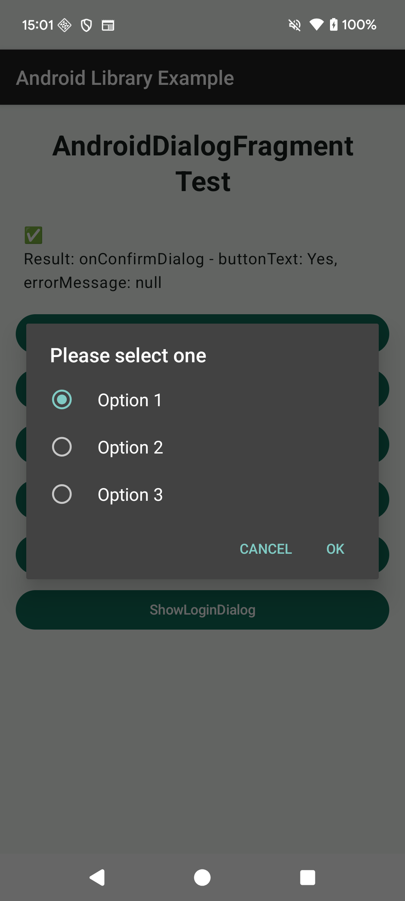
</p>

#### 다중 선택 다이얼로그

- 여러 항목을 선택할 수 있는 목록을 표시합니다.

```kotlin
import com.jonghyunkim.nativetoolkit.dialog.AndroidDialogManager
import com.jonghyunkim.nativetoolkit.dialog.domain.model.DialogOptions
import com.jonghyunkim.nativetoolkit.dialog.domain.model.DialogRequest
import com.jonghyunkim.nativetoolkit.dialog.domain.model.DialogResult
import com.jonghyunkim.nativetoolkit.dialog.domain.model.DialogValue

val request = DialogRequest.MultiChoice(
    // 제목을 설정합니다. 필수 항목입니다.
    title = "Multiple Selection",
    // 선택 항목을 설정합니다. 필수 항목이며, 비워 둘 수 없습니다.
    items = listOf("Option 1", "Option 2", "Option 3", "Option 4"),
    // 처음 선택 상태를 설정합니다. 필수 항목이며, 항목마다 값 하나를 지정합니다.
    checked = listOf(false, true, false, true),
    // 부정 버튼 텍스트를 설정합니다. 미설정 시 "Cancel"이 사용됩니다.
    negativeText = "Cancel",
    // 긍정 버튼 텍스트를 설정합니다. 미설정 시 "OK"가 사용됩니다.
    positiveText = "OK",
    options = DialogOptions(cancelable = false, cancelableOnTouchOutside = false)
)

AndroidDialogManager.getInstance(context).show(request) { result ->
    if (result is DialogResult.Button) {
        val value = result.value
        if (value is DialogValue.MultiChoice) {
            // 항목마다 값 하나입니다. 선택된 항목은 true입니다.
            Log.d(TAG, "button: ${result.which}, checked: ${value.checked}")
        }
    }
}
```

<p align="center">
    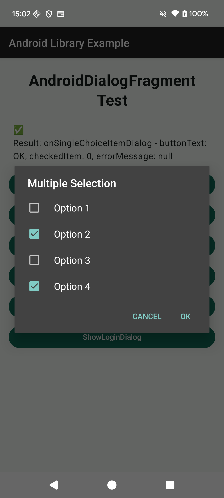
</p>

#### 입력 다이얼로그

- 메시지와 입력 필드 하나를 표시합니다.

```kotlin
import com.jonghyunkim.nativetoolkit.dialog.AndroidDialogManager
import com.jonghyunkim.nativetoolkit.dialog.domain.model.DialogOptions
import com.jonghyunkim.nativetoolkit.dialog.domain.model.DialogRequest
import com.jonghyunkim.nativetoolkit.dialog.domain.model.DialogResult
import com.jonghyunkim.nativetoolkit.dialog.domain.model.DialogValue

val request = DialogRequest.TextInput(
    // 제목을 설정합니다. 필수 항목입니다.
    title = "Text Input",
    // 메시지를 설정합니다. 필수 항목입니다.
    message = "Please enter your name",
    // 힌트를 설정합니다. 미설정 시 빈 문자열이 사용됩니다.
    hint = "Enter here...",
    // 부정 버튼 텍스트를 설정합니다. 미설정 시 "Cancel"이 사용됩니다.
    negativeText = "Cancel",
    // 긍정 버튼 텍스트를 설정합니다. 미설정 시 "OK"가 사용됩니다.
    positiveText = "OK",
    // 입력 필드가 비어 있을 때 긍정 버튼을 누를 수 있는지 설정합니다. 미설정 시 false가 사용됩니다.
    enablePositiveWhenEmpty = false,
    options = DialogOptions(cancelable = false, cancelableOnTouchOutside = false)
)

AndroidDialogManager.getInstance(context).show(request) { result ->
    if (result is DialogResult.Button) {
        val value = result.value
        if (value is DialogValue.Text) {
            // value.text는 사용자가 입력한 문자열입니다. 문자열 자체가 아니라 길이를 로그에 남깁니다.
            Log.d(TAG, "button: ${result.which}, textLength: ${value.text.length}")
        }
    }
}
```

<p align="center">
    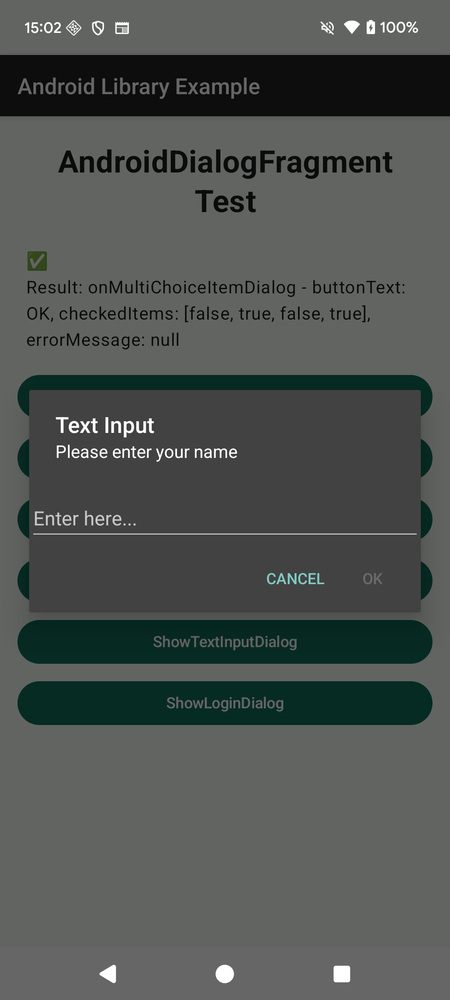
</p>

#### 로그인 다이얼로그

- 메시지와 사용자 이름, 비밀번호 입력 필드를 표시합니다.

```kotlin
import com.jonghyunkim.nativetoolkit.dialog.AndroidDialogManager
import com.jonghyunkim.nativetoolkit.dialog.domain.model.DialogOptions
import com.jonghyunkim.nativetoolkit.dialog.domain.model.DialogRequest
import com.jonghyunkim.nativetoolkit.dialog.domain.model.DialogResult
import com.jonghyunkim.nativetoolkit.dialog.domain.model.DialogValue

val request = DialogRequest.Login(
    // 제목을 설정합니다. 필수 항목입니다.
    title = "Login",
    // 메시지를 설정합니다. 필수 항목입니다.
    message = "Please enter your credentials",
    // 사용자 이름 힌트를 설정합니다. 미설정 시 "Username"이 사용됩니다.
    usernameHint = "Username",
    // 비밀번호 힌트를 설정합니다. 미설정 시 "Password"가 사용됩니다.
    passwordHint = "Password",
    // 부정 버튼 텍스트를 설정합니다. 미설정 시 "Cancel"이 사용됩니다.
    negativeText = "Cancel",
    // 긍정 버튼 텍스트를 설정합니다. 미설정 시 "Login"이 사용됩니다.
    positiveText = "Login",
    // 입력 필드 중 하나라도 비어 있을 때 긍정 버튼을 누를 수 있는지 설정합니다. 미설정 시 false가 사용됩니다.
    enablePositiveWhenEmpty = false,
    options = DialogOptions(cancelable = false, cancelableOnTouchOutside = false)
)

AndroidDialogManager.getInstance(context).show(request) { result ->
    if (result is DialogResult.Button) {
        val value = result.value
        if (value is DialogValue.Login) {
            // value.username과 value.password는 사용자가 입력한 값입니다. 비밀번호는 절대 로그에 남기지 마세요.
            Log.d(TAG, "usernameLength: ${value.username.length}, passwordLength: ${value.password.length}")
        }
    }
}
```

<p align="center">
    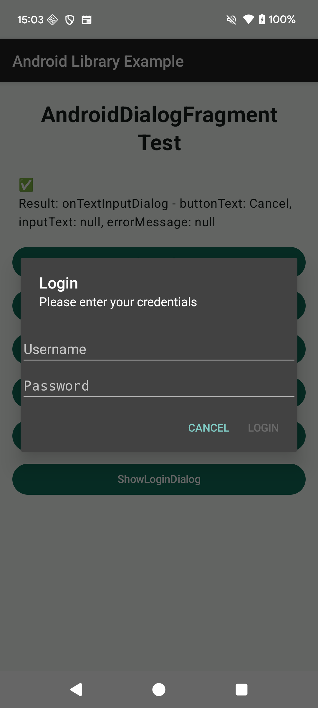
</p>

#### 코루틴으로 기다리기

- 콜백 없는 `show(request)`는 `suspend` 함수입니다. 응답으로 `DialogResult.Button` 또는 `DialogResult.Dismissed`(둘 다 `DialogResult.Answer`)를 반환합니다.
- 응답 없이 끝난 요청은 `DialogDomainError.Canceled(reason)`를, 표시할 수 없었던 다이얼로그는 `DialogDomainError.Unavailable(error)`를 던집니다.
- 코루틴을 취소하면 다이얼로그가 닫힙니다. 코루틴을 화면에 묶어 두면(Compose에서는 `rememberCoroutineScope()`) 화면을 떠날 때 다이얼로그도 닫힙니다.

```kotlin
import com.jonghyunkim.nativetoolkit.dialog.AndroidDialogManager
import com.jonghyunkim.nativetoolkit.dialog.domain.error.DialogDomainError
import com.jonghyunkim.nativetoolkit.dialog.domain.model.DialogOptions
import com.jonghyunkim.nativetoolkit.dialog.domain.model.DialogRequest
import com.jonghyunkim.nativetoolkit.dialog.domain.model.DialogResult
import kotlinx.coroutines.launch

val manager = AndroidDialogManager.getInstance(context)
val request = DialogRequest.Confirm(
    title = "Confirmation",
    message = "Do you want to proceed with this action?",
    negativeText = "No",
    positiveText = "Yes",
    options = DialogOptions(cancelable = false, cancelableOnTouchOutside = false)
)

scope.launch {
    try {
        when (val answer = manager.show(request)) {
            is DialogResult.Button -> Log.d(TAG, "button: ${answer.which} (${answer.text})")
            DialogResult.Dismissed -> Log.d(TAG, "Dismissed")
        }
    } catch (e: DialogDomainError.Canceled) {
        // e.reason은 CancelReason.REQUESTED 또는 CancelReason.HOST_DESTROYED입니다.
        Log.d(TAG, "Canceled: ${e.reason}")
    } catch (e: DialogDomainError.Unavailable) {
        // e.error는 DialogError입니다. 예: NOT_FOREGROUND
        Log.d(TAG, "Unavailable: ${e.error}")
    }
}
```

#### 뒤로 가기나 바깥 탭으로 닫기

- 인수 없는 `DialogOptions()`에서는 뒤로 가기와 바깥 탭으로 다이얼로그를 닫을 수 있습니다. 이때 결과는 `DialogResult.Dismissed`이며, 값을 담지 않습니다.

```kotlin
import com.jonghyunkim.nativetoolkit.dialog.AndroidDialogManager
import com.jonghyunkim.nativetoolkit.dialog.domain.model.DialogOptions
import com.jonghyunkim.nativetoolkit.dialog.domain.model.DialogRequest
import com.jonghyunkim.nativetoolkit.dialog.domain.model.DialogResult

val request = DialogRequest.Alert(
    title = "Cancelable",
    message = "Tap outside or press Back.",
    buttonText = "OK",
    // cancelable = true, cancelableOnTouchOutside = true입니다.
    options = DialogOptions()
)

AndroidDialogManager.getInstance(context).show(request) { result ->
    if (result == DialogResult.Dismissed) {
        // 사용자가 뒤로 가기를 누르거나 다이얼로그 바깥을 탭했습니다.
    }
}
```

#### 다이얼로그 취소

- `cancel(requestId)`는 코드에서 다이얼로그를 닫습니다. 아직 결과가 없으면 결과는 `DialogResult.Canceled(CancelReason.REQUESTED)`가 됩니다.
- `cancel`은 어느 스레드에서든 호출할 수 있습니다. 알 수 없는 ID나 이미 결과가 나온 다이얼로그의 ID는 무시됩니다.

```kotlin
import android.os.Handler
import android.os.Looper
import com.jonghyunkim.nativetoolkit.dialog.AndroidDialogManager

val manager = AndroidDialogManager.getInstance(context)
// request: 어떤 DialogRequest든 상관없습니다. 예를 들어 기본 다이얼로그의 요청입니다.
val requestId = manager.show(request) { result ->
    // cancel()이 먼저 호출된 경우 DialogResult.Canceled(CancelReason.REQUESTED)입니다.
    Log.d(TAG, "result: $result")
}

// 2초 후에 다이얼로그를 닫습니다.
Handler(Looper.getMainLooper()).postDelayed({ manager.cancel(requestId) }, 2_000)
```

### C ABI

- 같은 다이얼로그를 C에서, 그리고 C 함수를 호출할 수 있는 언어(C#, Dart, Rust 등)에서 사용하기 위한 API입니다. Kotlin이나 Java 앱은 대신 `AndroidDialogManager`를 호출해 주세요. C ABI는 JNI를 통해 그것을 호출하므로 왕복만 늘어납니다.
- 앱에는 두 AAR을 모두 추가합니다. `android-native-toolkit-capi-2.0.0.aar`에는 `libntk.so`와 헤더가 들어 있으며, 옆에 `android-native-toolkit-2.0.0.aar`가 필요합니다. `libntk.so`는 64비트 ABI(`arm64-v8a`, `x86_64`)용만 있습니다. 32비트로 설치된 앱도 시작은 되지만, `libntk.so`가 없으므로 로드에 실패합니다.
- 헤더와 `libntk.so`는 Prefab으로 제공됩니다. Prefab을 켜고, 앱의 ABI와 CMake 빌드를 모두 64비트 ABI로 제한해 주세요. 이유는 [설정](index.ko.md#c-abi)에서 설명합니다(`CMakeLists.txt`의 `if()`로는 `CXX1210` 빌드 오류를 피할 수 없습니다. 직접 작성한 32비트 네이티브 코드는 Prefab을 사용하지 않는 별도 모듈에 둡니다).

```kotlin
android {
    buildFeatures { prefab = true }
    defaultConfig {
        ndk { abiFilters += listOf("arm64-v8a", "x86_64") }
        externalNativeBuild {
            cmake { abiFilters("arm64-v8a", "x86_64") }
        }
    }
}
```

```cmake
find_package(ntk REQUIRED CONFIG)
target_link_libraries(your_library PRIVATE ntk::ntk)
```

- androidx.startup이 앱 시작 시 라이브러리를 초기화합니다. Startup을 끈 앱, 기본 프로세스가 아닌 프로세스에서 호출하는 앱, `libntk.so`를 `dlopen`으로만 로드하는 앱은 먼저 `ntk_android_init(env, context)`(`<NativeToolkitC/Android.h>`)를 호출합니다. 라이브러리가 초기화될 때까지 `ntk_dialog_show_*_async` 함수는 `NTK_DIALOG_ERROR_NOT_INITIALIZED`를 반환합니다. 인수 검사가 먼저 이루어지므로 잘못된 인수에는 이때도 `NTK_DIALOG_ERROR_INVALID_PARAMETER`가 반환되며, `ntk_dialog_cancel`은 아무것도 하지 않고 `NTK_DIALOG_ERROR_NONE`을 반환합니다. 결과를 읽는 함수와 `ntk_dialog_result_free`는 초기화 여부와 관계없이 동작합니다.
- 헤더는 순수한 C99이며 `<stddef.h>`와 `<stdint.h>` 외에는 include하지 않습니다. 문자열은 NUL로 끝나는 UTF-8입니다. 버튼이나 힌트 텍스트가 `NULL`이면 Kotlin의 기본값(`"OK"`, `"Cancel"` 등)이 사용되고, 제목이나 메시지의 `NULL`은 빈 문자열이 됩니다.
- 요청 구조체는 0으로 채우고 `struct_size`에 자신의 `sizeof`를 넣습니다. 0이 기본값입니다. 기본값을 0으로 유지하기 위해 두 플래그는 Kotlin API와 이름의 방향이 반대입니다. `not_cancelable`은 `cancelable`의 반대, `not_cancelable_on_touch_outside`는 `cancelableOnTouchOutside`의 반대입니다.
- 모든 함수는 어느 스레드에서든 호출할 수 있으며, 메인 스레드를 기다리지 않습니다. 반환값은 요청이 접수되었는지만 나타냅니다. 호출 시점에 거부된 경우(잘못된 인수, `NOT_INITIALIZED`) 콜백은 호출되지 않으며, `release`는 호출이 반환되기 전에 호출한 스레드에서 호출됩니다.
- 접수된 요청은 Android 메인 스레드에서 정확히 한 번 완료되고, 그 뒤에 `release`가 호출됩니다. 둘 다 요청을 시작한 호출 안에서는 실행되지 않습니다. 메인 스레드가 아닌 곳에서 호출하면 그 호출이 반환되기 전에 완료가 도착할 수 있으므로, 완료와 요청은 `user_data`로 연결해 주세요. 앱이 백그라운드에 있을 때 호출하면 요청은 `NTK_DIALOG_ERROR_NOT_FOREGROUND`로 완료됩니다.
- 콜백에 전달되는 `ntk_dialog_result`는 받은 쪽이 소유하며, 콜백 안에서 또는 나중에 `ntk_dialog_result_free`로 해제합니다. 오류가 `NTK_DIALOG_ERROR_NONE`이 아니면 `NULL`입니다. Android에서 `system_code`와 `ntk_last_system_code()`는 항상 0입니다.
- 요청 ID는 `uint64_t`이며 재사용되지 않습니다. `ntk_dialog_cancel`은 어느 스레드에서든 ID를 받으며, 알 수 없는 ID나 이미 완료된 요청은 무시합니다.
- 콜백에서 메인 스레드를 블로킹하거나 예외를 밖으로 내보내지 마세요. 라이브러리는 예외를 잡지 않으므로 프로세스가 종료됩니다.

#### 알림 다이얼로그와 확인 다이얼로그

```c
#include <string.h>
#include <NativeToolkitC/Common.h>
#include <NativeToolkitC/Android.h>
#include <NativeToolkitC/Dialog.h>

static void NTK_CALL on_dialog_result(void* user_data, uint64_t request_id, ntk_dialog_error error,
                                      uint32_t system_code, ntk_dialog_result* result)
{
    /* Android 메인 스레드에서, 접수된 요청마다 한 번 호출됩니다. system_code는 항상 0입니다. */
    (void)user_data; (void)request_id; (void)system_code;
    if (error != NTK_DIALOG_ERROR_NONE) {
        /* result는 NULL입니다. ntk_dialog_cancel 후에는 CANCELED, Activity가 사라진 경우에는
           CANCELED_BY_SYSTEM, 앱이 백그라운드에 있던 경우에는 NOT_FOREGROUND입니다. */
        return;
    }
    if (ntk_dialog_result_answer(result) == NTK_DIALOG_ANSWER_BUTTON) {
        ntk_dialog_button button = ntk_dialog_result_button(result);
        size_t size = 0;
        const char* label = ntk_dialog_result_button_text(result, &size);
        (void)button; (void)label;
    } else {
        /* NTK_DIALOG_ANSWER_DISMISSED: 뒤로 가기나 바깥 탭입니다. 값을 담지 않습니다. */
    }
    /* 결과는 받은 쪽의 것입니다. 여기서 해제하거나, 나중에 어느 스레드에서든 해제합니다. */
    ntk_dialog_result_free(result);
}

static void NTK_CALL release_user_data(void* user_data)
{
    /* 정확히 한 번 호출됩니다. 완료 후 메인 스레드에서 호출되거나, 호출이 거부된 경우에는
       그 호출이 반환되기 전에 호출한 스레드에서 호출됩니다. */
    (void)user_data;
}

/* 헤더와 libntk.so는 같은 버전이어야 합니다. */
if (ntk_version() != NTK_VERSION) {
    return;
}
/* androidx.startup이 앱 시작 시 라이브러리를 초기화합니다. Startup을 끈 앱은
   먼저 ntk_android_init(env, context)를 호출합니다. */
if (!ntk_android_is_initialized()) {
    return;
}

/* --- 기본 다이얼로그 ------------------------------------------------- */
ntk_dialog_alert_request alert;
memset(&alert, 0, sizeof(alert));
alert.struct_size = (uint32_t)sizeof(alert);
alert.title = "Hello from Android";
alert.message = "This is a native Android dialog!";
alert.button_text = "OK";                    /* NULL이면 "OK" */
alert.not_cancelable = 1;                    /* 뒤로 가기로 닫히지 않습니다 */
alert.not_cancelable_on_touch_outside = 1;   /* 바깥 탭으로도 닫히지 않습니다 */

uint64_t request_id = 0;
ntk_dialog_error error = ntk_dialog_show_alert_async(&alert, &on_dialog_result, NULL,
                                                     &release_user_data, &request_id);
if (error != NTK_DIALOG_ERROR_NONE) {
    /* 거부되었습니다. 콜백은 호출되지 않으며, release_user_data는 이미 실행되었습니다. */
    return;
}

/* 나중에, 예를 들어 화면을 닫을 때: 다이얼로그가 닫히고 NTK_DIALOG_ERROR_CANCELED로
   완료됩니다. 이미 완료된 ID나 알 수 없는 ID에는 아무 일도 일어나지 않습니다. */
ntk_dialog_cancel(request_id);

/* --- 확인 다이얼로그 ------------------------------------------------- */
ntk_dialog_confirm_request confirm;
memset(&confirm, 0, sizeof(confirm));
confirm.struct_size = (uint32_t)sizeof(confirm);
confirm.title = "Confirmation";
confirm.message = "Do you want to proceed with this action?";
confirm.negative_text = "No";                /* NULL이면 "No" */
confirm.positive_text = "Yes";               /* NULL이면 "Yes" */
confirm.not_cancelable = 1;
confirm.not_cancelable_on_touch_outside = 1;

/* 다이얼로그를 취소하지 않는다면 out_request_id는 NULL이어도 됩니다. */
error = ntk_dialog_show_confirm_async(&confirm, &on_dialog_result, NULL, &release_user_data, NULL);
```

#### 선택 목록 다이얼로그

`ntk_dialog_result_checked_index`는 단일 선택의 응답을 읽으며, 아무것도 선택하지 않은 경우 -1입니다. `ntk_dialog_result_checked_count`와 `ntk_dialog_result_checked_at`은 다중 선택의 응답을 읽으며, 선택된 항목에서는 0이 아닌 값입니다. 부정 버튼은 선택을 담지 않습니다.

```c
#include <string.h>
#include <NativeToolkitC/Common.h>
#include <NativeToolkitC/Dialog.h>

static void NTK_CALL on_single_choice(void* user_data, uint64_t request_id, ntk_dialog_error error,
                                      uint32_t system_code, ntk_dialog_result* result)
{
    (void)user_data; (void)request_id; (void)system_code;
    if (error != NTK_DIALOG_ERROR_NONE) {
        return;
    }
    if (ntk_dialog_result_answer(result) == NTK_DIALOG_ANSWER_BUTTON
        && ntk_dialog_result_button(result) == NTK_DIALOG_BUTTON_POSITIVE) {
        int32_t index = ntk_dialog_result_checked_index(result);   /* -1: 선택 없음 */
        (void)index;
    }
    ntk_dialog_result_free(result);
}

static void NTK_CALL on_multi_choice(void* user_data, uint64_t request_id, ntk_dialog_error error,
                                     uint32_t system_code, ntk_dialog_result* result)
{
    (void)user_data; (void)request_id; (void)system_code;
    if (error != NTK_DIALOG_ERROR_NONE) {
        return;
    }
    if (ntk_dialog_result_answer(result) == NTK_DIALOG_ANSWER_BUTTON
        && ntk_dialog_result_button(result) == NTK_DIALOG_BUTTON_POSITIVE) {
        size_t count = ntk_dialog_result_checked_count(result);
        size_t i;
        for (i = 0; i < count; ++i) {
            int32_t checked = ntk_dialog_result_checked_at(result, i);   /* 0이 아니면 선택됨 */
            (void)checked;
        }
    }
    ntk_dialog_result_free(result);
}

/* --- 항목 하나 ------------------------------------------------------ */
const char* const single_items[] = { "Option 1", "Option 2", "Option 3" };

ntk_dialog_single_choice_request single;
memset(&single, 0, sizeof(single));
single.struct_size = (uint32_t)sizeof(single);
single.title = "Please select one";
single.items = single_items;
single.item_count = 3;                       /* 0이면 안 됩니다 */
single.checked_index = 0;                    /* -1: 선택 없음 */
single.negative_text = "Cancel";             /* NULL이면 "Cancel" */
single.positive_text = "OK";                 /* NULL이면 "OK" */
single.not_cancelable = 1;
single.not_cancelable_on_touch_outside = 1;

/* 해제할 것이 없다면 user_data와 release는 NULL이어도 됩니다. */
ntk_dialog_error error = ntk_dialog_show_single_choice_async(&single, &on_single_choice, NULL, NULL, NULL);

/* --- 여러 항목 ------------------------------------------------------ */
const char* const multi_items[] = { "Option 1", "Option 2", "Option 3", "Option 4" };
const int32_t multi_checked[] = { 0, 1, 0, 1 };

ntk_dialog_multi_choice_request multi;
memset(&multi, 0, sizeof(multi));
multi.struct_size = (uint32_t)sizeof(multi);
multi.title = "Multiple Selection";
multi.items = multi_items;
multi.item_count = 4;
multi.checked = multi_checked;               /* NULL: 선택 없음. 그 외에는 item_count개의 값 */
multi.negative_text = "Cancel";
multi.positive_text = "OK";
multi.not_cancelable = 1;
multi.not_cancelable_on_touch_outside = 1;

error = ntk_dialog_show_multi_choice_async(&multi, &on_multi_choice, NULL, NULL, NULL);
```

#### 입력 다이얼로그와 로그인 다이얼로그

텍스트, 사용자 이름, 비밀번호는 결과 내부를 가리키며, 결과를 해제할 때까지 유효합니다.

```c
#include <string.h>
#include <NativeToolkitC/Common.h>
#include <NativeToolkitC/Dialog.h>

static void NTK_CALL on_text_input(void* user_data, uint64_t request_id, ntk_dialog_error error,
                                   uint32_t system_code, ntk_dialog_result* result)
{
    (void)user_data; (void)request_id; (void)system_code;
    if (error != NTK_DIALOG_ERROR_NONE) {
        return;
    }
    if (ntk_dialog_result_answer(result) == NTK_DIALOG_ANSWER_BUTTON
        && ntk_dialog_result_button(result) == NTK_DIALOG_BUTTON_POSITIVE) {
        size_t size = 0;
        const char* text = ntk_dialog_result_text(result, &size);   /* UTF-8 */
        (void)text;
    }
    ntk_dialog_result_free(result);
}

static void NTK_CALL on_login(void* user_data, uint64_t request_id, ntk_dialog_error error,
                              uint32_t system_code, ntk_dialog_result* result)
{
    (void)user_data; (void)request_id; (void)system_code;
    if (error != NTK_DIALOG_ERROR_NONE) {
        return;
    }
    if (ntk_dialog_result_answer(result) == NTK_DIALOG_ANSWER_BUTTON
        && ntk_dialog_result_button(result) == NTK_DIALOG_BUTTON_POSITIVE) {
        const char* username = ntk_dialog_result_username(result, NULL);
        const char* password = ntk_dialog_result_password(result, NULL);   /* 절대 로그에 남기지 마세요 */
        (void)username; (void)password;
    }
    ntk_dialog_result_free(result);
}

/* --- 텍스트 입력 ---------------------------------------------------- */
ntk_dialog_text_input_request input;
memset(&input, 0, sizeof(input));
input.struct_size = (uint32_t)sizeof(input);
input.title = "Text Input";
input.message = "Please enter your name";
input.hint = "Enter here...";                /* NULL이면 힌트 없음 */
input.negative_text = "Cancel";              /* NULL이면 "Cancel" */
input.positive_text = "OK";                  /* NULL이면 "OK" */
input.enable_positive_when_empty = 0;
input.not_cancelable = 1;
input.not_cancelable_on_touch_outside = 1;

ntk_dialog_error error = ntk_dialog_show_text_input_async(&input, &on_text_input, NULL, NULL, NULL);

/* --- 로그인 --------------------------------------------------------- */
ntk_dialog_login_request login;
memset(&login, 0, sizeof(login));
login.struct_size = (uint32_t)sizeof(login);
login.title = "Login";
login.message = "Please enter your credentials";
login.username_hint = "Username";            /* NULL이면 "Username" */
login.password_hint = "Password";            /* NULL이면 "Password" */
login.negative_text = "Cancel";              /* NULL이면 "Cancel" */
login.positive_text = "Login";               /* NULL이면 "Login" */
login.enable_positive_when_empty = 0;
login.not_cancelable = 1;
login.not_cancelable_on_touch_outside = 1;

error = ntk_dialog_show_login_async(&login, &on_login, NULL, NULL, NULL);
```

| 오류 | 반환 / 완료 | 의미 |
|---|---|---|
| `NTK_DIALOG_ERROR_NONE` | 둘 다 | 접수됨, 또는 응답이 있음 |
| `NTK_DIALOG_ERROR_INVALID_PARAMETER` | 반환(드물게 완료) | `NULL` 콜백이나 요청, 잘못된 UTF-8, 항목 없음, 범위를 벗어난 인덱스, 2.0.0 크기 미만이거나 4096을 넘는 `struct_size`, 0이 아닌 예약 필드입니다. 접수된 뒤 Kotlin API가 `IllegalArgumentException`으로 거부한 요청이 이 오류로 완료될 수도 있습니다 |
| `NTK_DIALOG_ERROR_NOT_INITIALIZED` | 반환 | 초기화 전에 호출했습니다. 인수 검사가 먼저 이루어지며, `ntk_dialog_cancel`은 `NONE`을 반환합니다 |
| `NTK_DIALOG_ERROR_NOT_SUPPORTED` | 반환 | 이 라이브러리가 모르는 0이 아닌 필드를 가진, 더 새로운 `struct_size`입니다 |
| `NTK_DIALOG_ERROR_UNKNOWN` | 둘 다 | 그 밖의 오류입니다(자세한 내용은 logcat에 있습니다) |
| `NTK_DIALOG_ERROR_OUT_OF_MEMORY` | 둘 다 | 메모리 부족입니다 |
| `NTK_DIALOG_ERROR_CANCELED` | 완료 | `ntk_dialog_cancel`(`CancelReason.REQUESTED`) |
| `NTK_DIALOG_ERROR_CANCELED_BY_SYSTEM` | 완료 | 다이얼로그를 표시하던 Activity가 소멸되었습니다(`CancelReason.HOST_DESTROYED`) |
| `NTK_DIALOG_ERROR_NOT_FOREGROUND` | 완료 | 앱이 포그라운드에 있지 않았습니다(`DialogError.NOT_FOREGROUND`) |
| `NTK_DIALOG_ERROR_HOST_START_FAILED` | 완료 | 투명한 Activity가 시작되지 않았습니다(`DialogError.HOST_START_FAILED`) |
| `NTK_DIALOG_ERROR_SHOW_FAILED` | 완료 | 다이얼로그 표시에 실패했습니다(`DialogError.SHOW_FAILED`) |

| Kotlin API | C ABI |
|---|---|
| `show(DialogRequest.Alert(...))` | `ntk_dialog_show_alert_async` |
| `show(DialogRequest.Confirm(...))` | `ntk_dialog_show_confirm_async` |
| `show(DialogRequest.SingleChoice(...))` | `ntk_dialog_show_single_choice_async` |
| `show(DialogRequest.MultiChoice(...))` | `ntk_dialog_show_multi_choice_async` |
| `show(DialogRequest.TextInput(...))` | `ntk_dialog_show_text_input_async` |
| `show(DialogRequest.Login(...))` | `ntk_dialog_show_login_async` |
| `cancel(requestId)` | `ntk_dialog_cancel` |
| `DialogResult.Button` / `DialogResult.Dismissed` | `ntk_dialog_result_answer` |
| `DialogResult.Button.which` / `text` | `ntk_dialog_result_button`, `ntk_dialog_result_button_text` |
| `DialogValue` | `ntk_dialog_result_checked_index`, `ntk_dialog_result_checked_count`, `ntk_dialog_result_checked_at`, `ntk_dialog_result_text`, `ntk_dialog_result_username`, `ntk_dialog_result_password` |
| - | `ntk_dialog_result_free` |

---

## iOS

iOS 라이브러리는 다이얼로그를 두 가지 공개 API로 제공합니다. 구현은 하나이며, 샘플 앱은 Swift API를 사용합니다.

| API | 이름 | 모듈 / 헤더 | XCFramework |
|---|---|---|---|
| Swift API | `IosDialogManager` | `IosLibrary` | `ios-native-toolkit-2.0.0.xcframework` |
| C ABI | `ntk_dialog_*` | `<NativeToolkitC/Dialog.h>` | `ios-native-toolkit-capi-2.0.0.xcframework`(`ios-native-toolkit-2.0.0.xcframework`와 함께 임베드합니다) |

- 라이브러리에는 iOS 18.0 이상이 필요합니다. Swift API를 사용하는 앱은 Xcode 26.3 이상으로 빌드합니다.
- iOS에는 Android에 없는 파괴적 다이얼로그와 액션 시트가 있습니다. Android의 단일 선택 다이얼로그와 다중 선택 다이얼로그에 해당하는 것은 iOS에 없습니다. iOS의 알림은 바깥을 탭해도 닫히지 않으므로, Android와 같은 "닫힘" 응답은 없습니다.
- 1.x 라이브러리용으로 작성한 코드는 수정해야 합니다. [iOS 라이브러리를 2.0.0으로 마이그레이션](index.ko.md#ios-라이브러리를-200으로-마이그레이션)을 참고해 주세요. 다이얼로그의 경우 `show...` 메서드의 이름, 인수, 기본값은 그대로이지만 다음이 바뀌었습니다.
  - 콜백은 `@MainActor @Sendable`이며 메인 스레드에서 호출됩니다.
  - 실패는 `completion`으로만 보고됩니다. `showLoginDialog`가 `isSuccess == false`로 `onLogin`을 호출하는 일은 더 이상 없습니다. UIKit이 표시를 거부하면 `completion(false, "Failed to present the dialog")`가 한 번 호출됩니다.
  - `getRootViewController()`는 `@MainActor`입니다. 동기 nonisolated 컨텍스트에서는 호출할 수 없습니다.
  - 2.0.0에서 추가된 것: 요청마다 하나의 결과를 보고하는 `show(_:presenter:requestBox:completion:)`와 그 `async` 버전, `cancel(_:)`, `foregroundViewController()`, 그리고 `DialogRequest`, `DialogAnswer`, `DialogInput`, `DialogError`, `PresenterSelection`, `RequestBox` 타입입니다.

### IosDialogManager

- `IosDialogManager.shared`는 프로세스 전체에서 하나인 인스턴스입니다. `getRootViewController()`와 `foregroundViewController()` 외의 메서드는 어느 스레드에서든 호출할 수 있습니다. 이 두 메서드는 UIKit 상태를 읽으므로 `@MainActor`입니다.
- 다이얼로그를 표시하는 방법은 두 가지이며, 샘플 화면은 둘 다 이 순서로 보여 줍니다.
  - 종류마다 하나인 `show...` 메서드(`showAlert`, `showConfirmDialog`, `showDestructiveDialog`, `showActionSheet`, `showTextInputDialog`, `showLoginDialog`). 1.x의 API입니다. 버튼 콜백이 눌린 버튼을 보고하고, `completion`이 다이얼로그를 표시했는지를 보고합니다. 직접 만든 `UIAlertAction`을 전달하는 `showDialog(...)`도 계속 사용할 수 있습니다.
  - `show(_:presenter:requestBox:completion:)`는 `DialogRequest`를 받아 하나의 `Result<DialogAnswer, DialogError>`를 보고합니다. 눌린 버튼, 또는 버튼이 눌리지 않은 채 요청이 끝난 이유입니다. 취소할 수 있으며, 어느 뷰 컨트롤러에서 표시할지도 지정할 수 있습니다.
- 모든 콜백은 메인 스레드에서 최대 한 번 호출되며, 다이얼로그를 표시한 호출 안에서 호출되는 일은 없습니다. 그 호출을 메인 스레드에서 한 경우에도 마찬가지입니다. 콜백 타입은 `@MainActor @Sendable`이므로, SwiftUI 뷰 안에서 작성한 클로저에서 뷰의 상태를 직접 사용할 수 있습니다.
- 다이얼로그를 표시하려면 포그라운드에 있는 윈도 씬이 필요합니다. 라이브러리는 표시된 다이얼로그를 약한 참조로 보관하며, 요청이 끝나면 콜백을 놓습니다. 큰 객체를 클로저에서 강하게 캡처하지 않도록 해 주세요.

`show...` 메서드는 다음과 같이 보고합니다.

| 콜백 | 호출되는 경우 |
|---|---|
| 버튼 콜백(`onButton`, `onConfirm`, `onCancel`, `onDestructive`, `onAction`, `onLogin`) | 사용자가 그 버튼을 누른 경우입니다. 버튼 텍스트(입력 다이얼로그와 로그인 다이얼로그에서는 입력된 내용도), `isSuccess == true`, `errorMessage == nil`을 받습니다 |
| `completion(true, nil)` | UIKit이 다이얼로그를 표시한 경우입니다 |
| `completion(false, "Failed to get root view controller")` | 표시할 뷰 컨트롤러를 찾지 못한 경우입니다 |
| `completion(false, "Failed to present the dialog")` | UIKit이 표시를 거부한 경우입니다. 예를 들어 찾은 뷰 컨트롤러가 이미 다른 것을 표시하고 있던 경우입니다 |

- 버튼이 눌리지 않은 채 다이얼로그가 사라진 경우(다른 코드가 닫았거나, 씬의 연결이 끊긴 경우)에는 어느 것도 호출되지 않습니다. `show...` 메서드에는 이 경우의 결과가 없습니다. `show(_:presenter:requestBox:completion:)`는 이를 `DialogError.dismissedBySystem`으로 보고합니다.
- `show...` 메서드는 첫 번째 `foregroundActive` 씬의 키 윈도에서 가장 위에 있는 뷰 컨트롤러로부터 표시하며, 기다리지 않습니다. 첫 번째 다이얼로그가 표시되는 도중에 두 번째를 요청하면 `"Failed to present the dialog"`로 실패할 가능성이 높습니다. 첫 번째 위에 표시하려면 `show(_:presenter:requestBox:completion:)`를 `presenter: .foreground`로 사용해 주세요([표시할 뷰 컨트롤러 선택](#표시할-뷰-컨트롤러-선택) 참고).

#### 기본 다이얼로그

- 메시지와 버튼 하나를 표시합니다.

```swift
import IosLibrary

IosDialogManager.shared.showAlert(
    // 제목을 설정합니다. 미설정 시 제목이 표시되지 않습니다.
    title: "Hello from iOS",
    // 메시지를 설정합니다. 미설정 시 메시지가 표시되지 않습니다.
    message: "This is a native iOS dialog!",
    // 버튼 텍스트를 설정합니다. 미설정 시 "OK"가 사용됩니다.
    buttonText: "OK",
    // 버튼을 누르면 메인 스레드에서 호출됩니다.
    onButton: { buttonText, isSuccess, errorMessage in
        // buttonText: 버튼 텍스트("OK")입니다. isSuccess는 true, errorMessage는 nil입니다.
    },
    // 다이얼로그를 표시했거나 표시하지 못했을 때 메인 스레드에서 한 번 호출됩니다.
    completion: { isSuccess, errorMessage in
        // isSuccess: 다이얼로그가 표시되면 true입니다.
        // errorMessage: 성공 시 nil, 그 외에는 "Failed to get root view controller"
        // 또는 "Failed to present the dialog"입니다.
    }
)
```

<p align="center">
    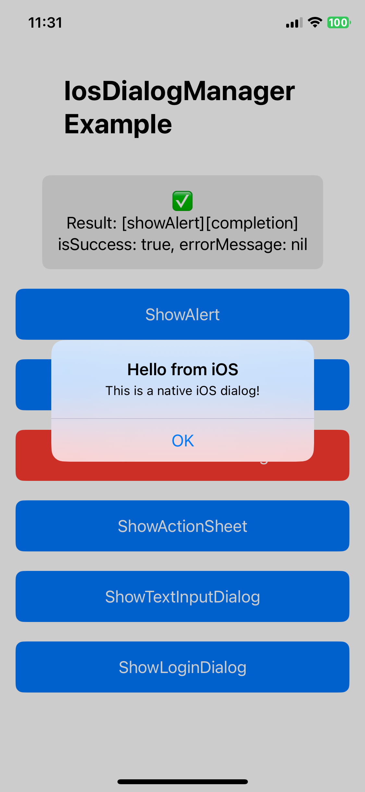
</p>

#### 확인 다이얼로그

- 메시지와 확인 버튼, 취소 버튼을 표시합니다.

```swift
import IosLibrary

IosDialogManager.shared.showConfirmDialog(
    // 제목을 설정합니다. 미설정 시 제목이 표시되지 않습니다.
    title: "Confirm Action",
    // 메시지를 설정합니다. 미설정 시 메시지가 표시되지 않습니다.
    message: "Are you sure you want to proceed?",
    // 확인 버튼 텍스트를 설정합니다. 미설정 시 "OK"가 사용됩니다.
    confirmTitle: "Yes",
    // 취소 버튼 텍스트를 설정합니다. 미설정 시 "Cancel"이 사용됩니다.
    cancelTitle: "No",
    // 확인 버튼을 누르면 호출됩니다.
    onConfirm: { confirmButtonText, isSuccess, errorMessage in
        // confirmButtonText: "Yes"입니다.
    },
    // 취소 버튼을 누르면 호출됩니다.
    onCancel: { cancelButtonText, isSuccess, errorMessage in
        // cancelButtonText: "No"입니다.
    },
    // 다이얼로그를 표시했거나 표시하지 못했을 때 한 번 호출됩니다.
    completion: { isSuccess, errorMessage in
        // showAlert와 같습니다.
    }
)
```

<p align="center">
    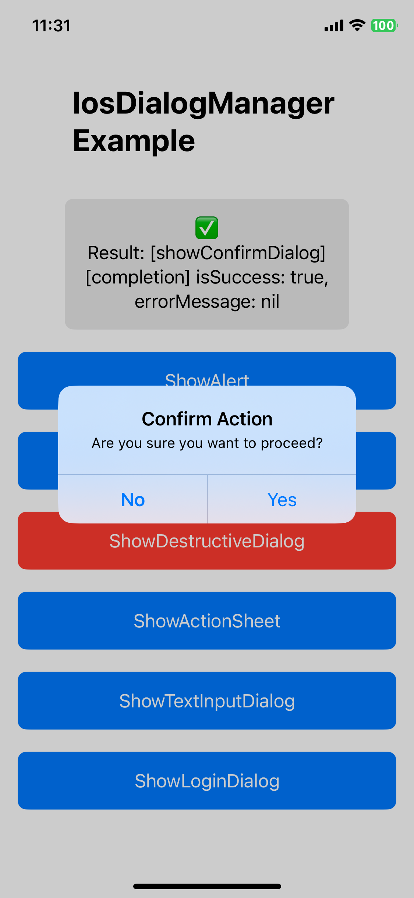
</p>

#### 파괴적 다이얼로그

- 메시지와 빨간색으로 표시되는 파괴적 버튼, 취소 버튼을 표시합니다. iOS 전용입니다.

```swift
import IosLibrary

IosDialogManager.shared.showDestructiveDialog(
    // 제목을 설정합니다. 미설정 시 제목이 표시되지 않습니다.
    title: "Delete File",
    // 메시지를 설정합니다. 미설정 시 메시지가 표시되지 않습니다.
    message: "This action cannot be undone. Are you sure?",
    // 파괴적 버튼 텍스트를 설정합니다. 미설정 시 "Delete"가 사용됩니다.
    destructiveTitle: "Delete",
    // 취소 버튼 텍스트를 설정합니다. 미설정 시 "Cancel"이 사용됩니다.
    cancelTitle: "Cancel",
    // 파괴적 버튼을 누르면 호출됩니다.
    onDestructive: { destructiveButtonText, isSuccess, errorMessage in
        // destructiveButtonText: "Delete"입니다.
    },
    // 취소 버튼을 누르면 호출됩니다.
    onCancel: { cancelButtonText, isSuccess, errorMessage in
        // cancelButtonText: "Cancel"입니다.
    },
    // 다이얼로그를 표시했거나 표시하지 못했을 때 한 번 호출됩니다.
    completion: { isSuccess, errorMessage in
        // showAlert와 같습니다.
    }
)
```

<p align="center">
    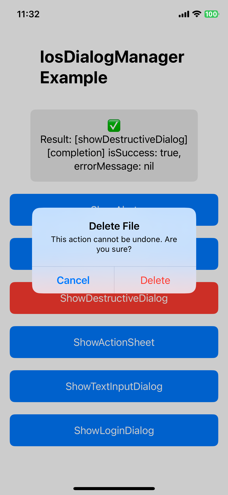
</p>

#### 액션 시트

- 선택지 목록과 취소 버튼을 표시합니다. iOS 전용입니다.
- iPad에서 액션 시트는 `sourceView` 안에 고정된 팝오버가 됩니다. `sourceRect`는 팝오버가 가리키는 `sourceView` 안의 사각형이며, `nil`이면 `sourceView`의 경계 전체가 사용됩니다. `sourceView`가 크면(예: 화면 전체) 팝오버가 놓일 공간이 없어 선택지 없이 표시되므로, 샘플이 중심점을 전달하듯이 작은 사각형을 전달해 주세요.
- iPad와 iOS 26의 iPhone에서는 액션 시트 바깥을 탭하면 취소 버튼을 선택한 것이 됩니다. `onAction`은 `cancelTitle`을 받습니다.
- `getRootViewController()`는 `@MainActor`입니다. SwiftUI 버튼의 액션은 메인 액터에서 실행되므로 직접 호출할 수 있습니다.

```swift
import IosLibrary
import UIKit

if let rootVC = IosDialogManager.shared.getRootViewController() {
    IosDialogManager.shared.showActionSheet(
        // 제목을 설정합니다. 미설정 시 제목이 표시되지 않습니다.
        title: "Please select",
        // 메시지를 설정합니다. 미설정 시 메시지가 표시되지 않습니다.
        message: "Please choose an option",
        // 선택지를 설정합니다. 필수 항목입니다.
        options: ["Camera", "Photo Library", "Documents"],
        // 취소 버튼 텍스트를 설정합니다. 미설정 시 "Cancel"이 사용됩니다.
        cancelTitle: "Cancel",
        // iPad 팝오버를 고정할 뷰를 설정합니다. 필수 항목입니다.
        sourceView: rootVC.view,
        // 중심점입니다. 뷰 전체(nil)로는 iPad 팝오버에 선택지를 놓을 공간이 없습니다.
        sourceRect: CGRect(x: rootVC.view.bounds.midX, y: rootVC.view.bounds.midY, width: 0, height: 0),
        // 애니메이션으로 표시할지 설정합니다. 미설정 시 true가 사용됩니다.
        animated: true,
        // 선택지나 취소 버튼을 선택하면 호출됩니다.
        onAction: { action, isSuccess, errorMessage in
            // action: 선택한 선택지("Camera" 등), 또는 취소 버튼의 경우 "Cancel"입니다.
        },
        // 액션 시트를 표시했거나 표시하지 못했을 때 한 번 호출됩니다.
        completion: { isSuccess, errorMessage in
            // showAlert와 같습니다.
        }
    )
}
```

<p align="center">
    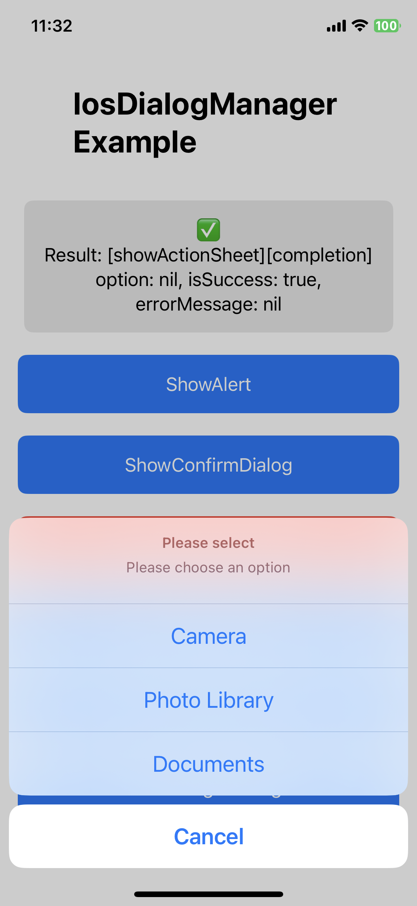
</p>

#### 입력 다이얼로그

- 메시지와 텍스트 필드 하나를 표시합니다.

```swift
import IosLibrary

IosDialogManager.shared.showTextInputDialog(
    // 제목을 설정합니다. 미설정 시 제목이 표시되지 않습니다.
    title: "Enter Name",
    // 메시지를 설정합니다. 미설정 시 메시지가 표시되지 않습니다.
    message: "Please enter your name",
    // 플레이스홀더를 설정합니다. 미설정 시 플레이스홀더가 표시되지 않습니다.
    placeholder: "Your name here",
    // 확인 버튼 텍스트를 설정합니다. 미설정 시 "OK"가 사용됩니다.
    confirmTitle: "OK",
    // 취소 버튼 텍스트를 설정합니다. 미설정 시 "Cancel"이 사용됩니다.
    cancelTitle: "Cancel",
    // 필드가 비어 있어도 확인 버튼이 동작할지 설정합니다. 미설정 시 true가 사용됩니다.
    enableConfirmWhenEmpty: false,
    // 확인 버튼을 누르면 호출됩니다.
    onConfirm: { confirmButtonText, inputText, isSuccess, errorMessage in
        // inputText: 사용자가 입력한 내용입니다. 로그에는 텍스트가 아니라 길이를 남겨 주세요.
    },
    // 취소 버튼을 누르면 호출됩니다. 입력된 내용은 전달되지 않습니다.
    onCancel: { cancelButtonText, isSuccess, errorMessage in
        // cancelButtonText: "Cancel"입니다.
    },
    // 다이얼로그를 표시했거나 표시하지 못했을 때 한 번 호출됩니다.
    completion: { isSuccess, errorMessage in
        // showAlert와 같습니다.
    }
)
```

<p align="center">
    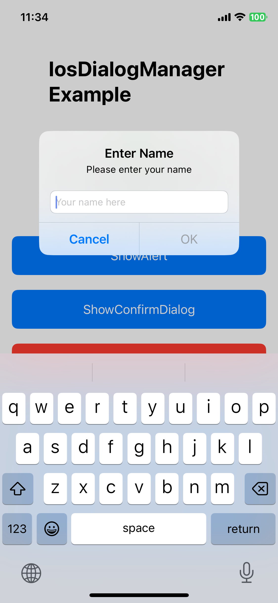
</p>

#### 로그인 다이얼로그

- 메시지와 사용자 이름 필드, 비밀번호 필드(보안 입력)를 표시합니다.

```swift
import IosLibrary

IosDialogManager.shared.showLoginDialog(
    // 제목을 설정합니다. 미설정 시 제목이 표시되지 않습니다.
    title: "Login Required",
    // 메시지를 설정합니다. 미설정 시 메시지가 표시되지 않습니다.
    message: "Please enter your credentials",
    // 사용자 이름 플레이스홀더를 설정합니다. 미설정 시 "Username"이 사용됩니다.
    usernamePlaceholder: "Username",
    // 비밀번호 플레이스홀더를 설정합니다. 미설정 시 "Password"가 사용됩니다.
    passwordPlaceholder: "Password",
    // 로그인 버튼 텍스트를 설정합니다. 미설정 시 "Login"이 사용됩니다.
    loginTitle: "Login",
    // 취소 버튼 텍스트를 설정합니다. 미설정 시 "Cancel"이 사용됩니다.
    cancelTitle: "Cancel",
    // 필드가 비어 있어도 로그인 버튼이 동작할지 설정합니다. 미설정 시 true가 사용됩니다.
    enableLoginWhenEmpty: false,
    // 로그인 버튼을 눌렀을 때만 호출됩니다. 실패는 completion으로 전달됩니다.
    onLogin: { loginButtonText, username, password, isSuccess, errorMessage in
        // username과 password: 사용자가 입력한 내용입니다. 비밀번호는 절대 로그에 남기지 마세요.
    },
    // 취소 버튼을 누르면 호출됩니다.
    onCancel: { cancelButtonText, isSuccess, errorMessage in
        // cancelButtonText: "Cancel"입니다.
    },
    // 다이얼로그를 표시했거나 표시하지 못했을 때 한 번 호출됩니다.
    completion: { isSuccess, errorMessage in
        // showAlert와 같습니다.
    }
)
```

<p align="center">
    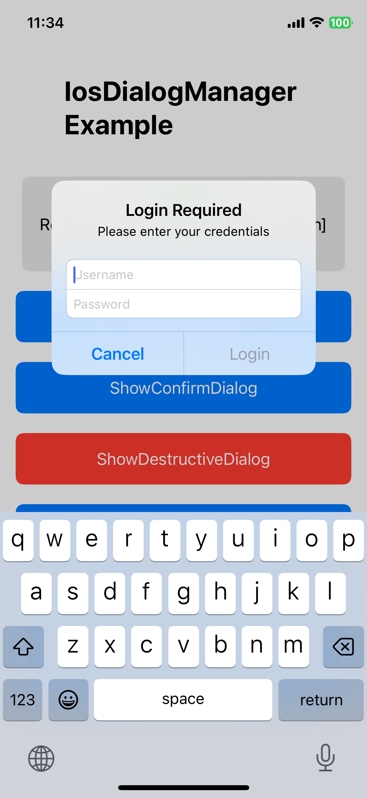
</p>

#### 하나의 요청에 하나의 결과

- `show(_:presenter:requestBox:completion:)`는 하나의 `DialogRequest`를 표시하고, `completion`을 메인 스레드에서 정확히 한 번 `Result<DialogAnswer, DialogError>`와 함께 호출합니다. 반환값은 그 요청의 `RequestBox`이며, `cancel(_:)`에 전달합니다.
- completion이 없는 `show(_:presenter:)`는 `async throws`입니다. `DialogAnswer`를 반환하고 `DialogError`를 던집니다. 태스크가 취소되면 요청도 취소되고, 호출은 `CancellationError`를 던집니다(그 전에 버튼이 눌린 경우는 제외).
- 요청의 기본값은 `show...` 메서드와 같습니다. 제목, 메시지, 플레이스홀더에 `nil`을 전달하면 표시되지 않습니다.

| 요청(`DialogRequest`) | 버튼(`DialogAnswer.Button`) | `DialogAnswer.input` |
|---|---|---|
| `.alert(title:message:buttonTitle:)` | `.primary` | `nil` |
| `.confirm(title:message:confirmTitle:cancelTitle:)` | `.primary`, `.cancel` | `nil` |
| `.destructive(title:message:destructiveTitle:cancelTitle:)` | `.destructive`, `.cancel` | `nil` |
| `.actionSheet(title:message:options:cancelTitle:)` | `.option(index:)`, `.cancel` | `nil` |
| `.textInput(title:message:placeholder:confirmTitle:cancelTitle:enableConfirmWhenEmpty:)` | `.primary`, `.cancel` | `.primary`에서는 `.text(text)`, `.cancel`에서는 `nil` |
| `.login(title:message:usernamePlaceholder:passwordPlaceholder:loginTitle:cancelTitle:enableLoginWhenEmpty:)` | `.primary`, `.cancel` | `.primary`에서는 `.login(username:password:)`, `.cancel`에서는 `nil` |

- `DialogAnswer.title`은 눌린 버튼의 텍스트로, 요청에서 지정한 그대로입니다(`.option(index:)`에서는 선택지의 텍스트입니다). `.option(index:)`는 `options` 안의 인덱스입니다.
- `DialogInput`의 `description`은 입력된 내용의 길이만 보여 줍니다(`text(length: 5)`). 따라서 응답을 출력해도 사용자가 입력한 내용은 로그에 남지 않습니다.
- `show`로 표시한 액션 시트는 iPad에서 표시하는 뷰 컨트롤러의 뷰 중심에 고정됩니다. 고정 위치를 선택하려면 `showActionSheet`를 사용해 주세요.
- `DialogAnswer.Button`, `DialogInput`, `DialogError`에는 이후 버전에서 케이스가 추가될 수 있습니다. 샘플처럼 switch에서는 `@unknown default` 분기를 작성해 주세요.

```swift
import IosLibrary

// 여섯 가지 요청입니다. 텍스트는 샘플의 것입니다.
let alert: DialogRequest = .alert(title: "Request Alert", message: "Shown by show(_:presenter:)")
let confirm: DialogRequest = .confirm(title: "Request Confirm", message: "Proceed?", confirmTitle: "Yes", cancelTitle: "No")
let destructive: DialogRequest = .destructive(title: "Request Delete", message: "This cannot be undone.")
let actionSheet: DialogRequest = .actionSheet(title: "Request Sheet", message: "Choose a color", options: ["Red", "Green", "Blue"])
let textInput: DialogRequest = .textInput(title: "Request Name", message: "Enter your name", placeholder: "Your name here",
                                          enableConfirmWhenEmpty: false)
let login: DialogRequest = .login(title: "Request Login", message: "Enter your credentials", enableLoginWhenEmpty: false)

Task {
    do {
        let answer = try await IosDialogManager.shared.show(confirm, presenter: .foreground)
        switch answer.button {
        case .primary:
            // 확인 버튼("Yes")입니다. .textInput과 .login에서는 answer.input에 입력된 내용이 들어 있습니다.
            break
        case .cancel:
            // 취소 버튼("No")입니다.
            break
        case .destructive:
            break
        case .option(let index):
            // options의 index 번째 선택지입니다.
            _ = index
        @unknown default:
            break
        }
        if case .text(let text)? = answer.input {
            // 사용자가 입력 다이얼로그에 입력한 내용입니다. 로그에는 텍스트가 아니라 길이를 남겨 주세요.
            _ = text.utf8.count
        }
        if case .login(let username, let password)? = answer.input {
            // 비밀번호는 절대 로그에 남기지 마세요.
            _ = (username, password)
        }
    } catch let error as DialogError {
        // .notForeground, .presentationFailed, .dismissedBySystem 중 하나입니다(아래 표 참고).
        print(error)
    } catch {
        // CancellationError: 태스크가 취소되었고, 다이얼로그는 닫혔습니다.
    }
}
```

<p align="center">
    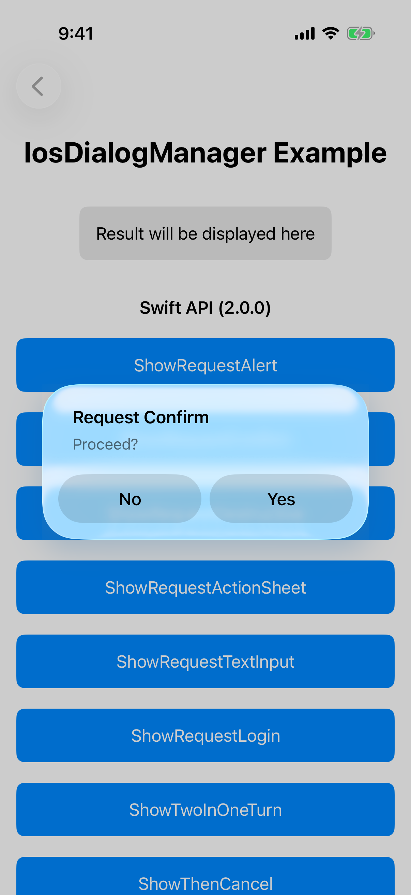
</p>

다음 경우에는 요청이 응답 없이 끝납니다.

| `DialogError` | 반환되는 경우 |
|---|---|
| `.canceled` | `cancel(_:)`이 요청을 끝낸 경우입니다. `async` 버전은 대신 `CancellationError`를 던집니다 |
| `.notForeground` | 표시할 뷰 컨트롤러를 찾지 못한 경우입니다. 앱의 포그라운드에 윈도 씬이 없거나, `.viewController(_:)` 클로저가 `nil`을 반환했습니다 |
| `.presentationFailed` | 한 번 기다린 뒤에도 표시할 뷰 컨트롤러가 전환 중이었거나, UIKit이 표시를 거부했거나, 같은 윈도에서 이 라이브러리의 공유 시트가 10초 안에 표시를 마치지 않은 경우입니다 |
| `.dismissedBySystem` | 버튼이 눌리지 않은 채 다이얼로그가 사라진 경우입니다. 다른 코드가 닫았거나, 씬의 연결이 끊겨 다이얼로그가 해제되었습니다 |
| `.invalidRequest` | 전달한 `RequestBox`가 이미 다른 요청에서 사용되고 있는 경우입니다. 첫 번째 요청에는 영향이 없습니다 |

- 다이얼로그가 표시된 동안 앱이 윈도, 그 루트 뷰 컨트롤러, 또는 씬을 교체하거나, 표시된 알림을 계속 붙잡고 있으면 결과가 보장되지 않습니다. 다이얼로그의 씬 연결이 끊겼는데 다이얼로그가 해제되지 않은 경우도 마찬가지입니다. 이때는 요청을 취소해서 결과를 받아 주세요.
- `DialogError`의 `errorDescription`은 로그용의 고정된 영어 문장입니다. 그대로 사용자에게 보여 주지 마세요.

#### 표시할 뷰 컨트롤러 선택

- `presenter`는 다이얼로그를 어느 뷰 컨트롤러에서 표시할지 정합니다. 타입은 `PresenterSelection`입니다.

| `presenter` | 뷰 컨트롤러 | 대기 |
|---|---|---|
| `.firstActiveScene`(기본값) | 첫 번째 `foregroundActive` 씬의 키 윈도에서 가장 위에 표시된 뷰 컨트롤러입니다. `show...` 메서드는 항상 이것을 사용합니다 | 기다리지 않습니다. 다른 다이얼로그가 표시되는 도중에 요청한 다이얼로그는 `.presentationFailed`로 끝날 가능성이 높습니다 |
| `.foreground` | `foregroundActive` 또는 `foregroundInactive` 씬의 키 윈도에서, 닫히는 중이 아닌 가장 위의 뷰 컨트롤러입니다(`foregroundInactive`는 시작 직후나, 앱 위로 제어 센터를 내린 동안입니다) | 그 뷰 컨트롤러가 전환 중이면 요청은 전환이 끝나기를 한 번 기다립니다. 연달아 한 두 요청은 모두 표시되며, 두 번째가 첫 번째 위에 표시됩니다 |
| `.viewController(_:)` | 클로저가 반환하는 뷰 컨트롤러입니다. 클로저는 다이얼로그를 표시하기 직전에 메인 스레드에서 한 번 호출됩니다 | `.foreground`와 같습니다 |

- 앱의 윈도 두 개를 나란히 표시하는 iPad에서는 두 씬이 모두 `foregroundActive`일 수 있으며, `.firstActiveScene`과 `.foreground`는 사용자가 보고 있지 않은 윈도를 선택할 수 있습니다. 이때는 `.viewController(_:)`로 뷰 컨트롤러를 전달해 주세요.
- `foregroundViewController()`는 `.foreground`가 선택할 뷰 컨트롤러를, `getRootViewController()`는 `.firstActiveScene`의 뷰 컨트롤러를 반환합니다. 둘 다 `@MainActor`입니다.

샘플은 메인 큐의 같은 차례에서 `.foreground`로 두 개의 알림을 표시합니다. 두 번째가 첫 번째 위에 표시됩니다.

```swift
import IosLibrary

for (title, button) in [("First", "First OK"), ("Second", "Second OK")] {
    IosDialogManager.shared.show(.alert(title: title, message: nil, buttonTitle: button),
                                 presenter: .foreground) { result in
        switch result {
        case .success(let answer):
            // answer.title은 "First OK" 또는 "Second OK"입니다.
            print(answer.button)
        case .failure(let error):
            print(error)
        }
    }
}
```

<p align="center">
    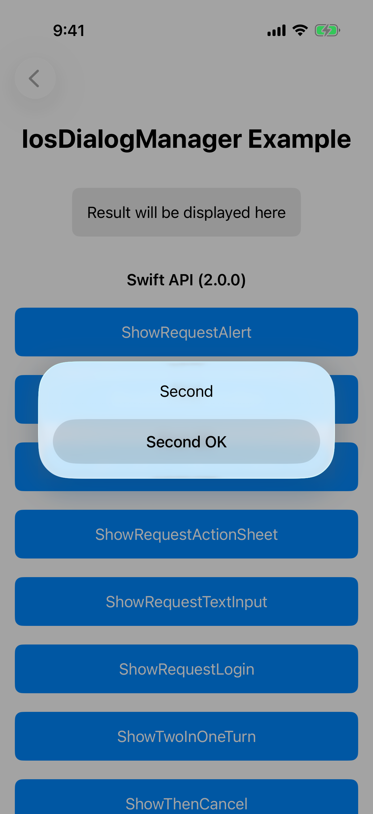
</p>

직접 만든 뷰 컨트롤러에서는 그 뷰 컨트롤러를 전달하고, 약한 참조로 캡처합니다.

```swift
import IosLibrary
import UIKit

final class SettingsViewController: UIViewController {
    func confirmReset() {
        IosDialogManager.shared.show(.confirm(title: "Confirm Action", message: "Are you sure you want to proceed?"),
                                     presenter: .viewController { [weak self] in self }) { result in
            if case .success(let answer) = result, answer.button == .primary {
                // 사용자가 "OK"를 눌렀습니다.
            }
        }
    }
}
```

#### 다이얼로그 취소

- `cancel(_:)`은 `show(_:presenter:requestBox:completion:)`가 반환한 박스를 받습니다. 요청은 즉시 `.failure(.canceled)`로 끝나며(completion은 그 뒤에 메인 스레드에서 호출됩니다), 다이얼로그는 닫힙니다. 이미 끝난 요청은 바뀌지 않습니다.
- `cancel(_:)`은 어느 스레드에서든 호출할 수 있으며, 기다리지 않습니다.
- 다이얼로그 위에 다른 뷰 컨트롤러가 표시되어 있으면 다이얼로그는 닫히지 않습니다(닫으면 그 위의 뷰 컨트롤러도 닫히기 때문입니다). 다이얼로그는 그 뷰 컨트롤러가 사라질 때까지 남으며, 그 뒤에는 버튼을 눌러도 아무 일도 일어나지 않습니다. 요청은 이미 `.canceled`로 끝났습니다.
- 요청을 시작하기 전에 박스를 가지고 있으려면 `RequestBox()`로 만들어 `requestBox`에 전달합니다. 요청이 시작되기 전에 취소된 박스를 전달하면, 요청은 아무것도 표시하지 않고 즉시 `.canceled`로 끝납니다. 박스는 하나의 요청에 속합니다. 두 번째 요청에 전달하면 그 요청은 `.invalidRequest`로 끝납니다.
- `async` 버전에서는 대신 `Task`를 취소합니다. `CancellationError`가 던져집니다.

```swift
import IosLibrary

let box = IosDialogManager.shared.show(.alert(title: "Cancel Me", message: "Cancelled after 3 seconds"),
                                       presenter: .foreground) { result in
    // 버튼을 누르기 전에 cancel(_:)이 호출된 경우 .failure(.canceled)입니다.
    print(result)
}

// 3초 후에 다이얼로그를 닫습니다.
DispatchQueue.main.asyncAfter(deadline: .now() + 3) {
    IosDialogManager.shared.cancel(box)
}
```

<p align="center">
    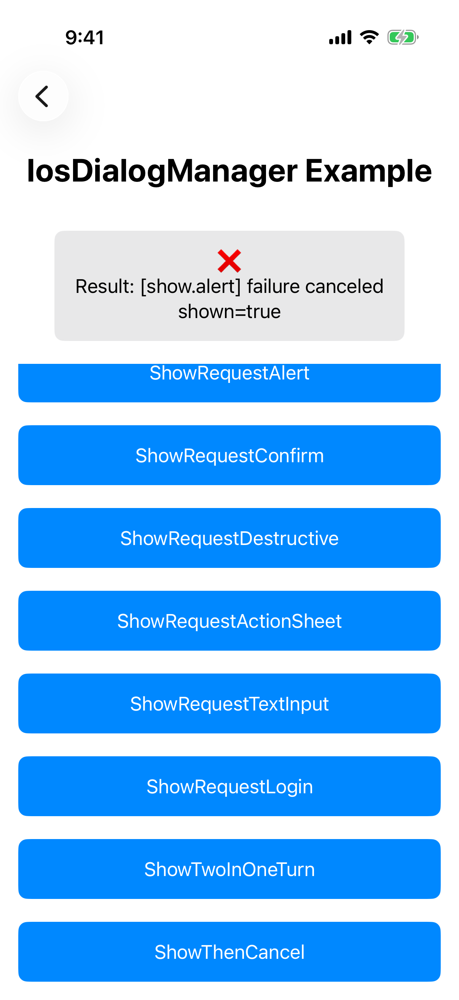
</p>

### C ABI

- 같은 다이얼로그를 C에서, 그리고 C 함수를 호출할 수 있는 언어(C#, Dart, Rust 등)에서 사용하기 위한 API입니다. Swift 앱은 대신 `IosDialogManager`를 호출해 주세요.
- `ios-native-toolkit-capi-2.0.0.xcframework`와 `ios-native-toolkit-2.0.0.xcframework`를 둘 다 **Embed & Sign**으로, 같은 버전으로 임베드합니다. C ABI가 Swift API를 호출하기 때문입니다. `<IosLibraryCApi/NativeToolkitC/Dialog.h>`를 include하거나, `dist/1.14.0/ios/include`를 헤더 검색 경로에 추가하고 `<NativeToolkitC/Dialog.h>`를 include합니다. 요구 사항과 추가 절차는 매뉴얼 상단의 [지원 플랫폼: iOS](index.ko.md#지원-플랫폼-ios실기기-arm64--simulator-arm64-x86_64)에, 모든 기능에 공통인 규칙은 같은 매뉴얼 상단의 [C ABI](index.ko.md#c-abi-1)에 있습니다.
- 헤더는 순수한 C99이며 `<stddef.h>`와 `<stdint.h>` 외에는 include하지 않습니다. 문자열은 NUL로 끝나는 UTF-8이며 엄격하게 검사됩니다. 잘못된 UTF-8은 거부됩니다. 제목, 메시지, `placeholder`가 `NULL`이면 표시되지 않습니다. 그 밖의 텍스트가 `NULL`이면 Swift의 기본값(`"OK"`, `"Cancel"`, `"Delete"`, `"Username"`, `"Password"`, `"Login"`)이 사용됩니다.
- 요청 구조체는 0으로 채우고 `struct_size`에 자신의 `sizeof`를 넣습니다. 0이 기본값이며, `reserved` 필드는 0으로 두어야 합니다. 기본값을 0으로 유지하기 위해 두 플래그는 Swift API와 이름의 방향이 반대입니다. `confirm_disabled_when_empty`는 `enableConfirmWhenEmpty`의 반대, `login_disabled_when_empty`는 `enableLoginWhenEmpty`의 반대입니다. 불리언은 `int32_t`입니다.
- C ABI는 비동기만 제공합니다. 모든 함수는 어느 스레드에서든 호출할 수 있으며, 메인 스레드를 기다리지 않습니다. 반환값은 요청이 접수되었는지만 나타냅니다. 호출 시점에 거부된 경우 콜백은 호출되지 않으며, `release`(`NULL`이 아닌 경우)는 호출이 반환되기 전에 호출한 스레드에서 호출됩니다.
- 접수된 요청은 메인 스레드(메인 큐)에서 정확히 한 번 완료되고, 그 뒤에 `release`가 정확히 한 번 호출됩니다. 둘 다 요청을 시작한 호출 안에서는 실행되지 않습니다. 메인 스레드가 아닌 곳에서 호출하면 그 호출이 반환되기 전, `out_request_id`가 보이기 전에 완료가 도착할 수 있으므로, 완료와 요청은 `user_data`로 연결해 주세요.
- 다이얼로그를 표시하려면 포그라운드에 있는 윈도 씬(키 윈도가 있는 `foregroundActive` 또는 `foregroundInactive`)이 필요합니다. 앱이 백그라운드에 있을 때 호출하면 요청은 `NTK_DIALOG_ERROR_NOT_FOREGROUND`로 완료됩니다. C ABI는 Swift API의 `.foreground`처럼 포그라운드의 뷰 컨트롤러에서 표시하므로, 다른 다이얼로그가 표시되는 도중에 한 요청은 그 표시를 기다린 뒤 그 위에 표시됩니다.
- 앱의 윈도 여러 개를 나란히 표시하는 iPad에서는 다이얼로그가 어느 윈도에 표시될지 정해져 있지 않습니다. C ABI에는 뷰 컨트롤러를 전달하는 방법이 없습니다. Swift API의 `.viewController(_:)`에는 있습니다. iPad에서 액션 시트는 표시하는 뷰의 중심에 고정된 팝오버이며, C ABI에서는 다른 위치를 선택할 수 없습니다.
- 콜백에 전달되는 `ntk_dialog_result`는 받은 쪽이 소유하며, 콜백 안에서 또는 나중에 어느 스레드에서든 `ntk_dialog_result_free`로 해제합니다. 오류가 `NTK_DIALOG_ERROR_NONE`이 아니면 `NULL`입니다. 결과를 읽는 함수는 결과 내부를 가리키는 포인터를 반환하며, 이 포인터는 결과를 해제할 때까지 유효합니다. `out_size`는 `NULL`이어도 됩니다. `ntk_dialog_result_free(NULL)`은 아무것도 하지 않습니다. iOS에서 `system_code`와 `ntk_last_system_code()`는 항상 0입니다.
- 요청 ID는 `uint64_t`이며 재사용되지 않습니다. `ntk_dialog_cancel`은 어느 스레드에서든 ID를 받으며, 기다리지 않고 `NTK_DIALOG_ERROR_NONE`을 반환합니다. 알 수 없는 ID나 이미 완료된 요청은 무시합니다. 다른 화면에 가려진 다이얼로그는 그 화면이 사라질 때까지 남지만(그 뒤에는 버튼을 눌러도 아무 일도 일어나지 않습니다), 요청은 `NTK_DIALOG_ERROR_CANCELED`로 완료됩니다.
- 다이얼로그가 표시된 동안 앱이 윈도나 루트 뷰 컨트롤러를 교체하거나, 시스템이 씬의 연결을 끊었는데 다이얼로그가 해제되지 않으면 콜백과 `release`가 오지 않을 수 있습니다. 이때는 `ntk_dialog_cancel`로 요청을 끝냅니다.
- 콜백에서 메인 스레드를 오래 블로킹하거나, 예외(C++, Objective-C, Rust의 panic, C#의 예외)를 밖으로 내보내지 마세요.
- Android와 같은 "닫힘" 응답은 없습니다. 액션 시트 바깥 탭(iPad와 iOS 26의 iPhone)은 취소 버튼, 즉 `NTK_DIALOG_BUTTON_NEGATIVE`입니다. 다른 코드가 닫은 다이얼로그는 `NTK_DIALOG_ERROR_CANCELED_BY_SYSTEM`으로 완료됩니다.

#### 알림, 확인, 파괴적 다이얼로그

`ntk_dialog_result_button`은 눌린 버튼을 알려 주고, `ntk_dialog_result_button_text`는 그 텍스트를 반환합니다. 버튼 값은 이후 버전에서 늘어날 수 있으므로 `default` 분기를 작성해 주세요.

```c
static void NTK_CALL on_dialog_result(void* user_data, uint64_t request_id, ntk_dialog_error error,
                                      uint32_t system_code, ntk_dialog_result* result)
{
    /* 메인 스레드에서, 접수된 요청마다 한 번 호출됩니다. iOS에서 system_code는 항상 0입니다. */
    (void)user_data; (void)request_id; (void)system_code;
    if (error != NTK_DIALOG_ERROR_NONE) {
        /* result는 NULL입니다. ntk_dialog_cancel 후에는 CANCELED, 다른 코드가 다이얼로그를
           닫은 경우에는 CANCELED_BY_SYSTEM, 포그라운드에 씬이 없던 경우에는 NOT_FOREGROUND,
           다이얼로그를 표시하지 못한 경우에는 SHOW_FAILED입니다. */
        return;
    }
    size_t size = 0;
    const char* label = ntk_dialog_result_button_text(result, &size);   /* "OK", "Yes", "Delete" 등 */
    switch (ntk_dialog_result_button(result)) {
    case NTK_DIALOG_BUTTON_POSITIVE:      /* 알림의 버튼, 또는 확인 버튼 */
        break;
    case NTK_DIALOG_BUTTON_NEGATIVE:      /* 취소 버튼 */
        break;
    case NTK_DIALOG_BUTTON_DESTRUCTIVE:   /* 파괴적 버튼 */
        break;
    default:
        break;
    }
    (void)label;
    /* 결과는 받은 쪽의 것입니다. 여기서 해제하거나, 나중에 어느 스레드에서든 해제합니다. */
    ntk_dialog_result_free(result);
}

static void NTK_CALL release_user_data(void* user_data)
{
    /* 정확히 한 번 호출됩니다. 완료 후 메인 스레드에서 호출되거나, 호출이 거부된 경우에는
       그 호출이 반환되기 전에 호출한 스레드에서 호출됩니다. */
    (void)user_data;
}

/* --- 기본 다이얼로그 ------------------------------------------------- */
ntk_dialog_alert_request alert;
memset(&alert, 0, sizeof(alert));
alert.struct_size = (uint32_t)sizeof(alert);
alert.title = "Hello from iOS";                   /* NULL이면 제목 없음 */
alert.message = "This is a native iOS dialog!";   /* NULL이면 메시지 없음 */
alert.button_text = "OK";                         /* NULL이면 "OK" */

uint64_t request_id = 0;
ntk_dialog_error error = ntk_dialog_show_alert_async(&alert, &on_dialog_result, NULL,
                                                     &release_user_data, &request_id);
if (error != NTK_DIALOG_ERROR_NONE) {
    /* 거부되었습니다. 콜백은 호출되지 않으며, release_user_data는 이미 실행되었습니다. */
    return;
}

/* 나중에, 어느 스레드에서든: 다이얼로그가 닫히고 NTK_DIALOG_ERROR_CANCELED로
   완료됩니다. 이미 완료된 ID나 알 수 없는 ID에는 아무 일도 일어나지 않습니다. */
ntk_dialog_cancel(request_id);

/* --- 확인 다이얼로그 ------------------------------------------------- */
ntk_dialog_confirm_request confirm;
memset(&confirm, 0, sizeof(confirm));
confirm.struct_size = (uint32_t)sizeof(confirm);
confirm.title = "Confirm Action";
confirm.message = "Are you sure you want to proceed?";
confirm.confirm_text = "Yes";                     /* NULL이면 "OK" */
confirm.cancel_text = "No";                       /* NULL이면 "Cancel" */

/* out_request_id는 NULL이어도 됩니다. 이때 요청은 취소할 수 없습니다. */
error = ntk_dialog_show_confirm_async(&confirm, &on_dialog_result, NULL, &release_user_data, NULL);

/* --- 파괴적 다이얼로그 ----------------------------------------------- */
ntk_dialog_destructive_request destructive;
memset(&destructive, 0, sizeof(destructive));
destructive.struct_size = (uint32_t)sizeof(destructive);
destructive.title = "Delete File";
destructive.message = "This action cannot be undone. Are you sure?";
destructive.destructive_text = "Delete";          /* NULL이면 "Delete" */
destructive.cancel_text = "Cancel";               /* NULL이면 "Cancel" */

/* 해제할 것이 없으면 user_data와 release는 NULL이어도 됩니다. */
error = ntk_dialog_show_destructive_async(&destructive, &on_dialog_result, NULL, NULL, NULL);
```

#### 액션 시트

`ntk_dialog_result_option_index`는 선택한 선택지의 0부터 시작하는 인덱스이며, 다른 버튼에서는 -1입니다. `option_count`는 0이어도 되며, 이때는 취소 버튼만 남습니다. 개수가 0이 아니면 `options`는 `NULL`일 수 없고, 어떤 선택지도 `NULL`일 수 없습니다.

```c
static void NTK_CALL on_action_sheet(void* user_data, uint64_t request_id, ntk_dialog_error error,
                                     uint32_t system_code, ntk_dialog_result* result)
{
    (void)user_data; (void)request_id; (void)system_code;
    if (error != NTK_DIALOG_ERROR_NONE) {
        return;
    }
    if (ntk_dialog_result_button(result) == NTK_DIALOG_BUTTON_OPTION) {
        int64_t index = ntk_dialog_result_option_index(result);          /* "Camera"는 0 */
        const char* option = ntk_dialog_result_button_text(result, NULL);
        (void)index; (void)option;
    } else {
        /* NTK_DIALOG_BUTTON_NEGATIVE: 취소 버튼, 또는 액션 시트 바깥 탭입니다. */
    }
    ntk_dialog_result_free(result);
}

const char* const options[] = { "Camera", "Photo Library", "Documents" };

ntk_dialog_action_sheet_request sheet;
memset(&sheet, 0, sizeof(sheet));
sheet.struct_size = (uint32_t)sizeof(sheet);
sheet.title = "Please select";
sheet.message = "Please choose an option";
sheet.options = options;
sheet.option_count = 3;
sheet.cancel_text = "Cancel";                     /* NULL이면 "Cancel" */

ntk_dialog_error error = ntk_dialog_show_action_sheet_async(&sheet, &on_action_sheet, NULL, NULL, NULL);
```

#### 입력 다이얼로그와 로그인 다이얼로그

텍스트, 사용자 이름, 비밀번호는 `NTK_DIALOG_BUTTON_POSITIVE`일 때만 읽을 수 있습니다. 취소 버튼에서는 읽는 함수가 `NULL`을 반환합니다. 이 값들은 결과 내부를 가리키며, 결과를 해제할 때까지 유효합니다.

```c
static void NTK_CALL on_text_input(void* user_data, uint64_t request_id, ntk_dialog_error error,
                                   uint32_t system_code, ntk_dialog_result* result)
{
    (void)user_data; (void)request_id; (void)system_code;
    if (error != NTK_DIALOG_ERROR_NONE) {
        return;
    }
    if (ntk_dialog_result_button(result) == NTK_DIALOG_BUTTON_POSITIVE) {
        size_t size = 0;
        const char* text = ntk_dialog_result_text(result, &size);   /* UTF-8. 로그에는 텍스트가 아니라 size를 남겨 주세요 */
        (void)text;
    }
    ntk_dialog_result_free(result);
}

static void NTK_CALL on_login(void* user_data, uint64_t request_id, ntk_dialog_error error,
                              uint32_t system_code, ntk_dialog_result* result)
{
    (void)user_data; (void)request_id; (void)system_code;
    if (error != NTK_DIALOG_ERROR_NONE) {
        return;
    }
    if (ntk_dialog_result_button(result) == NTK_DIALOG_BUTTON_POSITIVE) {
        const char* username = ntk_dialog_result_username(result, NULL);
        const char* password = ntk_dialog_result_password(result, NULL);   /* 절대 로그에 남기지 마세요 */
        (void)username; (void)password;
    }
    ntk_dialog_result_free(result);
}

/* --- 텍스트 입력 ---------------------------------------------------- */
ntk_dialog_text_input_request input;
memset(&input, 0, sizeof(input));
input.struct_size = (uint32_t)sizeof(input);
input.title = "Enter Name";
input.message = "Please enter your name";
input.placeholder = "Your name here";             /* NULL이면 플레이스홀더 없음 */
input.confirm_text = "OK";                        /* NULL이면 "OK" */
input.cancel_text = "Cancel";                     /* NULL이면 "Cancel" */
input.confirm_disabled_when_empty = 1;            /* 0이면 비어 있어도 확인 버튼이 동작 */

ntk_dialog_error error = ntk_dialog_show_text_input_async(&input, &on_text_input, NULL, NULL, NULL);

/* --- 로그인 --------------------------------------------------------- */
ntk_dialog_login_request login;
memset(&login, 0, sizeof(login));
login.struct_size = (uint32_t)sizeof(login);
login.title = "Login Required";
login.message = "Please enter your credentials";
login.username_placeholder = "Username";          /* NULL이면 "Username" */
login.password_placeholder = "Password";          /* NULL이면 "Password" */
login.login_text = "Login";                       /* NULL이면 "Login" */
login.cancel_text = "Cancel";                     /* NULL이면 "Cancel" */
login.login_disabled_when_empty = 1;              /* 0이면 비어 있어도 로그인 버튼이 동작 */

error = ntk_dialog_show_login_async(&login, &on_login, NULL, NULL, NULL);
```

| 오류 | 반환 / 완료 | 의미 |
|---|---|---|
| `NTK_DIALOG_ERROR_NONE` | 둘 다 | 접수됨, 또는 응답이 있음 |
| `NTK_DIALOG_ERROR_INVALID_PARAMETER` | 반환 | `NULL` 콜백이나 요청, 잘못된 UTF-8, 2.0.0 크기 미만이거나 4096을 넘는 `struct_size`, 0이 아닌 예약 필드, 개수가 0이 아닌데 `NULL`인 `options`, 또는 `NULL`인 선택지입니다 |
| `NTK_DIALOG_ERROR_NOT_SUPPORTED` | 반환 | 이 라이브러리가 모르는 0이 아닌 필드를 가진, 더 새로운 `struct_size`입니다 |
| `NTK_DIALOG_ERROR_UNKNOWN` | 완료 | 2.0.0에서는 발생하지 않을 것으로 예상됩니다. 자세한 내용은 로그에 있습니다 |
| `NTK_DIALOG_ERROR_CANCELED` | 완료 | `ntk_dialog_cancel`(`DialogError.canceled`) |
| `NTK_DIALOG_ERROR_CANCELED_BY_SYSTEM` | 완료 | 버튼이 눌리지 않은 채 다이얼로그가 사라졌습니다. 다른 코드가 닫았거나, 씬의 연결이 끊겨 다이얼로그가 해제되었습니다(`DialogError.dismissedBySystem`) |
| `NTK_DIALOG_ERROR_NOT_FOREGROUND` | 완료 | 포그라운드에 윈도 씬이 없었습니다(`DialogError.notForeground`) |
| `NTK_DIALOG_ERROR_SHOW_FAILED` | 완료 | 한 번 기다린 뒤에도 뷰 컨트롤러가 전환 중이었거나, UIKit이 표시를 거부했거나, 같은 윈도의 공유 시트가 10초 안에 표시를 마치지 않았습니다(`DialogError.presentationFailed`) |

`NTK_DIALOG_ERROR_NOT_INITIALIZED`와 `NTK_DIALOG_ERROR_OUT_OF_MEMORY`는 모든 플랫폼용으로 선언되어 있지만, iOS에서는 반환되지 않습니다.

| Swift API | C ABI |
|---|---|
| `show(.alert(...))` | `ntk_dialog_show_alert_async` |
| `show(.confirm(...))` | `ntk_dialog_show_confirm_async` |
| `show(.destructive(...))` | `ntk_dialog_show_destructive_async` |
| `show(.actionSheet(...))` | `ntk_dialog_show_action_sheet_async` |
| `show(.textInput(...))` | `ntk_dialog_show_text_input_async` |
| `show(.login(...))` | `ntk_dialog_show_login_async` |
| `cancel(_:)` | `ntk_dialog_cancel` |
| `DialogAnswer.button` | `ntk_dialog_result_button`, `ntk_dialog_result_option_index` |
| `DialogAnswer.title` | `ntk_dialog_result_button_text` |
| `DialogAnswer.input` | `ntk_dialog_result_text`, `ntk_dialog_result_username`, `ntk_dialog_result_password` |
| - | `ntk_dialog_result_free` |

---

## Windows

Windows 라이브러리는 같은 다이얼로그를 두 가지 공개 API로 제공합니다. 구현은 하나이며, 샘플 앱은 C++ API를 사용합니다.

| API | 이름 | 헤더 | NuGet 패키지 |
|---|---|---|---|
| C++ API | `NativeToolkit::Dialog` | `<NativeToolkit/Dialog.h>` | `NativeToolkit` |
| C ABI | `ntk_dialog_*` | `<NativeToolkitC/Dialog.h>` | `NativeToolkit.CApi` |

### NativeToolkit::Dialog

- 모든 다이얼로그는 모달이며 호출한 스레드를 블로킹합니다. UI 스레드에서 호출해 주세요.
- 반환값은 `Dialog::Result<T>`입니다. `has_value()`로 성공과 실패를 구분하고, 성공이면 `value()`, 실패면 `error()`(`Dialog::Error`)를 참조합니다. `Dialog::Error`는 정의된 구분인 `code`와 OS가 보고한 원래 값인 `systemCode`를 가집니다.
- 사용자가 다이얼로그를 닫은 경우는 호출의 실패도 값도 아니므로 `Dialog::ErrorCode::Canceled`로 돌아옵니다.
- 공개 헤더는 `<windows.h>`를 include하지 않습니다. `request.owner`는 `NativeToolkit::WindowHandle`(`HWND`와 같은 타입)을 받습니다.

#### ShowAlert - 기본 다이얼로그

- 메시지 박스를 표시하고 눌린 버튼을 반환합니다.

```cpp
#include <NativeToolkit/Dialog.h>

namespace Dialog = NativeToolkit::Dialog;

Dialog::AlertRequest request;
// 제목을 설정합니다.
request.title = L"Native Windows Dialog";
// 메시지를 설정합니다.
request.message = L"This is a native Windows dialog!";
// 표시할 버튼을 설정합니다. 여기서는 OK와 Cancel입니다.
request.buttons = Dialog::AlertButtons::OkCancel;
// 아이콘을 설정합니다. 여기서는 정보 아이콘입니다.
request.icon = Dialog::AlertIcon::Information;
// 처음에 포커스를 받을 버튼을 설정합니다. 여기서는 두 번째입니다.
request.defaultButton = Dialog::AlertDefaultButton::Second;
// 선택: 소유자 윈도우, MB_TOPMOST, MB_HELP도 지정할 수 있습니다.
// request.owner = hwnd;
// request.topMost = true;
// request.showHelpButton = true;

const auto result = Dialog::ShowAlert(request);
if (result.has_value())
{
    // Cancel도 하나의 버튼이므로 실패가 아니라
    // AlertResult::Cancel로 돌아옵니다.
    const Dialog::AlertResult pressed = result.value();
    if (pressed == Dialog::AlertResult::Ok)
    {
        // OK를 눌렀을 때의 처리입니다.
    }
}
else
{
    // code가 정의된 구분, systemCode가 OS의 원래 값입니다.
    const Dialog::ErrorCode code = result.error().code;
    const uint32_t systemCode = result.error().systemCode;
}
```

<p align="center">
    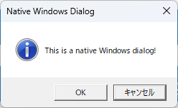
</p>

#### ShowOpenFile - 파일 선택 다이얼로그

- 기존 파일을 하나 선택하게 하고 전체 경로를 반환합니다.

```cpp
#include <NativeToolkit/Dialog.h>

namespace Dialog = NativeToolkit::Dialog;

Dialog::FileRequest request;
// 제목을 설정합니다.
request.title = L"Open File";
// 종류 목록을 설정합니다. 한 항목은 설명과 패턴의 쌍입니다.
// 필터를 하나도 설정하지 않으면 모든 파일이 대상이 됩니다.
request.filters = { Dialog::FileFilter{ L"All Files", { L"*.*" } } };
// 선택하는 파일이 실제로 존재하도록 요구합니다(OFN_FILEMUSTEXIST). 기본값입니다.
request.fileMustExist = true;

const auto result = Dialog::ShowOpenFile(request);
if (result.has_value())
{
    // 전체 경로입니다.
    const std::wstring& filePath = result.value();
}
else if (result.error().code == Dialog::ErrorCode::Canceled)
{
    // 사용자가 다이얼로그를 닫았습니다.
}
else
{
    const uint32_t systemCode = result.error().systemCode;
}
```

<p align="center">
    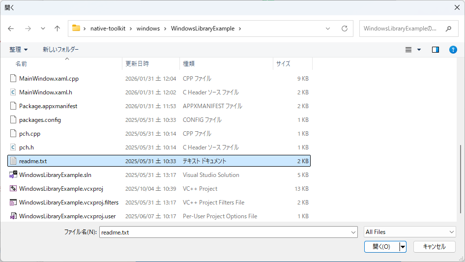
</p>

#### ShowOpenFiles - 다중 파일 선택 다이얼로그

- 기존 파일을 하나 이상, 다이얼로그가 반환한 순서대로 가져옵니다.

```cpp
#include <NativeToolkit/Dialog.h>

namespace Dialog = NativeToolkit::Dialog;

Dialog::FileRequest request;
// 제목을 설정합니다.
request.title = L"Open Files";
// 종류 목록을 설정합니다.
request.filters = { Dialog::FileFilter{ L"All Files", { L"*.*" } } };

const auto result = Dialog::ShowOpenFiles(request);
if (result.has_value())
{
    // 각 항목은 전체 경로이며, 폴더 자체는 항목에 포함되지 않습니다.
    const std::vector<std::wstring>& paths = result.value();
    for (const std::wstring& path : paths)
    {
        // 선택된 파일 하나입니다.
    }
}
else if (result.error().code == Dialog::ErrorCode::Canceled)
{
    // 사용자가 다이얼로그를 닫았습니다.
}
```

<p align="center">
    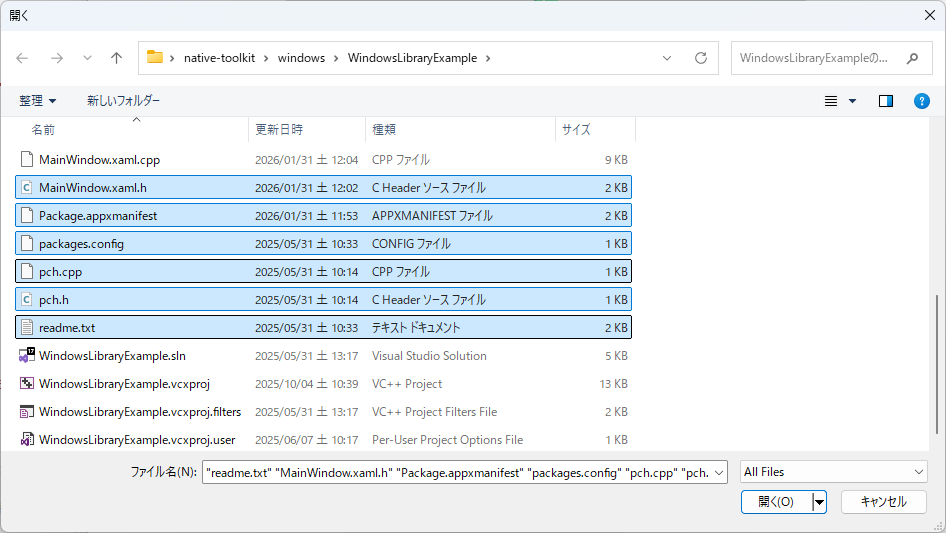
</p>

#### ShowPickFolder - 폴더 선택 다이얼로그

- 폴더를 하나 선택하게 합니다.

```cpp
#include <NativeToolkit/Dialog.h>

namespace Dialog = NativeToolkit::Dialog;

Dialog::FolderRequest request;
// 제목을 설정합니다. 비워 두면 OS의 기본 제목이 사용됩니다.
request.title = L"Select Folder";

const auto result = Dialog::ShowPickFolder(request);
if (result.has_value())
{
    const std::wstring& folderPath = result.value();
}
else if (result.error().code == Dialog::ErrorCode::Canceled)
{
    // 사용자가 다이얼로그를 닫았습니다.
}
```

<p align="center">
    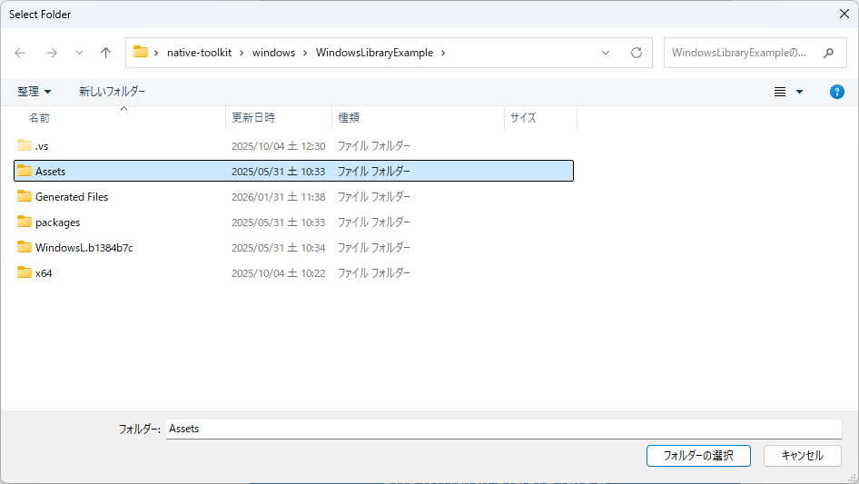
</p>

#### ShowPickFolders - 다중 폴더 선택 다이얼로그

- 폴더를 하나 이상 선택하게 합니다.

```cpp
#include <NativeToolkit/Dialog.h>

namespace Dialog = NativeToolkit::Dialog;

Dialog::FolderRequest request;
// 제목을 설정합니다.
request.title = L"Select Folders";

const auto result = Dialog::ShowPickFolders(request);
if (result.has_value())
{
    // 각 항목은 전체 경로입니다.
    const std::vector<std::wstring>& paths = result.value();
}
else if (result.error().code == Dialog::ErrorCode::Canceled)
{
    // 사용자가 다이얼로그를 닫았습니다.
}
```

<p align="center">
    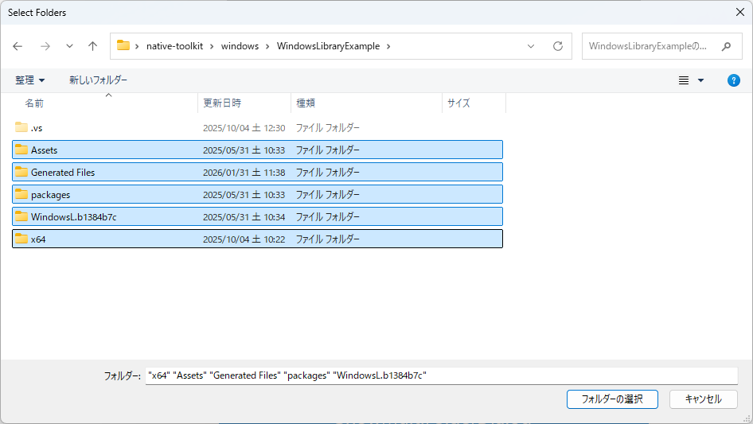
</p>

#### ShowSaveFile - 저장 다이얼로그

- 저장할 위치를 선택하게 합니다. 파일 자체는 만들어지지 않습니다.

```cpp
#include <NativeToolkit/Dialog.h>

namespace Dialog = NativeToolkit::Dialog;

Dialog::SaveFileRequest request;
// 제목을 설정합니다.
request.title = L"Save File";
// 종류 목록을 설정합니다.
request.filters = { Dialog::FileFilter{ L"All Files", { L"*.*" } } };
// 확장자를 입력하지 않았을 때 붙일 확장자를 설정합니다.
request.defaultExtension = L"txt";
// 기존 파일을 선택했을 때 확인합니다(OFN_OVERWRITEPROMPT). 기본값입니다.
request.overwritePrompt = true;

const auto result = Dialog::ShowSaveFile(request);
if (result.has_value())
{
    const std::wstring& savePath = result.value();
}
else if (result.error().code == Dialog::ErrorCode::Canceled)
{
    // 사용자가 다이얼로그를 닫았습니다.
}
```

<p align="center">
    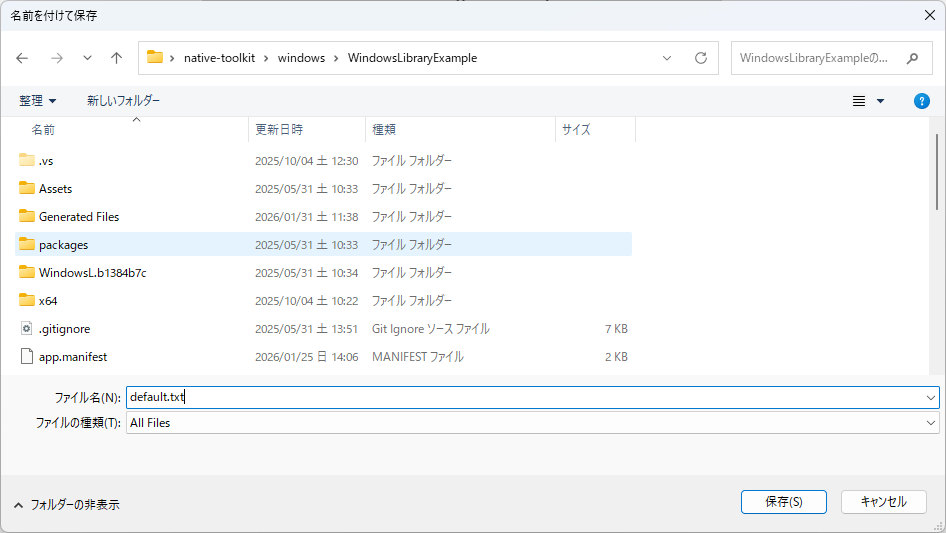
</p>

### C ABI

- C에서, 그리고 C DLL을 호출할 수 있는 언어에서 사용하기 위한 API입니다. 헤더는 C99이며 `<stddef.h>`와 `<stdint.h>` 외에는 include하지 않습니다.
- 문자열은 입출력 모두 NUL로 끝나는 UTF-8입니다. `NULL`은 빈 문자열을 의미합니다.
- 요청 구조체는 0으로 채우고 `struct_size`에 자신의 `sizeof`를 넣습니다. 0이 기본값입니다. 기본값을 0으로 유지하기 위해 두 플래그는 C++ API와 이름의 방향이 반대입니다. `allow_missing_file`은 `fileMustExist`의 반대, `skip_overwrite_prompt`는 `overwritePrompt`의 반대입니다.
- 오류는 반환값으로 보고됩니다. OS가 돌려준 원래 값은 같은 스레드에서 실패 직후에 `ntk_last_system_code()`로 읽습니다.
- 라이브러리가 돌려주는 것은 핸들이며, 대응하는 `_free`로 해제합니다. 핸들에서 꺼낸 포인터는 그 핸들을 해제할 때까지 유효합니다.

#### 메시지 박스

```c
#include <string.h>
#include <NativeToolkitC/Common.h>
#include <NativeToolkitC/Dialog.h>

/* 헤더와 DLL은 같은 버전이어야 합니다. */
if (ntk_version() != NTK_VERSION) {
    return;
}

/* 0으로 채운 상태가 기본값입니다. struct_size는 이 구조체가 어느 버전인지
   DLL에 알려 줍니다. */
ntk_dialog_alert_request request;
memset(&request, 0, sizeof(request));
request.struct_size = (uint32_t)sizeof(request);
request.title = "Native Windows Dialog";
request.message = "This is a native Windows dialog!";
request.buttons = NTK_DIALOG_ALERT_BUTTONS_OK_CANCEL;
request.icon = NTK_DIALOG_ALERT_ICON_INFORMATION;
request.default_button = NTK_DIALOG_ALERT_DEFAULT_BUTTON_SECOND;
/* 선택: request.top_most = 1; request.show_help_button = 1;
   request.owner = hwnd; */

ntk_dialog_alert_result pressed = 0;
ntk_dialog_error error = ntk_dialog_show_alert(&request, &pressed);
if (error == NTK_DIALOG_ERROR_NONE) {
    /* Cancel도 버튼이므로 여기서는 NTK_DIALOG_ALERT_RESULT_CANCEL입니다. */
} else if (error == NTK_DIALOG_ERROR_SYSTEM_ERROR) {
    uint32_t system_code = ntk_last_system_code();
    (void)system_code;
}
```

#### 파일 선택

`ntk_dialog_show_open_file`과 `ntk_dialog_show_save_file`은 경로 하나를 `ntk_string`으로 반환합니다. `ntk_dialog_show_open_files`는 `ntk_string_list`를 반환하며, 각 항목은 인덱스로 읽고 리스트를 해제할 때까지 유효합니다.

```c
#include <string.h>
#include <NativeToolkitC/Common.h>
#include <NativeToolkitC/Dialog.h>

/* 종류 목록입니다. 패턴은 ';'로 구분합니다. 모든 파일을 대상으로 하려면
   NULL과 0개를 전달합니다. */
ntk_dialog_filter filters[1];
filters[0].name = "All Files";
filters[0].patterns = "*.*";

/* --- 기존 파일 하나 -------------------------------------------------- */
ntk_dialog_file_request open_request;
memset(&open_request, 0, sizeof(open_request));
open_request.struct_size = (uint32_t)sizeof(open_request);
open_request.title = "Open File";
/* 0은 "선택하는 파일이 실제로 존재할 것"을 요구합니다(OFN_FILEMUSTEXIST). */
open_request.allow_missing_file = 0;

ntk_string* path = NULL;
ntk_dialog_error error = ntk_dialog_show_open_file(&open_request, filters, 1, &path);
if (error == NTK_DIALOG_ERROR_NONE) {
    /* 빌린 포인터입니다. ntk_string_free 전까지 유효합니다. */
    const char* utf8 = ntk_string_data(path);
    size_t size = ntk_string_size(path);
    (void)utf8; (void)size;
    ntk_string_free(path);
} else if (error == NTK_DIALOG_ERROR_CANCELED) {
    /* 사용자가 다이얼로그를 닫았습니다. path는 NULL 그대로입니다. */
}

/* --- 기존 파일 하나 이상 --------------------------------------------- */
ntk_string_list* paths = NULL;
error = ntk_dialog_show_open_files(&open_request, filters, 1, &paths);
if (error == NTK_DIALOG_ERROR_NONE) {
    size_t count = ntk_string_list_count(paths);
    size_t i;
    for (i = 0; i < count; ++i) {
        size_t size = 0;
        const char* entry = ntk_string_list_at(paths, i, &size);  /* 전체 경로 */
        (void)entry; (void)size;
    }
    ntk_string_list_free(paths);
}

/* --- 저장 위치 -------------------------------------------------------- */
ntk_dialog_save_file_request save_request;
memset(&save_request, 0, sizeof(save_request));
save_request.struct_size = (uint32_t)sizeof(save_request);
save_request.title = "Save File";
save_request.default_extension = "txt";
/* 0은 "기존 파일을 선택했을 때 확인한다"는 뜻입니다. */
save_request.skip_overwrite_prompt = 0;

ntk_string* save_path = NULL;
error = ntk_dialog_show_save_file(&save_request, filters, 1, &save_path);
if (error == NTK_DIALOG_ERROR_NONE) {
    ntk_string_free(save_path);
}
```

#### 폴더 선택

```c
#include <string.h>
#include <NativeToolkitC/Common.h>
#include <NativeToolkitC/Dialog.h>

ntk_dialog_folder_request request;
memset(&request, 0, sizeof(request));
request.struct_size = (uint32_t)sizeof(request);
/* NULL이나 ""로 두면 OS의 기본 제목이 사용됩니다. */
request.title = "Select Folder";

/* --- 폴더 하나 -------------------------------------------------------- */
ntk_string* folder = NULL;
ntk_dialog_error error = ntk_dialog_show_pick_folder(&request, &folder);
if (error == NTK_DIALOG_ERROR_NONE) {
    const char* utf8 = ntk_string_data(folder);
    (void)utf8;
    ntk_string_free(folder);
}

/* --- 폴더 하나 이상 --------------------------------------------------- */
request.title = "Select Folders";

ntk_string_list* folders = NULL;
error = ntk_dialog_show_pick_folders(&request, &folders);
if (error == NTK_DIALOG_ERROR_NONE) {
    size_t count = ntk_string_list_count(folders);
    size_t i;
    for (i = 0; i < count; ++i) {
        size_t size = 0;
        const char* entry = ntk_string_list_at(folders, i, &size);
        (void)entry; (void)size;
    }
    ntk_string_list_free(folders);
}
```

| C++ API | C ABI |
|---|---|
| `Dialog::ShowAlert` | `ntk_dialog_show_alert` |
| `Dialog::ShowOpenFile` | `ntk_dialog_show_open_file` |
| `Dialog::ShowOpenFiles` | `ntk_dialog_show_open_files` |
| `Dialog::ShowSaveFile` | `ntk_dialog_show_save_file` |
| `Dialog::ShowPickFolder` | `ntk_dialog_show_pick_folder` |
| `Dialog::ShowPickFolders` | `ntk_dialog_show_pick_folders` |
## macOS

### MacDialogManager

#### ShowDialog - 기본 다이얼로그

- 다이얼로그를 표시합니다.

```swift
// 제목을 설정합니다. 필수 항목입니다.
let title = "Hello from macOS"
// 메시지를 설정합니다. 생략하면 표시되지 않습니다.
let message = "This is a native macOS dialog!"
// 버튼을 설정합니다. 최소 1개의 버튼이 필요합니다.
let buttons = [
    // title: 버튼 제목을 설정합니다. 필수 항목입니다.
    // isDefault: 기본 버튼으로 설정하려면 true로 지정합니다. 기본값은 false이며, 다이얼로그당 기본 버튼은 1개만 허용됩니다.
    // keyEquivalent: 버튼 단축키를 설정합니다. 기본값은 null이며, isDefault가 true이면 Enter 키가 자동 할당됩니다.
    DialogButton(title: "OK", isDefault: true),
    DialogButton(title: "Cancel", keyEquivalent: "\u{1b}"),
    DialogButton(title: "Delete", keyEquivalent: "d")
]
// 옵션을 설정합니다. 필수 항목입니다.
let options = DialogOptions(
    // alertStyle: 다이얼로그 스타일을 설정합니다. 필수 항목입니다.
    alertStyle: .informational,
    // buttons: 다이얼로그에 표시할 버튼 배열을 설정합니다. 필수 항목입니다.
    buttons: buttons,
    // showsHelp: 도움말 버튼 표시 여부를 설정합니다. 기본값은 false입니다.
    showsHelp: true,
    // showsSuppressionButton: suppression 체크박스 표시 여부를 설정합니다. 기본값은 false입니다.
    showsSuppressionButton: true,
    // suppressionButtonTitle: suppression 체크박스 제목을 설정합니다. 생략 시 OS 기본값이 사용되며, showsSuppressionButton이 false이면 무시됩니다.
    suppressionButtonTitle: "Don't show this again",
    // icon: icon shown in the dialog.
    icon: IconConfiguration(
        // 아래는 아이콘 타입별 설정 예시입니다. 필요에 따라 설정하세요.
        ...
    ),
    // accessoryView: accessory view shown in the dialog. Defaults to nil.
    accessoryView: nil
)

// 아이콘 타입이 시스템 심볼일 때의 예시입니다.
let options = DialogOptions(
    ...
    icon: IconConfiguration(
        // type: 아이콘 타입이 시스템 심볼입니다. 필수 항목입니다.
        type: .systemSymbol,
        // value: 시스템 심볼 이름을 설정합니다. 필수 항목입니다.
        value: "info.square.fill",
        // renderingMode: 아이콘 렌더링 모드를 설정합니다. 필수 항목입니다.
        renderingMode: .palette,
        // colors: 아이콘 색상 배열을 설정합니다. Palette 모드에서는 1~3개 색상이 필요하며, Hierarchical 모드에서는 1개 색상을 지정할 수 있습니다. 색상은 #RRGGBB 또는 color name 형식을 사용합니다.
        colors: ["white", "systemblue", "systemblue"],
        // size: 아이콘 크기를 포인트 단위로 설정합니다. 생략 시 OS 기본값이 사용되며, 다이얼로그 제약으로 무시될 수 있습니다.
        size: 64,
        // weight: 아이콘 두께를 설정합니다. 생략 시 OS 기본값이 사용됩니다.
        weight: .regular,
        // scale: 아이콘 스케일을 설정합니다. 생략 시 OS 기본값이 사용되며, 다이얼로그 제약으로 무시될 수 있습니다.
        scale: .medium
    )
)

// 아이콘 타입이 파일 경로일 때의 예시입니다.
let options = DialogOptions(
    ...
    icon: IconConfiguration(
        // type: 아이콘 타입이 파일 경로입니다. 필수 항목입니다.
        type: .filePath,
        // value: 파일 경로를 설정합니다. 필수 항목입니다.
        value: "/Users/user/Downloads/test.png"
    )
);

// 아이콘 타입이 이름 이미지일 때의 예시입니다.
let options = DialogOptions(
    ...
    icon: IconConfiguration(
        // type: 아이콘 타입이 이름 이미지입니다. 필수 항목입니다.
        type: .namedImage,
        // value: 이름 이미지 식별자를 설정합니다. 필수 항목입니다.
        value: "test-image"
    )
);

// 아이콘 타입이 앱 아이콘일 때의 예시입니다.
let options = DialogOptions(
    ...
    icon: IconConfiguration(
        // type: 아이콘 타입이 앱 아이콘입니다. 필수 항목입니다.
        type: .appIcon
    )
);

// 아이콘 타입이 시스템 이미지일 때의 예시입니다.
let options = DialogOptions(
    ...
    icon: IconConfiguration(
        // type: 아이콘 타입이 시스템 이미지입니다. 필수 항목입니다.
        type: .systemImage,
        // value: 시스템 이미지 이름을 설정합니다. 필수 항목입니다.
        value: "cautionName"
    )
)

MacDialogManager.shared.showDialog(
    title: title,
    message: message,
    options: options
    // 다이얼로그 결과 수신 이벤트를 설정합니다.
) { result in
    // result: 다이얼로그 결과를 가져옵니다.
    switch result {
    // buttonIndex: 눌린 버튼 인덱스를 가져옵니다.
    // buttonTitle: 눌린 버튼 제목을 가져옵니다.
    // suppressionButtonState: suppression 체크박스 상태를 가져옵니다.
    // helpButtonPressed: 도움말 버튼 클릭 여부를 가져옵니다.
    // isSuccess: 다이얼로그 표시 성공 플래그를 가져옵니다. 성공 시 true를 반환합니다.
    case .success(let dialogResult):
        Log.d(TAG, "[ShowDialog] success: \(dialogResult)")
    // error: 오류 내용을 가져옵니다.
    case .failure(let error):
        Log.e(TAG, "[ShowDialog] error: \(error)")
    }
}
```

<p align="center">
    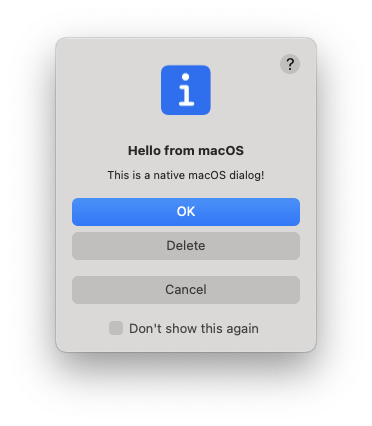
</p>

#### ShowFileDialog - 파일 선택 다이얼로그

- 다이얼로그를 표시합니다.

```swift
MacDialogManager.shared.showFileDialog(
    // 제목을 설정합니다. 필수 항목입니다.
    title: "Select a file",
    // 메시지를 설정합니다. 생략하면 표시되지 않습니다.
    message: "Please select a file to open.",
    // 허용할 파일 확장자를 설정합니다. 생략 시 OS 기본값이 사용됩니다.
    allowedContentTypes: ["txt", "png"],
    // 초기 디렉터리를 설정합니다. 생략 시 OS 기본값이 사용됩니다.
    directoryURL: nil
    // 파일 선택 다이얼로그 결과 수신 이벤트를 설정합니다.
) { result in
    // result: 파일 선택 결과를 가져옵니다.
    switch result {
    // filePaths: 선택된 파일 경로 배열을 가져옵니다. 취소 시 []를 반환합니다.
    // fileCount: 반환된 파일 수를 가져옵니다. 취소 시 0입니다.
    // directoryURL: 선택이 수행된 디렉터리 URL을 가져옵니다. 취소 시 ""를 반환합니다.
    // isCancelled: 다이얼로그 취소 여부를 가져옵니다.
    // isSuccess: 다이얼로그 표시 성공 플래그를 가져옵니다. 성공 시 true를 반환합니다.
    case .success(let openResult):
        Log.d(TAG, "[ShowFileDialog] success: \(openResult)")
    // error: 오류 내용을 가져옵니다.
    case .failure(let error):
        Log.e(TAG, "[ShowFileDialog] error: \(error)")
    }
}
```

<p align="center">
    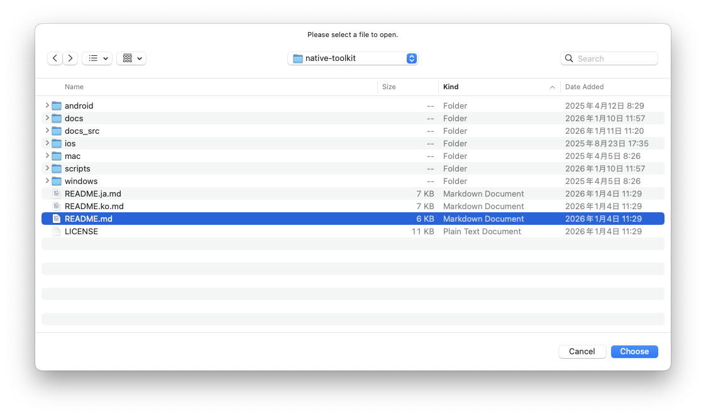
</p>

#### ShowMultiFileDialog - 다중 파일 선택 다이얼로그

- 다이얼로그를 표시합니다.

```swift
MacDialogManager.shared.showMultiFileDialog(
    // 제목을 설정합니다. 필수 항목입니다.
    title: "Select files",
    // 메시지를 설정합니다. 생략하면 표시되지 않습니다.
    message: "Please select files to open.",
    // 허용할 파일 확장자를 설정합니다. 생략 시 OS 기본값이 사용됩니다.
    allowedContentTypes: ["txt", "png"],
    // 초기 디렉터리를 설정합니다. 생략 시 OS 기본값이 사용됩니다.
    directoryURL: nil
    // 다중 파일 선택 다이얼로그 결과 수신 이벤트를 설정합니다.
) { result in
    // result: 다중 파일 선택 결과를 가져옵니다.
    switch result {
    // filePaths: 선택된 파일 경로 배열을 가져옵니다. 취소 시 []를 반환합니다.
    // fileCount: 반환된 파일 수를 가져옵니다. 취소 시 0입니다.
    // directoryURL: 선택이 수행된 디렉터리 URL을 가져옵니다. 취소 시 ""를 반환합니다.
    // isCancelled: 다이얼로그 취소 여부를 가져옵니다.
    // isSuccess: 다이얼로그 표시 성공 플래그를 가져옵니다. 성공 시 true를 반환합니다.
    case .success(let openResult):
        Log.d(TAG, "[ShowMultiFileDialog] success: \(openResult)")
    // error: 오류 내용을 가져옵니다.
    case .failure(let error):
        Log.e(TAG, "[ShowMultiFileDialog] error: \(error)")
    }
}
```

<p align="center">
    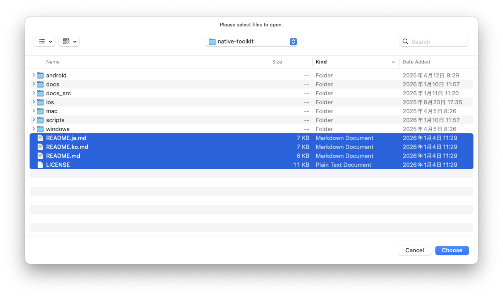
</p>

#### ShowFolderDialog - 폴더 선택 다이얼로그

- 다이얼로그를 표시합니다.

```swift
MacDialogManager.shared.showFolderDialog(
    // 제목을 설정합니다. 필수 항목입니다.
    title: "Select a folder",
    // 메시지를 설정합니다. 생략하면 표시되지 않습니다.
    message: "Please select a folder to open.",
    // 초기 디렉터리를 설정합니다. 생략 시 OS 기본값이 사용됩니다.
    directoryURL: nil
    // 폴더 선택 다이얼로그 결과 수신 이벤트를 설정합니다.
) { result in
    // result: 폴더 선택 결과를 가져옵니다.
    switch result {
    // filePaths: 선택된 폴더 경로 배열을 가져옵니다. 취소 시 []를 반환합니다.
    // fileCount: 반환된 폴더 수를 가져옵니다. 취소 시 0입니다.
    // directoryURL: 선택이 수행된 디렉터리 URL을 가져옵니다. 취소 시 ""를 반환합니다.
    // isCancelled: 다이얼로그 취소 여부를 가져옵니다.
    // isSuccess: 다이얼로그 표시 성공 플래그를 가져옵니다. 성공 시 true를 반환합니다.
    case .success(let openResult):
        Log.d(TAG, "[ShowFolderDialog] success: \(openResult)")
    case .failure(let error):
        Log.e(TAG, "[ShowFolderDialog] error: \(error)")
    }
}
```

<p align="center">
    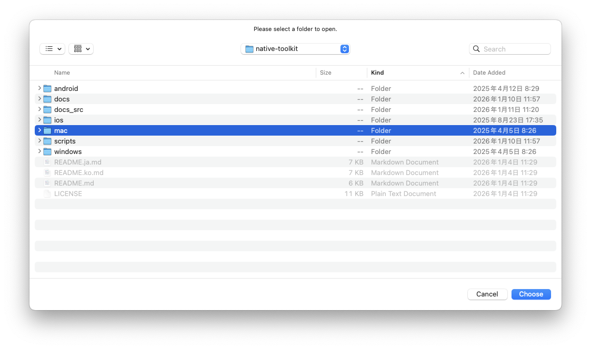
</p>

#### ShowMultiFolderDialog - 다중 폴더 선택 다이얼로그

- 다이얼로그를 표시합니다.

```swift
MacDialogManager.shared.showMultiFolderDialog(
    // 제목을 설정합니다. 필수 항목입니다.
    title: "Select folders",
    // 메시지를 설정합니다. 생략하면 표시되지 않습니다.
    message: "Please select folders to open.",
    // 초기 디렉터리를 설정합니다. 생략 시 OS 기본값이 사용됩니다.
    directoryURL: nil
    // 다중 폴더 선택 다이얼로그 결과 수신 이벤트를 설정합니다.
) { result in
    // result: 다중 폴더 선택 결과를 가져옵니다.
    switch result {
    // filePaths: 선택된 폴더 경로 배열을 가져옵니다. 취소 시 []를 반환합니다.
    // fileCount: 반환된 폴더 수를 가져옵니다. 취소 시 0입니다.
    // directoryURL: 선택이 수행된 디렉터리 URL을 가져옵니다. 취소 시 ""를 반환합니다.
    // isCancelled: 다이얼로그 취소 여부를 가져옵니다.
    // isSuccess: 다이얼로그 표시 성공 플래그를 가져옵니다. 성공 시 true를 반환합니다.
    case .success(let openResult):
        Log.d(TAG, "[ShowMultiFolderDialog] success: \(openResult)")
    // error: 오류 내용을 가져옵니다.
    case .failure(let error):
        Log.e(TAG, "[ShowMultiFolderDialog] error: \(error)")
    }
}
```

<p align="center">
    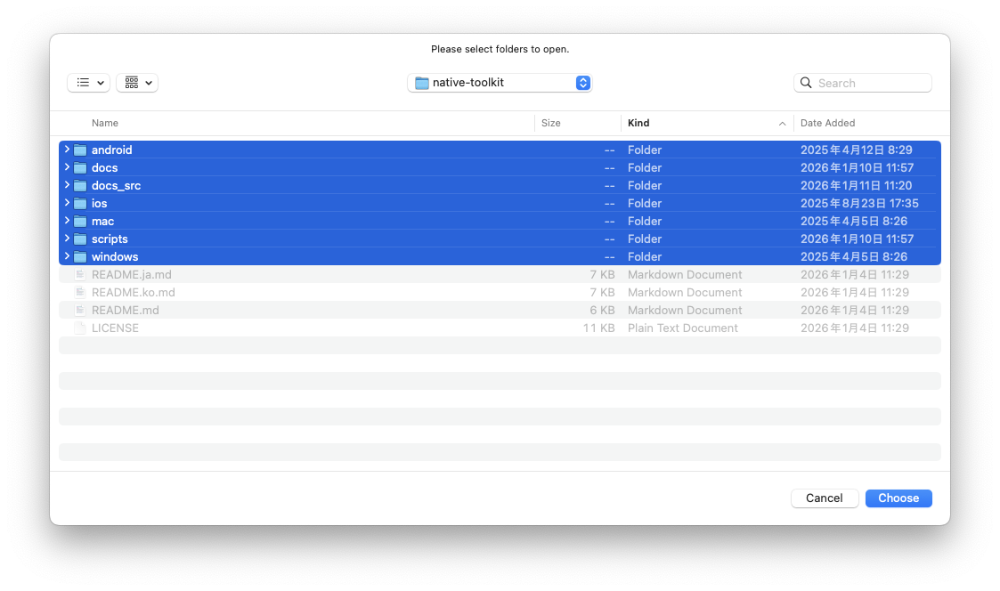
</p>

#### ShowSaveFileDialog - 파일 저장 다이얼로그

- 다이얼로그를 표시합니다.

```swift
MacDialogManager.shared.showSaveFileDialog(
    // 제목을 설정합니다. 필수 항목입니다.
    title: "Save File",
    // 메시지를 설정합니다. 생략하면 표시되지 않습니다.
    message: "Choose a destination",
    // 기본 파일명을 설정합니다. 생략 시 OS 기본값이 사용됩니다.
    nameFieldStringValue: "default",
    // 허용할 파일 확장자를 설정합니다. 생략 시 OS 기본값이 사용됩니다.
    allowedContentTypes: ["txt"],
    // 초기 디렉터리를 설정합니다. 생략 시 OS 기본값이 사용됩니다.
    directoryURL: nil
    // 파일 저장 다이얼로그 결과 수신 이벤트를 설정합니다.
) { result in
    // result: 파일 저장 결과를 가져옵니다.
    switch result {
    // filePath: 저장된 파일 경로를 가져옵니다. 취소 시 ""를 반환합니다.
    // fileCount: 반환된 경로 수를 가져옵니다. 성공 시 1, 취소 시 0입니다.
    // directoryURL: 저장이 수행된 디렉터리 URL을 가져옵니다. 취소 시 ""를 반환합니다.
    // isCancelled: 다이얼로그 취소 여부를 가져옵니다.
    // isSuccess: 다이얼로그 표시 성공 플래그를 가져옵니다. 성공 시 true를 반환합니다.
    case .success(let saveResult):
        Log.d(TAG, "[ShowSaveFileDialog] success: \(saveResult)")
    // error: 오류 내용을 가져옵니다.
    case .failure(let error):
        Log.e(TAG, "[ShowSaveFileDialog] error: \(error)")
    }
}
```

<p align="center">
    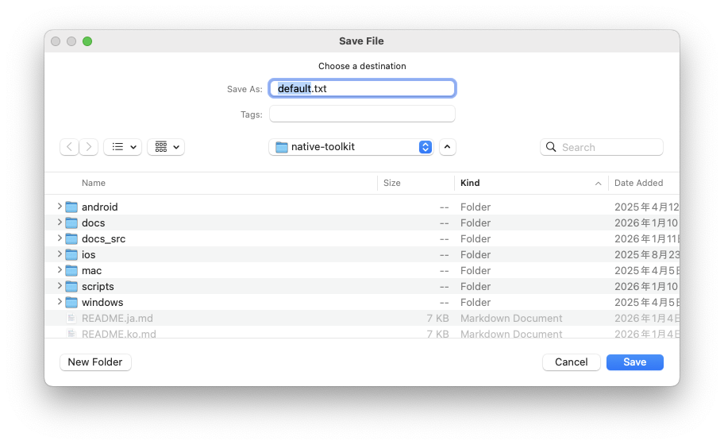
</p>
