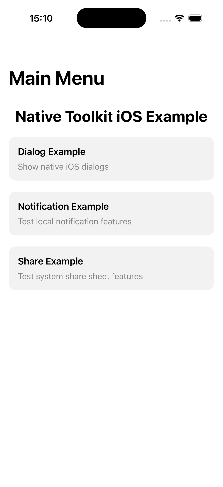
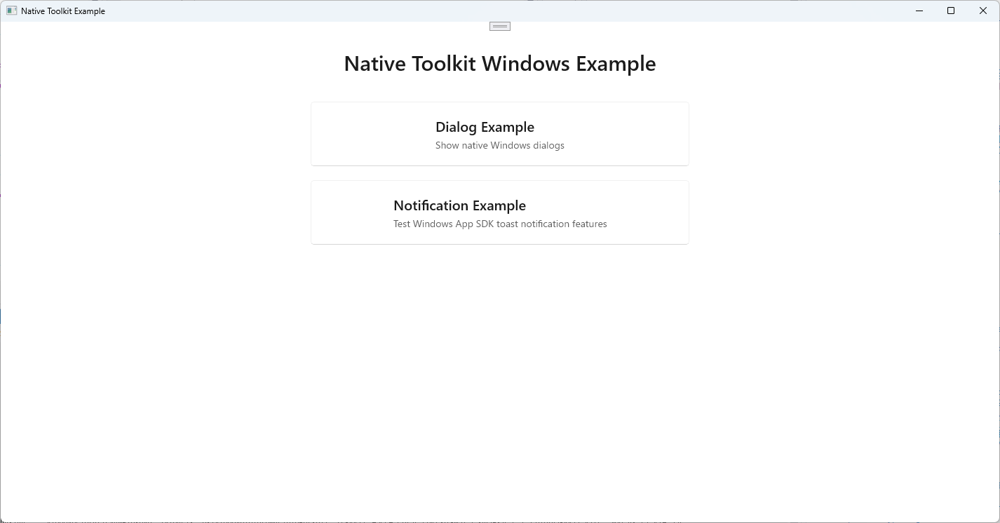
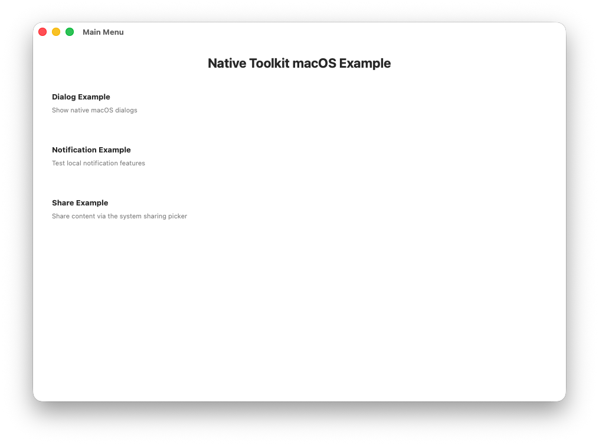

# native-toolkit 매뉴얼

언어:

- 한국어(이 페이지)
- 영어: [index.md](index.md)
- 일본어: [index.ja.md](index.ja.md)

이 디렉터리의 Markdown 파일은 버전 문서로 `docs/<version>/manual/`에 게시됩니다.

# 이 매뉴얼의 목적

- 자동 생성 문서(Dokka / DocC / Doxygen)만으로는 다루기 어려운 도입 절차와 실무 운영 포인트를 정리합니다.
- 수기 문서를 생성 산출물(`docs/`)과 분리해 publish 시 덮어쓰이지 않도록 합니다.

# 이 페이지에서 확인할 수 있는 내용

- 설치 / 도입
- 플랫폼별 설정
  - Android (Gradle)
  - iOS (Xcode)
  - Windows (Visual Studio)
  - macOS (Xcode)
- API 사용 예시

# 자동 생성 문서(API 레퍼런스)

- Android: `docs/<version>/android/`
- iOS: `docs/<version>/ios/`
- Windows: `docs/<version>/windows/`
- macOS: `docs/<version>/mac/`

# 배포 산출물 위치 (`dist/<version>/`)

- Android (Kotlin API): `dist/1.14.0/android/android-native-toolkit-2.0.0.aar`
- Android (C ABI): `dist/1.14.0/android/android-native-toolkit-capi-2.0.0.aar`, 헤더는 `dist/1.14.0/android/include/NativeToolkitC/`
- Android (두 AAR, POM, Gradle Module Metadata를 담은 Maven 저장소): `dist/1.14.0/android/m2/`
- iOS (Swift API): `dist/1.14.0/ios/ios-native-toolkit-2.0.0.xcframework`
- iOS (C ABI): `dist/1.14.0/ios/ios-native-toolkit-capi-2.0.0.xcframework`, 헤더는 `dist/1.14.0/ios/include/NativeToolkitC/`에도 있습니다
- Windows (C++ API): `dist/1.14.0/windows/windows-native-toolkit-2.0.0.nupkg`
- Windows (C ABI): `dist/1.14.0/windows/windows-native-toolkit-capi-2.0.0.nupkg`
- macOS: `dist/1.14.0/mac/mac-native-toolkit-1.3.0.xcframework`

# Native Toolkit

- native-toolkit은 각 플랫폼의 네이티브 기능을 통합적으로 사용하기 위한 툴킷입니다.
- 패키지에는 Android / iOS / Windows / macOS용 네이티브 플러그인과 샘플이 포함되며, 각 플랫폼의 네이티브 기능을 싱글톤 API로 사용할 수 있습니다.

# 버전

## 1.14.0

- iOS 라이브러리는 2.0.0이 되었습니다. Swift 6 동시성 어노테이션, 새 오류 케이스, 앱 시작 시 설치하는 알림 delegate, 알림 이벤트, 요청 취소, C ABI를 포함합니다. [iOS 라이브러리를 2.0.0으로 마이그레이션](#ios-라이브러리를-200으로-마이그레이션)을 참조해 주세요.

## 1.13.0

- Android 라이브러리는 2.0.0이 되었습니다. 새 패키지 이름, 기능별 매니저, C ABI를 포함합니다. [Android 라이브러리를 2.0.0으로 마이그레이션](#android-라이브러리를-200으로-마이그레이션)을 참조해 주세요.

# 지원 OS 버전

- Android 12+
- iOS 18+
- Windows 11+
- macOS 15+

# 기능 목록

## Android

- 다이얼로그 기능
  - 기본 다이얼로그
  - 확인 다이얼로그
  - 단일 선택 다이얼로그
  - 다중 선택 다이얼로그
  - 입력 다이얼로그
  - 로그인 다이얼로그
  - 코루틴으로 결과 기다리기
  - 다이얼로그 취소
- 알림 기능
  - 알림 권한 (확인, 요청, 요청 취소, 설정 열기)
  - 알림 표시 / 업데이트 / 취소
  - 알림 채널 관리
  - 인터랙션 이벤트 (탭, 액션, 닫기)
  - 진행 상황 알림
  - 포어그라운드 서비스 알림
  - 예약 알림
- 공유 기능
  - 텍스트 / URL 공유
  - 이미지 공유
  - 파일 공유
  - 리치 프리뷰
  - 커스텀 Chooser Action (Android 14+)
  - Direct Share Target
  - 콜백 포함 공유
  - 선택 이벤트 (선택된 앱)
  - 수신 공유 콘텐츠 처리
- 클립보드 기능
  - 복사 (일반 텍스트, HTML, URI, 여러 텍스트)
  - 민감 정보 복사 (미리보기 억제, Android 13+)
  - 읽기 / 데이터 존재 확인 / 메타데이터 확인
  - 지우기
  - 클립보드 변경 감시

위의 Android 기능은 C ABI(`libntk.so`의 `ntk_*` 함수)를 통해 C, C++, 그리고 다른 언어(C#, Rust, Dart 등)에서도 사용할 수 있습니다. 단, 수신 공유 콘텐츠 처리는 앱 자체의 Activity에서 하는 작업이므로 제외됩니다. C 함수는 각 기능 페이지에 정리되어 있습니다. "라이브러리 통합 방법"의 [C ABI](#c-abi)도 참조해 주세요.

## iOS

- 다이얼로그 기능
  - 기본 다이얼로그
  - 확인 다이얼로그
  - 파괴적 다이얼로그
  - 액션 시트
  - 입력 다이얼로그
  - 로그인 다이얼로그
  - 하나의 요청에 하나의 결과 (`DialogRequest`, async)
  - 표시에 사용할 뷰 컨트롤러 지정 (presenter)
  - 다이얼로그 취소
- 알림 기능
  - 앱 시작 시 설치하는 delegate (이전 delegate로 전달)
  - 권한 (확인, 요청, 권한 상태, 설정 열기)
  - 알림 표시 / 업데이트 / 취소 / 제거
  - 예약 알림 (시간 간격, 캘린더, 위치)
  - 첨부 파일 포함 알림
  - 배지
  - 카테고리 및 액션
  - 알림 이벤트 (탭, 액션, 텍스트 입력, 설정 앱의 링크)와 앱을 실행한 알림
- 공유 기능
  - 텍스트 / URL 공유
  - 리치 프리뷰
  - 이미지 / 파일 공유 (단일 및 여러 개)
  - 결합 콘텐츠 (제목, 액티비티 타입 제외)
  - presenter와 결과 (시트가 닫힌 방식)
- 클립보드 기능
  - 복사 (일반 텍스트, HTML, URL, 이미지 파일 / 데이터, 색상, 커스텀 데이터, 여러 텍스트, 다중 표현)
  - 복사 옵션 (localOnly, 만료 시각)
  - 추가
  - 읽기 / 데이터 읽기 / 메타데이터 스냅샷
  - 이름 있는 / 고유 페이스트보드 수명 주기
  - 비동기 로드 (텍스트 / URL / 이미지 / 파일)와 개별 로드 취소
  - 패턴 감지 (11종)
  - 클립보드 변경 감시
  - 시스템 붙여넣기 버튼 (UIPasteControl)

위의 iOS 기능은 C ABI(`ios-native-toolkit-capi-2.0.0.xcframework`의 `ntk_*` 함수)를 통해 C, C++, Objective-C, 그리고 다른 언어에서도 사용할 수 있습니다. 단, 시스템 붙여넣기 버튼, 클립보드 로드 일괄 취소, 클립보드 타임아웃과 제한의 사용자 지정, 표시에 사용할 뷰 컨트롤러 지정(C ABI는 포그라운드에 있는 것을 사용합니다), 알림의 포그라운드 표시 옵션, 임시(provisional) 알림 권한, 연·월·일·시·분·초 이외의 날짜 구성 요소를 사용하는 캘린더 트리거, 목록으로 가져온 알림의 `userInfo`는 제외됩니다. C 함수는 각 기능 페이지에 정리되어 있습니다. "라이브러리 통합 방법"의 [C ABI](#c-abi-1)도 참조해 주세요.

## Windows

- 다이얼로그 기능
  - 기본 다이얼로그
  - 파일 선택 다이얼로그
  - 다중 파일 선택 다이얼로그
  - 폴더 선택 다이얼로그
  - 다중 폴더 선택 다이얼로그
  - 파일 저장 다이얼로그
- 알림 기능
  - 알림 표시 / 업데이트 / 취소
  - 예약 알림
  - 진행 알림
  - 배지 (패키지 앱)
  - 액션 버튼 및 텍스트 입력

- 클립보드 기능
  - 복사 (텍스트, HTML, 파일, 이미지, 사용자 정의 형식, 여러 형식 동시 지정)
  - 쓰기 옵션 (히스토리 제외, 동기화 제외, 민감 정보)
  - 붙여넣기 (텍스트, HTML, 파일, 이미지, 사용자 정의 형식)
  - 형식 검사 (존재 여부, 목록, 우선 형식)
  - 지우기
  - 클립보드 변경 감시
  - 지연 렌더링 (형식 예약, 요청 시 생성)
  - 클립보드 히스토리 (사용 가능 여부, 목록, 복원, 삭제, 고정되지 않은 항목 지우기, 취소)

## Mac

- 다이얼로그 기능
  - 기본 다이얼로그
  - 파일 선택 다이얼로그
  - 다중 파일 선택 다이얼로그
  - 폴더 선택 다이얼로그
  - 다중 폴더 선택 다이얼로그
  - 파일 저장 다이얼로그
- 알림 기능
  - 권한
  - 알림 표시 / 업데이트 / 취소
  - 예약 알림
  - 배지
  - 카테고리 및 액션
- Share 기능
  - 피커를 통한 텍스트 / URL / 이미지 / 파일 공유(단일 및 다중)
  - 피커에서 서비스 제외
  - 개별 서비스 직접 실행(recipients, subject)
  - 서비스 실행 가능 여부 확인
- 클립보드 기능
  - 복사 (텍스트, URL, 이미지, 여러 항목, 다중 표현)
  - 복사 옵션 (localOnly, 기본값 활성)
  - 추가
  - 읽기 / 데이터 읽기 / 타입으로 걸러낸 스냅샷
  - 이름 있는 / 고유 페이스트보드 수명 주기
  - 감지 (패턴, 값, 메타데이터. macOS 15.4 이상)
  - 클립보드 변경 감시
  - 시스템 붙여넣기 버튼 (PasteButton)
  - 지우기

## 샘플

- Android 샘플
  - Android Studio를 설치합니다.
    - <a href="https://developer.android.com/studio" target="_blank" rel="noopener noreferrer">참고 사이트</a>
  - Android Studio를 실행합니다.
  - "File" → "Open..."를 선택합니다.
  - `native-toolkit/android/AndroidLibraryExample`를 선택하고 "Open" 버튼을 클릭합니다.
  - Android 기기를 연결합니다.
  - "Run" 버튼을 클릭해 샘플 앱을 설치합니다.
    <p align="center">
        
    </p>

- iOS 샘플
  - Xcode를 설치합니다.
    - <a href="https://developer.apple.com/xcode" target="_blank" rel="noopener noreferrer">참고 사이트</a>
  - Xcode를 실행합니다.
  - "Open Existing Project..."를 선택합니다.
  - `native-toolkit/ios/IosWorkspace.xcworkspace`를 선택하고 "Open" 버튼을 클릭합니다.
  - "Run" 버튼을 클릭해 샘플 앱을 설치합니다.
    <p align="center">
        
    </p>

- Windows 샘플
  - Visual Studio 2022를 설치합니다.
    - <a href="https://visualstudio.microsoft.com/vs/" target="_blank" rel="noopener noreferrer">참고 사이트</a>
  - Visual Studio 2022를 실행합니다.
  - "Open a project or solution"을 선택합니다.
  - `native-toolkit\windows\WindowsLibraryExample\WindowsLibraryExample.sln`을 선택하고 "Open" 버튼을 클릭합니다.
  - "Debug" → "Start Debugging"을 선택해 샘플 앱을 설치합니다.
    <p align="center">
        
    </p>

- Mac 샘플
  - Xcode를 설치합니다.
    - <a href="https://developer.apple.com/xcode" target="_blank" rel="noopener noreferrer">참고 사이트</a>
  - Xcode를 실행합니다.
  - "Open Existing Project..."를 선택합니다.
  - `native-toolkit/mac/MacWorkspace.xcworkspace`를 선택하고 "Open" 버튼을 클릭합니다.
  - "Run" 버튼을 클릭해 샘플 앱을 설치합니다.
    <p align="center">
        
    </p>

## 라이브러리 통합 방법

### Android

#### 지원 플랫폼: Android 12(API 31) 이상

Android 라이브러리는 두 개의 AAR로 배포합니다.

| AAR | 대상 | 내용 |
|---|---|---|
| `android-native-toolkit-2.0.0.aar` | Kotlin, Java에서 호출하는 경우 | Kotlin API(`com.jonghyunkim.nativetoolkit.*`) |
| `android-native-toolkit-capi-2.0.0.aar` | C, C++, 그리고 다른 언어에서 호출하는 경우 | C ABI. `libntk.so`(`arm64-v8a`, `x86_64`), Prefab으로 제공하는 그 헤더, 그리고 거기서 호출하는 Kotlin 측을 포함합니다. Kotlin API AAR에 의존합니다 |

요구 사항:

- `minSdk` 31 이상, `compileSdk` 36 이상
- Android Gradle Plugin 8.9.1 이상(AndroidX 의존성이 이를 요구하기 때문)
- 앱을 Kotlin으로 작성하는 경우 Kotlin 2.1 이상(라이브러리는 실행 시 `kotlin-stdlib` 2.2 이상이 필요하며, Gradle이 이를 해결합니다)

##### 방법 A: Maven 저장소(권장)

`dist/1.14.0/android/m2/`는 두 AAR과 그 의존성 정보를 담은 Maven 저장소입니다. AAR이 필요로 하는 AndroidX와 Kotlin 라이브러리는 Gradle이 해결합니다.

1. `dist/1.14.0/android/m2/`를 프로젝트에 복사합니다(예: `third_party/native-toolkit-m2/`).
2. `settings.gradle.kts`에 저장소로 추가합니다.
3. `app/build.gradle.kts`에 의존성을 추가합니다.
4. Gradle 동기화를 실행하고 빌드합니다.

**settings.gradle.kts:**

```kotlin
dependencyResolutionManagement {
    repositoriesMode.set(RepositoriesMode.FAIL_ON_PROJECT_REPOS)
    repositories {
        google()
        mavenCentral()
        maven { url = uri("third_party/native-toolkit-m2") }
    }
}
```

**app/build.gradle.kts:**

```kotlin
dependencies {
    // Kotlin API입니다.
    implementation("io.github.kimjh4941:android-native-toolkit:2.0.0")
    // C ABI입니다. C나 다른 언어에서 라이브러리를 호출하는 경우에 추가합니다. 실행 시 Kotlin API가 필요하며
    // 이를 런타임 의존성으로 가져옵니다. 앱 자체의 Kotlin, Java 코드도 Kotlin API를 호출한다면
    // 위의 줄도 남겨 두세요.
    implementation("io.github.kimjh4941:android-native-toolkit-capi:2.0.0")
}
```

##### 방법 B: AAR 파일

AAR 파일을 직접 배치하는 경우 Gradle은 그 의존 대상을 알 수 없으므로, 아래 의존성도 함께 추가해 주세요.

1. `android-native-toolkit-2.0.0.aar`(C ABI를 사용하는 경우 `android-native-toolkit-capi-2.0.0.aar`도)를 `app/libs`에 배치합니다.
2. `app/build.gradle.kts`에 AAR과 의존성을 추가합니다.

**app/build.gradle.kts:**

```kotlin
dependencies {
    implementation(files("libs/android-native-toolkit-2.0.0.aar"))
    implementation(files("libs/android-native-toolkit-capi-2.0.0.aar")) // C ABI를 사용하는 경우에만

    // AAR이 실행 시 필요로 하는 것입니다.
    implementation("org.jetbrains.kotlin:kotlin-stdlib:2.2.21")
    implementation("org.jetbrains.kotlin:kotlin-parcelize-runtime:2.2.21")
    implementation("androidx.core:core-ktx:1.18.0")
    implementation("androidx.fragment:fragment:1.9.1")
    implementation("androidx.media:media:1.8.0")
    implementation("androidx.startup:startup-runtime:1.2.0")
    implementation("org.jetbrains.kotlinx:kotlinx-coroutines-core:1.9.0")
}
```

<!-- ntk-android-dependencies: the list above is checked against the Gradle Module Metadata of the release by scripts/check_android_dist.py -->

##### 초기화

라이브러리는 앱이 시작될 때 AndroidX App Startup(`androidx.startup.InitializationProvider`. AAR이 병합된 매니페스트에 추가합니다)을 통해 스스로 초기화됩니다. 따로 호출할 것은 없습니다.

App Startup이 먼저 실행되지 않는 다음 경우에는 첫 호출 전에 직접 초기화해 주세요.

- 앱이 App Startup을 비활성화한 경우(또는 병합된 매니페스트에서 라이브러리의 initializer를 제거한 경우)
- 앱의 기본 프로세스가 아닌 다른 프로세스에서 라이브러리를 호출하는 경우(App Startup은 기본 프로세스에서만 실행됩니다)
- 직접 만든 `ContentProvider`에서 호출하는 경우(App Startup의 것보다 먼저 생성될 수 있습니다)

방법:

- Kotlin API: 첫 Activity의 `onCreate`에서 그 Activity를 넘겨 `LibraryRuntime.ensureInitialized(activity)`(`com.jonghyunkim.nativetoolkit.common.runtime`)를 호출합니다. 라이브러리는 그 이후로 포그라운드 Activity를 추적합니다. 애플리케이션 컨텍스트만 넘기면 이미 화면에 표시된 Activity를 놓치며, 다음 Activity가 시작될 때까지 다이얼로그와 권한 요청은 "포그라운드에 없음"으로 완료됩니다
- C ABI: C에서는 `ntk_android_init(env, activity)`, Kotlin에서는 `NativeToolkitCApi.init(activity)`를 호출합니다. 다이얼로그 등 포그라운드에서 동작하는 기능이 Activity를 찾을 수 있도록, 현재 Activity가 있으면 넘겨 주세요. 둘 다 기다리지 않습니다. `ntk_android_init`은 `NTK_ANDROID_ERROR_IN_PROGRESS`(다른 스레드가 초기화 중)나 `NTK_ANDROID_ERROR_JNI_FAILURE`를, `NativeToolkitCApi.init`은 `IN_PROGRESS`나 `RETRYABLE_ERROR`를 반환할 수 있습니다. 그 경우 나중에 다시 호출해 주세요. C ABI가 준비되었는지는 `ntk_android_is_initialized()`로 확인할 수 있습니다

##### 앱에 추가되는 권한과 컴포넌트

Kotlin API AAR은 알림 기능이 사용하는 권한을 선언하며, 이 권한들은 앱의 매니페스트에 병합됩니다. 필요 없는 것은 `tools:node="remove"`로 제거해 주세요.

| 권한 | 없을 때 동작하지 않는 것 | 함께 제거할 것 |
|---|---|---|
| `POST_NOTIFICATIONS` | Android 13 이상에서 알림이 표시되지 않습니다. `hasPermission`은 false가 되고 권한 요청은 즉시 거부됩니다 | - |
| `RECEIVE_BOOT_COMPLETED` | 기기 재부팅 후 예약 알림이 복원되지 않습니다 | - |
| `SCHEDULE_EXACT_ALARM` | 예약에 부정확한 알람을 사용합니다(`canScheduleExactAlarms`는 false) | - |
| `USE_FULL_SCREEN_INTENT` | 전체 화면 인텐트가 헤드업 알림으로 표시됩니다 | - |
| `FOREGROUND_SERVICE` | 진행 상황 알림과 통화 스타일 알림이 포어그라운드 서비스를 시작할 수 없습니다 | 아래 두 서비스. 해당 API도 호출하지 마세요 |
| `FOREGROUND_SERVICE_DATA_SYNC` | 진행 상황 알림이 포어그라운드 서비스를 시작할 수 없습니다 | `com.jonghyunkim.nativetoolkit.notification.presentation.progress.ProgressForegroundService` |
| `FOREGROUND_SERVICE_SPECIAL_USE` | 통화 스타일 알림이 포어그라운드 서비스를 시작할 수 없습니다 | `com.jonghyunkim.nativetoolkit.notification.presentation.call.CallStyleForegroundService` |

**AndroidManifest.xml(앱 측):**

```xml
<manifest xmlns:android="http://schemas.android.com/apk/res/android"
    xmlns:tools="http://schemas.android.com/tools">

    <uses-permission android:name="android.permission.FOREGROUND_SERVICE_DATA_SYNC" tools:node="remove" />

    <application>
        <service
            android:name="com.jonghyunkim.nativetoolkit.notification.presentation.progress.ProgressForegroundService"
            tools:node="remove" />
    </application>
</manifest>
```

##### C ABI

C ABI는 C, C++, 그리고 다른 언어에서 라이브러리를 호출하는 앱을 위한 것입니다. Kotlin, Java 앱은 Kotlin API를 직접 호출해 주세요. C ABI를 거치면 JNI 왕복만 늘어날 뿐입니다.

- 앱은 Kotlin, Java 코드를 가진 일반 Android 앱입니다(`android:hasCode="true"`). C 함수는 JNI를 통해 Kotlin API를 호출하므로, AAR의 Kotlin 클래스와 매니페스트 항목이 앱에 포함되어 있어야 합니다. `libntk.so`만 복사해서는 동작하지 않습니다
- `libntk.so`는 `arm64-v8a`와 `x86_64`용으로만 빌드되어 있습니다. 32비트 기기나 32비트 ABI만으로 빌드한 앱에는 이 라이브러리가 없습니다. 앱은 시작되지만 `libntk.so` 로드에 실패합니다(예: C#에서는 `DllNotFoundException`). 이를 처리하거나 앱을 64비트 ABI만으로 빌드해 주세요. C ABI AAR에 의존하는 모듈에서 Prefab이 활성화되어 있고 32비트 ABI용 네이티브 코드를 빌드하는 경우, 그 코드가 `ntk::ntk`를 사용하지 않더라도 빌드 자체가 `CXX1210`으로 중단됩니다(아래 참조)
- 완료, 이벤트, 수락된 호출의 `release`는 Android 메인 스레드에서 전달되며, 호출한 스레드가 아닙니다. 콜백을 등록한 스레드에서만 콜백을 받을 수 있는 런타임은 C ABI를 그대로 사용할 수 없습니다. (입구에서 거부된 호출은 오류를 반환하고, 반환하기 전에 호출한 스레드에서 `release`를 호출합니다. 완료는 전달되지 않습니다)
- 다이얼로그, Share, 설정 화면, 아직 허용되지 않은 알림 권한 요청은 앱이 포그라운드에 있어야 합니다. 백그라운드에서 호출하면 `NOT_FOREGROUND`로 완료됩니다

CMake를 사용하는 C, C++에서는 AAR이 Prefab을 통해 헤더와 `libntk.so`를 제공합니다.

**app/build.gradle.kts:**

```kotlin
android {
    buildFeatures { prefab = true }
    defaultConfig {
        ndk { abiFilters += listOf("arm64-v8a", "x86_64") }
        externalNativeBuild {
            cmake { abiFilters("arm64-v8a", "x86_64") }
        }
    }
}
```

**CMakeLists.txt:**

```cmake
find_package(ntk REQUIRED CONFIG)
target_link_libraries(your_library PRIVATE ntk::ntk)
```

`ntk::ntk`를 사용하는 CMake 빌드는 위와 같이 64비트 ABI로 한정해 주세요. Prefab에는 32비트 ABI용 `libntk.so`가 없습니다. Android Gradle Plugin은 CMake 빌드가 대상으로 하는 모든 ABI에 대해 Prefab 패키지를 검사하고 `CXX1210`으로 중단됩니다. `CMakeLists.txt`의 `if()`로는 이를 피할 수 없습니다. 앱에 자체 32비트 네이티브 코드도 포함된다면, Prefab을 사용하지 않는 별도의 모듈에서 빌드해 주세요.

다른 언어에서는 앱이 시작된 뒤 `libntk.so`를 이름(`ntk`)으로 로드합니다. 함수, 스레드, 오류는 각 기능 페이지의 Android 절에 있는 C ABI 항목에 정리되어 있습니다.

C ABI AAR에는 R8 규칙이 포함되어 있으므로, minify를 활성화한 릴리스 빌드에서도 추가 설정이 필요 없습니다. 앱이 App Startup을 비활성화하고 `NativeToolkitCApi.init`을 리플렉션이나 다른 런타임에서 호출하는 경우에는 해당 클래스를 keep해 주세요. `NativeToolkitCApi`는 Kotlin의 `object`이며 `init`은 static이 아닙니다. `INSTANCE` 필드에 대해 호출해 주세요(Java에서는 `NativeToolkitCApi.INSTANCE.init(activity)`).

```
-keep class com.jonghyunkim.nativetoolkit.capi.NativeToolkitCApi { *; }
-keep class com.jonghyunkim.nativetoolkit.capi.NativeToolkitCApi$InitResult { *; }
```

##### Android 라이브러리를 2.0.0으로 마이그레이션

2.0.0은 1.x와 호환되지 않습니다. 1.x용으로 작성한 코드는 변경해야 합니다.

| 1.x | 2.0.0 |
|---|---|
| 패키지 `android.library.*` | 패키지 `com.jonghyunkim.nativetoolkit.*` |
| 기능별 유스케이스와 헬퍼 | 기능마다 하나의 매니저: `AndroidDialogManager`, `AndroidNotificationManager`, `AndroidShareManager`, `AndroidClipboardManager`(`getInstance(context)`) |
| 1.x로 예약한 알림 | 앱이 처음 2.0.0으로 실행될 때 **한 번 폐기됩니다**(저장 형식이 바뀌었기 때문). 다시 예약해 주세요 |
| 1.x가 표시해 아직 화면에 남아 있는 알림 | 업데이트 후에는 탭이나 액션에 반응하지 않습니다(리시버 이름이 바뀌었기 때문). 필요하면 다시 표시해 주세요 |
| 1.x 매뉴얼에 따라 공유용으로 선언한 `FileProvider` | **제거해 주세요.** 라이브러리가 자체 provider(authority `${applicationId}.native_toolkit.share.fileprovider`)를 선언합니다. 매니페스트에서 `androidx.core.content.FileProvider`를 다시 선언하면 매니페스트 병합에서 충돌합니다. 직접 만드는 provider는 `FileProvider`의 서브클래스여야 합니다 |
| 라이브러리는 앱 시작 시 아무것도 추가하지 않았습니다 | AndroidX App Startup(`InitializationProvider`)을 추가하고 스스로 초기화합니다(위의 "초기화" 참조) |
| 하나의 AAR 파일 | 이전과 같은 Kotlin API AAR(Kotlin, Java 앱은 이것만 있으면 됩니다)에 더해, C와 다른 언어용 C ABI AAR, 그리고 둘 다 담은 Maven 저장소(위의 "방법 A"와 "방법 B" 참조) |

작업별 변경 사항은 각 기능 페이지의 Android 절에 있습니다.

### iOS

#### 지원 플랫폼: iOS（실기기: arm64 / Simulator: arm64, x86_64）

iOS 라이브러리는 두 개의 XCFramework로 배포합니다.

| XCFramework | 대상 | 내용 |
|---|---|---|
| `ios-native-toolkit-2.0.0.xcframework` | Swift에서 호출하는 경우 | Swift API(`IosLibrary.framework`, 모듈 `IosLibrary`)와 그 개인정보 보호 매니페스트 |
| `ios-native-toolkit-capi-2.0.0.xcframework` | C, C++, Objective-C, 그리고 다른 언어에서 호출하는 경우 | C ABI(`IosLibraryCApi.framework`, 헤더 `NativeToolkitC/`). Swift API를 호출하므로 위의 XCFramework에 의존합니다. 둘 다 임베드해 주세요 |

`dist/1.14.0/ios/include/NativeToolkitC/`에는 C ABI XCFramework와 같은 헤더가 들어 있습니다. 헤더에서 바인딩을 생성하는 도구를 위한 것입니다.

요구 사항:

- 앱의 최소 배포 대상이 iOS 18.0 이상
- 앱이 Swift API를 사용하는 경우 Xcode 26.3 이상(Xcode가 라이브러리의 Swift 인터페이스를 읽기 때문). C ABI만 사용하는 앱은 어떤 Xcode 26으로도 빌드할 수 있습니다
- 라이브러리는 UIKit 앱 안에서 동작합니다. 앱 확장(App Extension)과 명령줄 도구는 지원하지 않습니다
- 두 프레임워크 모두 동적 프레임워크이며 서명되어 있지 않습니다. **Embed & Sign**으로 설정하면 Xcode가 앱의 인증서로 서명합니다

절차:

1. `ios-native-toolkit-2.0.0.xcframework`를 Xcode 프로젝트 하위 `Frameworks` 폴더(없으면 생성)에 복사합니다. C ABI를 사용하는 경우 `ios-native-toolkit-capi-2.0.0.xcframework`도 같은 곳에 복사합니다.
2. Xcode 26.3 이상(C ABI만 사용하는 앱은 어떤 Xcode 26이든 가능)에서 프로젝트를 열고 **Project Navigator**에서 앱 타깃을 선택합니다.
3. **General** 탭에서 **Frameworks, Libraries, and Embedded Content**의 **+**를 클릭합니다.
4. **Add Other...** → **Add Files...**를 선택하고 `Frameworks/`에서 XCFramework(또는 두 XCFramework)를 추가합니다.
5. 각 XCFramework의 Embed 설정을 **Embed & Sign**으로 지정합니다. 여기서 추가한 XCFramework의 프레임워크와 헤더는 Xcode가 스스로 찾으므로 `Framework Search Paths`에 항목을 추가할 필요가 없습니다.
6. **Signing & Capabilities**에서 Team 설정이 올바른지 확인합니다.
7. **Product** → **Clean Build Folder**를 실행한 뒤 **Run**으로 빌드/실행합니다.
8. 오류 없이 실행되면 통합이 완료된 것입니다.

##### 개인정보 보호 매니페스트

`IosLibrary.framework`에는 개인정보 보호 매니페스트(`PrivacyInfo.xcprivacy`)가 포함되어 있습니다. 파일 타임스탬프 API를 사유 `C617.1`로 선언하며, 수집하는 데이터와 추적은 없습니다. 아카이브할 때 Xcode가 이를 앱의 개인정보 보호 보고서에 병합합니다.

##### 알림 delegate

알림 이벤트(탭, 액션, 텍스트 입력, 설정 앱의 링크)와 앱이 포그라운드에 있을 때 표시하는 알림에는 라이브러리의 `UNUserNotificationCenter` delegate가 필요합니다. 앱 시작이 끝나기 전에 메인 스레드에서 `application(_:didFinishLaunchingWithOptions:)` 안에서 설치해 주세요(SwiftUI 앱은 `App.init`에서 설치할 수 있습니다).

- Swift API: `IosNotificationManager.installDelegate()`
- C ABI: 앱의 네이티브 코드에서 `ntk_notification_install()`을 호출합니다. 앱 시작 후에 자체 코드를 실행하기 시작하는 런타임(게임 엔진의 스크립트, Dart isolate 등)에서는 너무 늦습니다. 앱을 실행한 탭을 놓치게 됩니다

라이브러리는 이전에 설정되어 있던 delegate를 보관하고 그쪽으로 전달합니다. 라이브러리가 만들지 않은 알림은, 그 delegate가 해당 메서드를 구현하고 있으면 그 delegate로 전달됩니다. 이후에 다른 `UNUserNotificationCenter` delegate를 설정하지 마세요. 설정하면 라이브러리가 이벤트를 받지 못하게 됩니다. [알림 기능](notification.ko.md)의 iOS 절을 참조해 주세요.

##### C ABI

C ABI는 C, C++, Objective-C, 그리고 다른 언어에서 라이브러리를 호출하는 앱을 위한 것입니다. Swift 앱은 Swift API를 직접 호출해 주세요.

- 헤더는 프레임워크에서 `#include <IosLibraryCApi/NativeToolkitC/Notification.h>`처럼 포함하거나, `dist/1.14.0/ios/include`를 헤더 검색 경로에 추가하고 `#include <NativeToolkitC/Notification.h>`라고 씁니다. 모듈을 활성화한 Objective-C에서는 `@import IosLibraryCApi;`라고 쓸 수 있습니다
- 모든 함수는 어느 스레드에서든 호출할 수 있으며(`ntk_notification_install`만 메인 스레드 전용입니다), 어떤 함수도 메인 스레드를 기다리지 않습니다. 완료, 이벤트, 수락된 호출의 `release`는 메인 큐에서 비동기로 전달되며, 이는 런타임이 만든 스레드가 아닐 수 있습니다. Dart에서는 `NativeCallable.isolateLocal`이 아니라 `NativeCallable.listener`를 사용해 주세요. (입구에서 거부된 호출은 오류를 반환하고, 반환하기 전에 호출한 스레드에서 `release`를 호출합니다)
- 다이얼로그, Share, 알림 설정 화면, 아직 응답하지 않은 알림 권한 요청은 포그라운드에 있는 scene이 필요합니다. 앱이 백그라운드에 있을 때 호출하면 `NOT_FOREGROUND`로 완료됩니다. 앱의 여러 창을 나란히 표시하는 iPad에서는 어느 창에 표시될지 정해져 있지 않습니다. Swift API에서는 이를 위해 presenter를 지정할 수 있습니다
- 다른 앱이 클립보드에 넣은 내용을 읽으면(`ntk_clipboard_read_async`, `ntk_clipboard_read_data_async`) iOS가 사용자에게 붙여넣기 허용을 요청할 수 있으며, 사용자가 응답할 때까지 앱의 메인 스레드가 멈춥니다. 메인 스레드가 계속 동작하게 하려면 `ntk_clipboard_load_item_async`를 사용해 주세요. 이 함수는 메인 스레드를 멈추지 않으며 `ntk_clipboard_cancel_load`로 취소할 수 있습니다
- 문자열은 NUL로 끝나는 UTF-8입니다. iOS에서 `ntk_last_system_code()`는 항상 0입니다

함수, 스레드, 오류는 각 기능 페이지의 iOS 절에 있는 C ABI 항목에 정리되어 있습니다.

##### iOS 라이브러리를 2.0.0으로 마이그레이션

2.0.0은 1.x와 소스 호환되지 않습니다. 모듈 이름은 `IosLibrary` 그대로이므로 `import IosLibrary`는 바뀌지 않습니다. 1.x용으로 작성한 코드는 다음을 사용하는 부분을 변경해야 합니다.

| 1.x | 2.0.0 |
|---|---|
| 프레임워크 번들 ID `ios.library.IosLibrary` | `com.jonghyunkim.nativetoolkit.IosLibrary` |
| 격리(isolation)가 없는 완료 핸들러 | Dialog, Share, Notification의 완료와 다이얼로그의 버튼 콜백 및 `textFields`는 `@MainActor @Sendable`이며 메인 스레드에서 전달됩니다. `NotificationActionHandler`와 `NotificationTextInputActionHandler`는 `@Sendable`입니다. Clipboard의 완료는 바뀌지 않습니다. 라이브러리는 Swift 6 언어 모드로 빌드되어 있습니다 |
| 직접 구현한 `ShareRepository`와 `NotificationRepository` | 두 프로토콜 모두 `Sendable`을 요구합니다. `ShareRepository.present(content:)`는 `present(content:presenter:)`로, `NotificationRepository.openNotificationSettings()`는 `async -> Bool`로 바뀝니다. 1.x 시그니처로 작성한 구현은 더 이상 컴파일되지 않습니다. `NotificationRepository`에는 `enqueueCategoryChange(_:completion:)`가 추가됩니다(기본 구현이 있습니다) |
| `NotificationRepositoryImpl(center:)` | `NotificationRepositoryImpl()`(받을 수 있던 값은 `.current()`뿐이었습니다) |
| 어떤 컨텍스트에서든 호출할 수 있던 `IosDialogManager.getRootViewController()` | `@MainActor`입니다. 동기 nonisolated 컨텍스트에서는 호출할 수 없습니다 |
| 알림의 `show`, `update`, `schedule`의 `content` | 매개변수가 `sending`입니다. Swift 6 언어 모드(또는 complete 동시성 검사)에서는 호출 후에도 계속 사용하는 content는 컴파일되지 않습니다. 호출할 때마다 새 `NotificationContent`를 만들어 주세요 |
| 임의의 `Error`를 담는 `NotificationError`와 `ShareError`의 케이스 | `FailureDetail`을 담는 케이스가 되었고, 일부 케이스는 제거되고 일부는 추가되었습니다. 이에 대한 망라적인 `switch`는 더 이상 컴파일되지 않습니다. 다이얼로그는 `DialogError`를 보고합니다 |
| `IosNotificationManager.setup()` | 앱 시작이 끝나기 전에 `IosNotificationManager.installDelegate()`(위의 "알림 delegate" 참조). `setup()`은 사용 중단(deprecated)되었습니다 |
| `onActionReceived`, `onTextInputActionReceived` | `IosNotificationManager.shared.responses.addListener`. 여러 리스너를 등록할 수 있고, 이벤트는 리스너가 등록될 때까지 보관됩니다. `launchResponse()`는 앱을 실행한 알림을 반환합니다. 두 프로퍼티는 사용 중단되었습니다 |
| `IosNotificationManager`가 `UNUserNotificationCenterDelegate`를 준수 | 준수하지 않습니다. 라이브러리의 delegate는 내부용입니다 |
| `userNotificationCenter(_:openSettingsFor:)`(설정 앱에 있는, 앱의 알림 설정으로 가는 링크)가 설정 앱을 열었습니다 | 라이브러리는 아무것도 열지 않습니다. 요청은 이벤트로 `IosNotificationManager.shared.settingsRequests`에 전달되므로, 앱 자체의 설정 화면을 표시해 주세요 |
| `async` 컨텍스트에서 완료 핸들러 없이 하는 호출 | 같은 이름의 `async` 버전이 생겼으므로, 이런 호출에는 `await`(와 `try`)가 필요합니다 |
| 임의의 `userInfo` 값 | 값은 프로퍼티 리스트 타입이어야 합니다(`NSNull`과 `NSURL`은 거부됩니다). 키 `com.jonghyunkim.nativetoolkit`은 예약되어 있습니다. 라이브러리는 자신의 알림에 이 키를 추가하고, 반환하는 `userInfo`에서는 제거합니다 |
| 이미 등록된 식별자로 카테고리를 등록하면 둘 다 남을 수 있었습니다 | 새 카테고리가 기존 카테고리를 대체합니다 |
| `Log` | 사용 중단되었습니다. 라이브러리는 `os.Logger`로 로그를 남기며 비밀 값은 비공개로 유지합니다 |
| `NotificationPermissionHelper`, `NotificationCategoryOptions.allowAnnouncement` | 사용 중단되었습니다. `NotificationPermissionHelper` 대신 `IosNotificationManager.requestPermission(options:presenter:)`를 사용해 주세요. `allowAnnouncement`는 효과가 없습니다(iOS 15부터 iOS가 무시합니다) |
| 알림 작업, 표시에 실패한 다이얼로그나 공유 시트, 실패한 공유 액티비티의 `errorMessage` | 고정된 영어 문장입니다(예: `"Notification permission was denied."`). 문장이 아니라 오류 케이스나 오류 코드로 분기해 주세요 |
| Swift API만 제공 | 두 번째 XCFramework의 C ABI(위의 "C ABI" 참조) |

1.x가 예약하거나 표시한 알림과 1.x가 등록한 카테고리는 업데이트 후에도 남습니다. 목록에 포함되며 식별자로 취소하거나 제거할 수 있고, 그 탭과 액션은 이전 delegate가 처리하지 않으면 라이브러리의 리스너에 전달됩니다.

2.0.0에서는 다이얼로그, Share, 알림 권한 요청, 알림 설정 화면에 presenter 인수가 추가되었습니다. 또한 다이얼로그나 비동기 클립보드 로드를 취소하기 위한 요청 박스와 `DialogRequest`를 받는 `IosDialogManager.show(_:)`가 추가되었습니다. 작업별 변경 사항은 각 기능 페이지의 iOS 절에 있습니다.

### Windows

#### 지원 플랫폼: Windows x64（win-x64）

Windows 라이브러리는 하나의 구현을 두 개의 NuGet 패키지로 배포합니다. 호출 방식에 맞는 쪽을 설치해 주세요. 둘 다 설치해도 괜찮습니다.

| 패키지 | 대상 | 내용 |
|---|---|---|
| `NativeToolkit` | C++에서 호출하는 경우 | C++ API 공개 헤더(`NativeToolkit/`)와 정적 라이브러리 |
| `NativeToolkit.CApi` | C에서, 그리고 다른 언어에서 호출하는 경우 | C ABI 공개 헤더(`NativeToolkitC/`), `NativeToolkitC.dll`, 그 import 라이브러리 |

`NativeToolkit`은 MSVC v143, `/std:c++20`, DLL 런타임(`/MD`, `/MDd`), x64로 만든 정적 라이브러리입니다. 이 설정이 다른 프로젝트는 LNK2038로 링크에 실패합니다. `NativeToolkit.CApi`에는 이런 제약이 없습니다. 헤더가 C99만으로 작성되어 있기 때문입니다.

둘 다 `Microsoft.WindowsAppSDK`를 의존으로 선언하며 NuGet이 함께 복원합니다. 패키지 식별자가 없는 앱은 `Microsoft.WindowsAppRuntime.Bootstrap.dll`도 실행 파일 옆에 두어야 합니다.

1. `windows-native-toolkit-2.0.0.nupkg`와 `windows-native-toolkit-capi-2.0.0.nupkg`를 `C:\packages`에 복사합니다.
2. Visual Studio 2022에서 **Tools** → **Options** → **NuGet Package Manager** → **Package Sources**를 엽니다.
3. **+**를 눌러 다음을 입력합니다.
   - Name: LocalPackages
   - Source: C:\packages
     입력 후 **Update**를 눌러 저장합니다.
4. 대상 솔루션을 엽니다.
5. **Solution Explorer**에서 프로젝트를 우클릭하고 **Manage NuGet Packages**를 선택합니다.
6. **Package source**를 **LocalPackages**로 변경합니다.
7. **NativeToolkit** 또는 **NativeToolkit.CApi**를 검색해 **Install**을 클릭합니다.
8. 라이선스 확인 창이 나오면 동의하여 설치를 완료합니다.

#### 1.x에서 이전하기

1.x는 C ABI만 공개하는 하나의 패키지였습니다(`showAlertDialog`, `initNotificationManager`, `initClipboardManager` 등). 2.0.0은 그것을 대체합니다. 모든 함수의 이름과 시그니처가 바뀌므로 1.x용으로 작성한 코드는 그대로 컴파일되지 않습니다.

| 1.x | 2.0.0 |
|---|---|
| `<common.h>`, `<WindowsDialogManager.h>`, `<WindowsNotificationManager.h>`, `<WindowsClipboardManager.h>` | `<NativeToolkit/Dialog.h>` 등, 또는 `<NativeToolkitC/Dialog.h>` 등 |
| JSON 문자열 | 타입이 있는 구조체(C++) 또는 내용 빌더(C ABI) |
| `wchar_t*` 버퍼와 두 번의 호출 | 호출이 반환하는 값(C++) 또는 `_free`로 해제하는 핸들(C ABI) |
| `DWORD* pError` | `Result<T>`(C++) 또는 반환값과 `ntk_last_system_code()`(C ABI) |
| 프로세스 전역 상태를 가진 자유 함수 | 수명이 명시된 `Clipboard::Session`과 `Notification::Manager` |

작업별 대응은 각 기능 페이지의 Windows 절에 있습니다. 아직 이전할 수 없는 프로젝트는 1.11.0 릴리스를 그대로 사용할 수 있습니다. 그 릴리스의 Windows 패키지에 1.x C ABI가 남아 있습니다.

### macOS

#### 지원 플랫폼: macOS arm64, x86_64

1. `mac-native-toolkit-1.3.0.xcframework`를 Xcode 프로젝트 하위 `Frameworks` 폴더(없으면 생성)에 복사합니다.
2. Xcode 26.2에서 프로젝트를 열고 Project Navigator에서 앱 타깃을 선택합니다.
3. **General** 탭에서 **Frameworks, Libraries, and Embedded Content**의 `+`를 클릭합니다.
4. "Add Other..." → "Add Files..."를 선택하고 `Frameworks/mac-native-toolkit-1.3.0.xcframework`를 추가합니다.
5. `mac-native-toolkit-1.3.0.xcframework`의 Embed 설정을 **Embed & Sign**으로 지정합니다.
6. 같은 타깃의 **Build Settings**에서 `Framework Search Paths`에 `$(PROJECT_DIR)/Frameworks`를 추가합니다. (일반적으로 non-recursive)
7. **Signing & Capabilities**에서 Team 설정이 올바른지 확인합니다.
8. **Product** → **Clean Build Folder**를 실행한 뒤 **Run**으로 빌드/실행합니다.
9. 오류 없이 실행되면 통합이 완료된 것입니다.

# API 사용 방법

- [다이얼로그 기능](dialog.ko.md)
- [알림 기능](notification.ko.md)
- [공유 기능](share.ko.md)
- [클립보드 기능](clipboard.ko.md)
