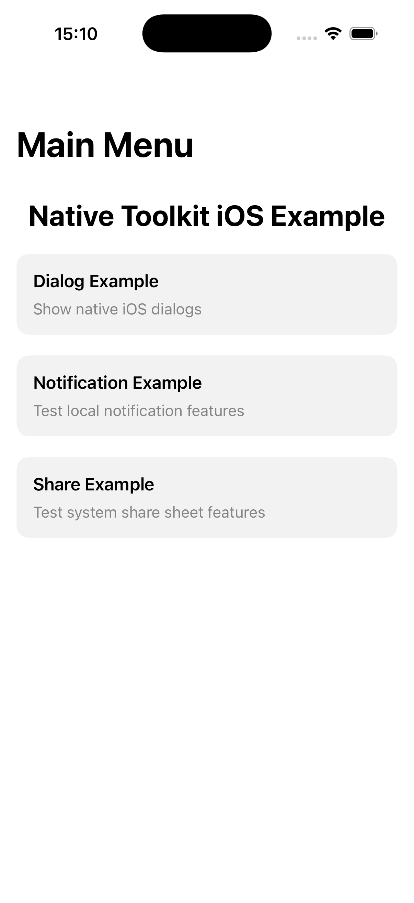
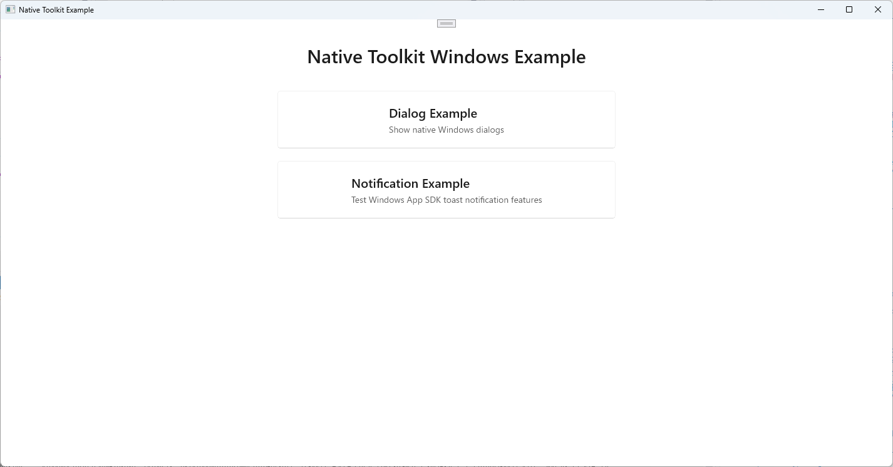
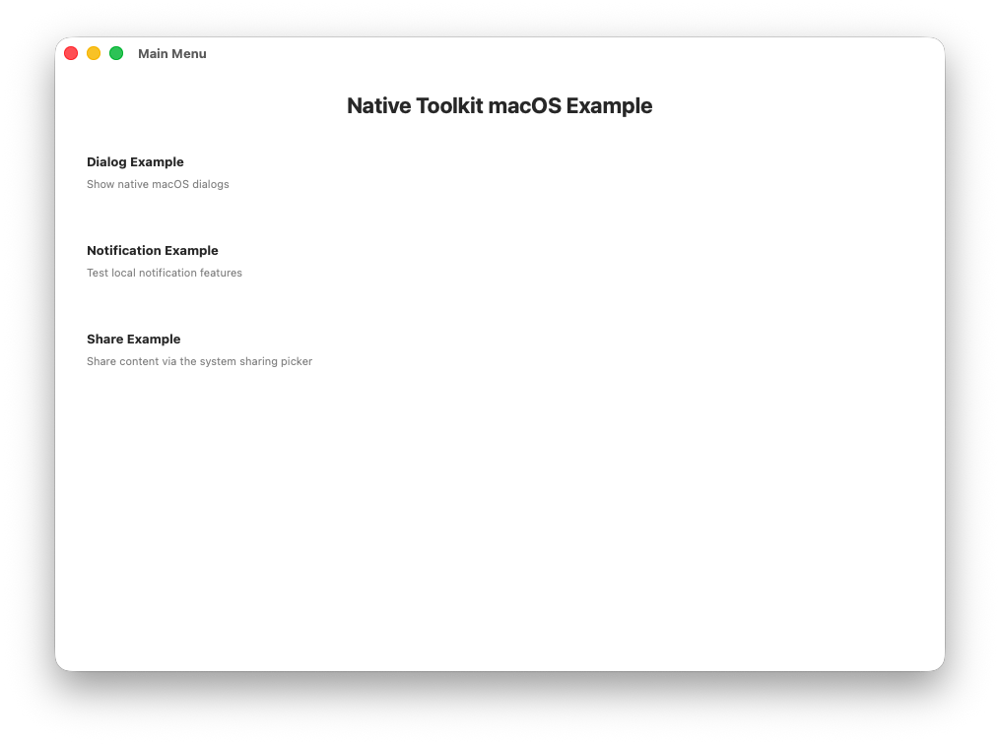

# native-toolkit Manual

Language:

- English (this page)
- Korean: [index.ko.md](index.ko.md)
- Japanese: [index.ja.md](index.ja.md)

Markdown files in this directory are published as versioned documents under `docs/<version>/manual/`.

# Purpose of this manual

- Summarize setup steps and practical operation notes that are hard to cover with generated docs alone (Dokka / DocC / Doxygen)
- Keep hand-written docs separate from generated output (`docs/`) so they are not overwritten during publish

# What you can learn on this page

- Installation / onboarding
- Platform-specific setup
  - Android (Gradle)
  - iOS (Xcode)
  - Windows (Visual Studio)
  - macOS (Xcode)
- API usage examples

# Generated documentation (API references)

- Android: `docs/<version>/android/`
- iOS: `docs/<version>/ios/`
- Windows: `docs/<version>/windows/`
- macOS: `docs/<version>/mac/`

# Artifact locations (`dist/<version>/`)

- Android (Kotlin API): `dist/1.14.0/android/android-native-toolkit-2.0.0.aar`
- Android (C ABI): `dist/1.14.0/android/android-native-toolkit-capi-2.0.0.aar`, headers in `dist/1.14.0/android/include/NativeToolkitC/`
- Android (Maven repository with both AARs, POMs and Gradle Module Metadata): `dist/1.14.0/android/m2/`
- iOS (Swift API): `dist/1.14.0/ios/ios-native-toolkit-2.0.0.xcframework`
- iOS (C ABI): `dist/1.14.0/ios/ios-native-toolkit-capi-2.0.0.xcframework`, headers also in `dist/1.14.0/ios/include/NativeToolkitC/`
- Windows (C++ API): `dist/1.14.0/windows/windows-native-toolkit-2.0.0.nupkg`
- Windows (C ABI): `dist/1.14.0/windows/windows-native-toolkit-capi-2.0.0.nupkg`
- macOS: `dist/1.14.0/mac/mac-native-toolkit-1.3.0.xcframework`

# Native Toolkit

- native-toolkit is a toolkit for using native platform features in a unified way.
- The package includes native plugins and samples for Android / iOS / Windows / macOS, and native platform features are available through singleton APIs.

# Version

## 1.14.0

- The iOS library is 2.0.0: Swift 6 concurrency annotations, new error cases, a notification delegate installed at launch, notification events, request cancellation and a C ABI. See [Migrating the iOS library to 2.0.0](#migrating-the-ios-library-to-200).

## 1.13.0

- The Android library is 2.0.0: new package names, per-feature managers and a C ABI. See [Migrating the Android library to 2.0.0](#migrating-the-android-library-to-200).

# Supported OS versions

- Android 12+
- iOS 18+
- Windows 11+
- macOS 15+

# Feature list

## Android

- Dialog features
  - Basic dialog
  - Confirmation dialog
  - Single-choice dialog
  - Multi-choice dialog
  - Text input dialog
  - Login dialog
  - Waiting for the result with a coroutine
  - Canceling a dialog
- Notification features
  - Notification permission (check, request, cancel a request, open the settings)
  - Show / update / cancel notifications
  - Manage notification channels
  - Interaction events (taps, actions, dismissals)
  - Progress notifications
  - Foreground service notifications
  - Schedule notifications
- Share features
  - Text / URL share
  - Image share
  - File share
  - Rich preview
  - Custom Chooser Actions (Android 14+)
  - Direct Share Target
  - Share with callback
  - Selection event (which app was chosen)
  - Receive incoming shares
- Clipboard features
  - Copy (plain text, HTML, URI, multiple text)
  - Sensitive content copy (preview suppression, Android 13+)
  - Read / has clip / metadata inspection
  - Clear
  - Clipboard change observation

The Android features above are also available from C, C++ and other languages (C#, Rust, Dart and so on) through the C ABI (`ntk_*` functions in `libntk.so`), except receiving incoming shares, which is the app's own Activity work. Each feature page lists the C functions; see also [C ABI](#c-abi) under Library integration.

## iOS

- Dialog features
  - Basic dialog
  - Confirmation dialog
  - Destructive dialog
  - Action sheet
  - Text input dialog
  - Login dialog
  - One request, one result (`DialogRequest`, async)
  - Choosing the view controller (presenter)
  - Canceling a dialog
- Notification features
  - Delegate installed at launch, forwarding to the previous delegate
  - Permission (check, request, authorization status, open the settings)
  - Show / update / cancel / remove notifications
  - Scheduled notifications (time interval, calendar, location)
  - Notifications with attachment
  - Badge
  - Categories and actions
  - Notification events (taps, actions, text input, the Settings app's link) and the launch notification
- Share features
  - Text / URL share
  - Rich preview
  - Image / file share (single and multiple)
  - Combined content (subject, exclude activity types)
  - Presenter and result (how the sheet was closed)
- Clipboard features
  - Copy (plain text, HTML, URL, image file / data, color, custom data, multiple text, multiple representations)
  - Copy options (localOnly, expiration date)
  - Append
  - Read / data read / metadata snapshot
  - Named and unique pasteboard lifecycle
  - Asynchronous item loading (text / URL / image / file), and canceling one load
  - Pattern detection (11 patterns)
  - Clipboard change observation
  - System paste button (UIPasteControl)

The iOS features above are also available from C, C++, Objective-C and other languages through the C ABI (`ntk_*` functions in `ios-native-toolkit-capi-2.0.0.xcframework`), except the system paste button, canceling all clipboard loads at once, custom clipboard timeouts and limits, choosing the view controller (the C ABI uses the foreground one), the foreground presentation options of notifications, the provisional notification authorization, calendar triggers with date components other than year, month, day, hour, minute and second, and the `userInfo` of listed notifications. Each feature page lists the C functions; see also [C ABI](#c-abi-1) under Library integration.

## Windows

- Dialog features
  - Basic dialog
  - File picker dialog
  - Multi-file picker dialog
  - Folder picker dialog
  - Multi-folder picker dialog
  - Save file dialog
- Notification features
  - Show / update / cancel notifications
  - Scheduled notifications
  - Progress notifications
  - Badge (packaged apps)
  - Action buttons and text input

- Clipboard features
  - Copy (text, HTML, files, image, custom format, multiple formats at once)
  - Write options (exclude from history, exclude from roaming, sensitive)
  - Paste (text, HTML, files, image, custom format)
  - Format inspection (has format, format list, preferred format)
  - Clear
  - Clipboard change observation
  - Delayed rendering (reserve formats, render on demand)
  - Clipboard history (availability, list, restore, delete, clear unpinned, cancel)

## Mac

- Dialog features
  - Basic dialog
  - File picker dialog
  - Multi-file picker dialog
  - Folder picker dialog
  - Multi-folder picker dialog
  - Save file dialog
- Notification features
  - Permission
  - Show / update / cancel notifications
  - Scheduled notifications
  - Badge
  - Categories and actions
- Share features
  - Text / URL / image / file share via the picker (single and multiple items)
  - Exclude services from the picker
  - Direct service execution (recipients, subject)
  - Check whether a service can perform
- Clipboard features
  - Copy (text, URL, image, multiple items, multiple representations)
  - Copy options (localOnly, on by default)
  - Append
  - Read / data read / snapshot with a type filter
  - Named and unique pasteboard lifecycle
  - Detection (patterns, values, metadata; macOS 15.4+)
  - Clipboard change observation
  - System paste button (PasteButton)
  - Clear

## Samples

- Android sample
  - Install Android Studio.
    - <a href="https://developer.android.com/studio" target="_blank" rel="noopener noreferrer">Reference site</a>
  - Launch Android Studio.
  - Select "File" → "Open...".
  - Select `native-toolkit/android/AndroidLibraryExample` and click "Open".
  - Connect an Android device.
  - Click "Run" to install the sample app.
    <p align="center">
        
    </p>

- iOS sample
  - Install Xcode.
    - <a href="https://developer.apple.com/xcode" target="_blank" rel="noopener noreferrer">Reference site</a>
  - Launch Xcode.
  - Select "Open Existing Project...".
  - Select `native-toolkit/ios/IosWorkspace.xcworkspace` and click "Open".
  - Click "Run" to install the sample app.
    <p align="center">
        
    </p>

- Windows sample
  - Install Visual Studio 2022.
    - <a href="https://visualstudio.microsoft.com/vs/" target="_blank" rel="noopener noreferrer">Reference site</a>
  - Launch Visual Studio 2022.
  - Select "Open a project or solution".
  - Select `native-toolkit\windows\WindowsLibraryExample\WindowsLibraryExample.sln` and click "Open".
  - Select "Debug" → "Start Debugging" to install the sample app.
    <p align="center">
        
    </p>

- Mac sample
  - Install Xcode.
    - <a href="https://developer.apple.com/xcode" target="_blank" rel="noopener noreferrer">Reference site</a>
  - Launch Xcode.
  - Select "Open Existing Project...".
  - Select `native-toolkit/mac/MacWorkspace.xcworkspace` and click "Open".
  - Click "Run" to install the sample app.
    <p align="center">
        
    </p>

## Library integration

### Android

#### Supported platform: Android 12 (API 31) and later

The Android library ships as two AARs:

| AAR | For | Contents |
|---|---|---|
| `android-native-toolkit-2.0.0.aar` | Kotlin and Java callers | The Kotlin API (`com.jonghyunkim.nativetoolkit.*`) |
| `android-native-toolkit-capi-2.0.0.aar` | C, C++ and other languages | The C ABI: `libntk.so` (`arm64-v8a`, `x86_64`), its headers through Prefab, and the Kotlin side it calls. It depends on the Kotlin API AAR |

Requirements:

- `minSdk` 31 or later and `compileSdk` 36 or later
- Android Gradle Plugin 8.9.1 or later (the AndroidX dependencies require it)
- Kotlin 2.1 or later if your app is written in Kotlin (the library needs `kotlin-stdlib` 2.2 or later at run time, which Gradle resolves)

##### Option A: the Maven repository (recommended)

`dist/1.14.0/android/m2/` is a Maven repository with both AARs and their dependency information, so Gradle resolves the AndroidX and Kotlin libraries the AARs need.

1. Copy `dist/1.14.0/android/m2/` into your project, for example as `third_party/native-toolkit-m2/`.
2. Add it as a repository in `settings.gradle.kts`.
3. Add the dependency in `app/build.gradle.kts`.
4. Run Gradle sync and build.

**settings.gradle.kts:**

```kotlin
dependencyResolutionManagement {
    repositoriesMode.set(RepositoriesMode.FAIL_ON_PROJECT_REPOS)
    repositories {
        google()
        mavenCentral()
        maven { url = uri("third_party/native-toolkit-m2") }
    }
}
```

**app/build.gradle.kts:**

```kotlin
dependencies {
    // The Kotlin API.
    implementation("io.github.kimjh4941:android-native-toolkit:2.0.0")
    // The C ABI, if you call the library from C or another language. It needs the Kotlin API at run
    // time and brings it as a runtime dependency; keep the line above if your own Kotlin or Java code
    // calls the Kotlin API too.
    implementation("io.github.kimjh4941:android-native-toolkit-capi:2.0.0")
}
```

##### Option B: the AAR files

If you place the AAR files yourself, Gradle does not know what they depend on, so add the dependencies below as well.

1. Place `android-native-toolkit-2.0.0.aar` (and `android-native-toolkit-capi-2.0.0.aar` for the C ABI) in `app/libs`.
2. Add the AARs and the dependencies in `app/build.gradle.kts`.

**app/build.gradle.kts:**

```kotlin
dependencies {
    implementation(files("libs/android-native-toolkit-2.0.0.aar"))
    implementation(files("libs/android-native-toolkit-capi-2.0.0.aar")) // C ABI only

    // What the AARs need at run time.
    implementation("org.jetbrains.kotlin:kotlin-stdlib:2.2.21")
    implementation("org.jetbrains.kotlin:kotlin-parcelize-runtime:2.2.21")
    implementation("androidx.core:core-ktx:1.18.0")
    implementation("androidx.fragment:fragment:1.9.1")
    implementation("androidx.media:media:1.8.0")
    implementation("androidx.startup:startup-runtime:1.2.0")
    implementation("org.jetbrains.kotlinx:kotlinx-coroutines-core:1.9.0")
}
```

<!-- ntk-android-dependencies: the list above is checked against the Gradle Module Metadata of the release by scripts/check_android_dist.py -->

##### Initialization

The library initializes itself when the app starts, through AndroidX App Startup (`androidx.startup.InitializationProvider`, which the AARs add to the merged manifest). Nothing has to be called.

Initialize it yourself before the first call when App Startup does not run first:

- your app disables App Startup (or removes the library's initializer from the merged manifest);
- you call the library from a process other than the app's default one (App Startup runs in the default process only);
- you call it from your own `ContentProvider`, which may be created before App Startup's.

How:

- Kotlin API: `LibraryRuntime.ensureInitialized(activity)` (`com.jonghyunkim.nativetoolkit.common.runtime`), from the first Activity's `onCreate`, passing that Activity. The library tracks the foreground Activity from then on; given only the application context, it misses the Activity already on screen, and dialogs and the permission request complete with "not in the foreground" until the next Activity starts
- C ABI: `ntk_android_init(env, activity)` from C, or `NativeToolkitCApi.init(activity)` from Kotlin. Pass the current Activity if there is one, so that dialogs and other foreground features can find it. Neither waits: `ntk_android_init` may return `NTK_ANDROID_ERROR_IN_PROGRESS` (another thread is initializing) or `NTK_ANDROID_ERROR_JNI_FAILURE`, and `NativeToolkitCApi.init` `IN_PROGRESS` or `RETRYABLE_ERROR`; call it again later. `ntk_android_is_initialized()` tells whether the C ABI is ready

##### Permissions and components added to your app

The Kotlin API AAR declares the permissions its notification features use, and they are merged into your app's manifest. Remove the ones you do not need with `tools:node="remove"`:

| Permission | What stops working without it | Also remove |
|---|---|---|
| `POST_NOTIFICATIONS` | Notifications are not shown on Android 13 and later; `hasPermission` is false and a permission request is denied at once | - |
| `RECEIVE_BOOT_COMPLETED` | Scheduled notifications are not restored after a reboot | - |
| `SCHEDULE_EXACT_ALARM` | Schedules use inexact alarms (`canScheduleExactAlarms` is false) | - |
| `USE_FULL_SCREEN_INTENT` | Full-screen intents show as heads-up notifications | - |
| `FOREGROUND_SERVICE` | Progress and call-style notifications cannot start their foreground services | Both services below, and do not call those APIs |
| `FOREGROUND_SERVICE_DATA_SYNC` | Progress notifications cannot start their foreground service | `com.jonghyunkim.nativetoolkit.notification.presentation.progress.ProgressForegroundService` |
| `FOREGROUND_SERVICE_SPECIAL_USE` | Call-style notifications cannot start their foreground service | `com.jonghyunkim.nativetoolkit.notification.presentation.call.CallStyleForegroundService` |

**AndroidManifest.xml (your app):**

```xml
<manifest xmlns:android="http://schemas.android.com/apk/res/android"
    xmlns:tools="http://schemas.android.com/tools">

    <uses-permission android:name="android.permission.FOREGROUND_SERVICE_DATA_SYNC" tools:node="remove" />

    <application>
        <service
            android:name="com.jonghyunkim.nativetoolkit.notification.presentation.progress.ProgressForegroundService"
            tools:node="remove" />
    </application>
</manifest>
```

##### C ABI

The C ABI is for apps that call the library from C, C++ or another language. A Kotlin or Java app calls the Kotlin API directly; going through the C ABI would only add a round trip through JNI.

- The app is an ordinary Android app with Kotlin or Java code (`android:hasCode="true"`): the C functions call the Kotlin API through JNI, and the AAR's Kotlin classes and manifest entries must be in the app. Copying `libntk.so` alone does not work
- `libntk.so` is built for `arm64-v8a` and `x86_64` only. On a 32-bit device, or in an app built only for 32-bit ABIs, the library is not there: the app still starts, but loading `libntk.so` fails (for example `DllNotFoundException` in C#). Handle that, or build your app for 64-bit ABIs only. If a module that depends on the C ABI AAR has Prefab enabled and builds native code for a 32-bit ABI, the build itself stops with `CXX1210` (see below), even when that code does not use `ntk::ntk`.
- Completions, events and the `release` of an accepted call come on the Android main thread, which is not your thread. A runtime that can only take callbacks on the thread that registered them cannot use the C ABI as is. (A call rejected at the entry returns its error and calls `release` on the calling thread before it returns; it never completes)
- Dialogs, Share, the settings screens and a notification permission request that has not been granted yet need the app in the foreground; called from the background they complete with `NOT_FOREGROUND`

For C and C++ with CMake, the AAR provides the headers and `libntk.so` through Prefab:

**app/build.gradle.kts:**

```kotlin
android {
    buildFeatures { prefab = true }
    defaultConfig {
        ndk { abiFilters += listOf("arm64-v8a", "x86_64") }
        externalNativeBuild {
            cmake { abiFilters("arm64-v8a", "x86_64") }
        }
    }
}
```

**CMakeLists.txt:**

```cmake
find_package(ntk REQUIRED CONFIG)
target_link_libraries(your_library PRIVATE ntk::ntk)
```

Limit the CMake build that uses `ntk::ntk` to the 64-bit ABIs as above. Prefab has no `libntk.so` for 32-bit ABIs, and the Android Gradle Plugin checks the Prefab package for every ABI the CMake build targets and stops with `CXX1210`; an `if()` in `CMakeLists.txt` does not avoid that. If your app also ships 32-bit native code of its own, build it in a separate module that does not use Prefab.

Other languages load `libntk.so` by name (`ntk`) after the app has started. Each feature page's Android section has a C ABI part with the functions, the threads and the errors.

The C ABI ships an R8 rule in its AAR, so minified release builds need nothing more. If your app disables App Startup and calls `NativeToolkitCApi.init` by reflection or from another runtime, keep that class. `NativeToolkitCApi` is a Kotlin `object` and `init` is not static: call it on the `INSTANCE` field (from Java, `NativeToolkitCApi.INSTANCE.init(activity)`).

```
-keep class com.jonghyunkim.nativetoolkit.capi.NativeToolkitCApi { *; }
-keep class com.jonghyunkim.nativetoolkit.capi.NativeToolkitCApi$InitResult { *; }
```

##### Migrating the Android library to 2.0.0

2.0.0 is not compatible with 1.x. Code written against 1.x has to change:

| 1.x | 2.0.0 |
|---|---|
| Packages `android.library.*` | Packages `com.jonghyunkim.nativetoolkit.*` |
| Use cases and helpers per feature | One manager per feature: `AndroidDialogManager`, `AndroidNotificationManager`, `AndroidShareManager`, `AndroidClipboardManager` (`getInstance(context)`) |
| Notifications scheduled with 1.x | **Discarded once** when the app first runs 2.0.0 (the storage format changed). Schedule them again |
| Notifications shown by 1.x and still on screen | They no longer respond to taps or actions after the update (the receivers have new names). Show them again if needed |
| A `FileProvider` declared for sharing, as the 1.x manual told | **Remove it.** The library declares its own (authority `${applicationId}.native_toolkit.share.fileprovider`). Declaring `androidx.core.content.FileProvider` again in your manifest conflicts with it in the manifest merge; a provider of your own has to be a subclass of `FileProvider` |
| The library added nothing at app start | It adds AndroidX App Startup (`InitializationProvider`) and initializes itself (see Initialization above) |
| One AAR file | The Kotlin API AAR as before (Kotlin and Java apps need only this one), plus the C ABI AAR for C and other languages, and a Maven repository with both (see Option A and Option B above) |

The per-operation changes are in each feature page's Android section.

### iOS

#### Supported platform: iOS (Device: arm64 / Simulator: arm64, x86_64)

The iOS library ships as two XCFrameworks:

| XCFramework | For | Contents |
|---|---|---|
| `ios-native-toolkit-2.0.0.xcframework` | Swift callers | The Swift API (`IosLibrary.framework`, module `IosLibrary`) and its privacy manifest |
| `ios-native-toolkit-capi-2.0.0.xcframework` | C, C++, Objective-C and other languages | The C ABI (`IosLibraryCApi.framework`, headers `NativeToolkitC/`). It calls the Swift API and depends on the XCFramework above: embed both |

`dist/1.14.0/ios/include/NativeToolkitC/` holds the same headers as the C ABI XCFramework, for tools that generate bindings from headers.

Requirements:

- The app's minimum deployment target is iOS 18.0 or later
- Xcode 26.3 or later when the app uses the Swift API (Xcode reads the library's Swift interface). An app that uses only the C ABI can be built with any Xcode 26
- The library runs inside a UIKit app. App extensions and command-line tools are not supported
- Both frameworks are dynamic and unsigned. With **Embed & Sign**, Xcode signs them with your app's certificate

Steps:

1. Copy `ios-native-toolkit-2.0.0.xcframework` to the `Frameworks` folder (create it if needed) under your Xcode project. For the C ABI, copy `ios-native-toolkit-capi-2.0.0.xcframework` there too.
2. Open the target project in Xcode 26.3 or later (any Xcode 26 for an app that uses only the C ABI) and select your app target in **Project Navigator**.
3. Open the **General** tab and click **+** in **Frameworks, Libraries, and Embedded Content**.
4. Select **Add Other...** → **Add Files...** and add the XCFramework (or both XCFrameworks) from `Frameworks/`.
5. Set the embed option of each XCFramework to **Embed & Sign**. Xcode finds the frameworks and headers of an XCFramework added here by itself: `Framework Search Paths` does not need an entry.
6. Verify that Team is correctly configured in **Signing & Capabilities**.
7. Run **Product** → **Clean Build Folder**, then build and run with **Run**.
8. Integration is complete if the app launches without errors.

##### Privacy manifest

`IosLibrary.framework` carries a privacy manifest (`PrivacyInfo.xcprivacy`). It declares the file timestamp API with reason `C617.1` and no collected data or tracking. Xcode merges it into your app's privacy report when you archive.

##### Notification delegate

Notification events (taps, actions, text input, the Settings app's link) and notifications shown while the app is in the foreground need the library's `UNUserNotificationCenter` delegate. Install it on the main thread before launch ends, in `application(_:didFinishLaunchingWithOptions:)` (a SwiftUI app can do it in `App.init`):

- Swift API: `IosNotificationManager.installDelegate()`
- C ABI: `ntk_notification_install()`, from your app's native code. A runtime that starts its own code after launch (a game engine's scripts, a Dart isolate) is too late: a tap that launched the app would be lost

The library keeps the delegate that was set before and forwards to it: a notification the library did not create goes to that delegate when it implements the method. Do not set another `UNUserNotificationCenter` delegate afterwards, or the library stops receiving events. See the iOS section of [Notification](notification.md).

##### C ABI

The C ABI is for apps that call the library from C, C++, Objective-C or another language. A Swift app calls the Swift API directly.

- Include the headers from the framework, `#include <IosLibraryCApi/NativeToolkitC/Notification.h>`, or put `dist/1.14.0/ios/include` on the header search path and write `#include <NativeToolkitC/Notification.h>`. Objective-C with modules enabled can write `@import IosLibraryCApi;`
- Every function may be called from any thread, except `ntk_notification_install` (main thread only), and none waits for the main thread. Completions, events and the `release` of an accepted call come asynchronously on the main queue, which may not be a thread your runtime created: in Dart use `NativeCallable.listener`, not `NativeCallable.isolateLocal`. (A call rejected at the entry returns its error and calls `release` on the calling thread before it returns)
- Dialogs, Share, the notification settings screen and a notification permission request that has not been answered yet need a scene in the foreground; called while the app is in the background they complete with `NOT_FOREGROUND`. On an iPad that shows several windows of the app side by side, which window they appear on is not decided; the Swift API takes a presenter for that
- Reading what another app put on the clipboard (`ntk_clipboard_read_async`, `ntk_clipboard_read_data_async`) can make iOS ask the user for permission to paste, and the app's main thread stops until the user answers. To keep the main thread running, use `ntk_clipboard_load_item_async`, which does not stop it and can be canceled with `ntk_clipboard_cancel_load`
- Strings are NUL-terminated UTF-8. `ntk_last_system_code()` is always 0 on iOS

Each feature page's iOS section has a C ABI part with the functions, the threads and the errors.

##### Migrating the iOS library to 2.0.0

2.0.0 is not source compatible with 1.x. The module name stays `IosLibrary`, so `import IosLibrary` does not change. Code written against 1.x has to change where it uses the following:

| 1.x | 2.0.0 |
|---|---|
| Framework bundle id `ios.library.IosLibrary` | `com.jonghyunkim.nativetoolkit.IosLibrary` |
| Completion handlers without isolation | The completions of Dialog, Share and Notification, and the button callbacks and `textFields` of dialogs, are `@MainActor @Sendable` and come on the main thread. `NotificationActionHandler` and `NotificationTextInputActionHandler` are `@Sendable`. The Clipboard completions do not change. The library is built in the Swift 6 language mode |
| `ShareRepository` and `NotificationRepository` of your own | Both protocols require `Sendable`. `ShareRepository.present(content:)` becomes `present(content:presenter:)`, and `NotificationRepository.openNotificationSettings()` becomes `async -> Bool`: an implementation of the 1.x signatures no longer compiles. `NotificationRepository` adds `enqueueCategoryChange(_:completion:)`, with a default implementation |
| `NotificationRepositoryImpl(center:)` | `NotificationRepositoryImpl()` (the only value it took was `.current()`) |
| `IosDialogManager.getRootViewController()` callable from any context | It is `@MainActor`: a synchronous nonisolated context cannot call it |
| `content` of `show`, `update` and `schedule` of notifications | The parameter is `sending`. In the Swift 6 language mode (or with complete concurrency checking), content that is still used after the call does not compile; build a new `NotificationContent` per call |
| `NotificationError` and `ShareError` cases that carry any `Error` | Cases with a `FailureDetail`, some cases removed and some added. An exhaustive `switch` over them no longer compiles. Dialogs report `DialogError` |
| `IosNotificationManager.setup()` | `IosNotificationManager.installDelegate()` before launch ends (see Notification delegate above). `setup()` is deprecated |
| `onActionReceived`, `onTextInputActionReceived` | `IosNotificationManager.shared.responses.addListener`, with several listeners and events kept until one registers. `launchResponse()` returns the notification that launched the app. The two properties are deprecated |
| `IosNotificationManager` conforms to `UNUserNotificationCenterDelegate` | It does not; the library's delegate is internal |
| `userNotificationCenter(_:openSettingsFor:)` (the Settings app's link to your app's notification settings) opened the Settings app | The library does not open anything; the request reaches `IosNotificationManager.shared.settingsRequests` as an event, and your app shows its own settings screen |
| Calls without a completion from an `async` context | `async` versions with the same names now exist, so such calls need `await` (and `try`) |
| Any `userInfo` value | Values must be property-list types (`NSNull` and `NSURL` are rejected). The key `com.jonghyunkim.nativetoolkit` is reserved: the library adds it to its notifications and removes it from the `userInfo` it returns |
| Registering a category with an identifier already registered could keep both | The new category replaces the old one |
| `Log` | Deprecated. The library logs through `os.Logger` and keeps secret values private |
| `NotificationPermissionHelper`, `NotificationCategoryOptions.allowAnnouncement` | Deprecated. In place of `NotificationPermissionHelper`, use `IosNotificationManager.requestPermission(options:presenter:)`. `allowAnnouncement` has no effect (iOS ignores it since iOS 15) |
| `errorMessage` of notification operations, of a dialog or a share sheet that fails to show, and of a failed share activity | A fixed English text, for example `"Notification permission was denied."`. Branch on the error case or the error code, not on the text |
| Swift API only | A C ABI in a second XCFramework (see C ABI above) |

Notifications scheduled or shown by 1.x, and the categories it registered, stay after the update: they are listed and can be canceled or removed by identifier, and their taps and actions reach the library's listener when no previous delegate handles them.

New in 2.0.0: a presenter argument for dialogs, Share, the notification permission request and the notification settings screen; a request box to cancel a dialog or an asynchronous clipboard load; `IosDialogManager.show(_:)` with a `DialogRequest`. The per-operation changes are in each feature page's iOS section.

### Windows

#### Supported platform: Windows x64 (win-x64)

The Windows library ships as two NuGet packages over one implementation. Install the one that matches how you call it; installing both is fine.

| Package | For | Contents |
|---|---|---|
| `NativeToolkit` | C++ callers | The C++ API headers (`NativeToolkit/`) and the static library |
| `NativeToolkit.CApi` | C callers, and other languages | The C ABI headers (`NativeToolkitC/`), `NativeToolkitC.dll` and its import library |

`NativeToolkit` is a static library built with MSVC v143, `/std:c++20` and the DLL runtime (`/MD`, `/MDd`), x64 only; a project that differs in those settings fails the link with LNK2038. `NativeToolkit.CApi` carries no such requirement, because its headers are plain C99.

Both declare `Microsoft.WindowsAppSDK` as a dependency, which NuGet restores with them. An app without package identity also needs `Microsoft.WindowsAppRuntime.Bootstrap.dll` next to its executable.

1. Copy `windows-native-toolkit-2.0.0.nupkg` and `windows-native-toolkit-capi-2.0.0.nupkg` to `C:\packages`.
2. Launch Visual Studio 2022 and open **Tools** → **Options** → **NuGet Package Manager** → **Package Sources**.
3. Click **+** and enter:
   - Name: LocalPackages
   - Source: C:\packages
     Then click **Update** to save.
4. Open your target solution.
5. In **Solution Explorer**, right-click your project and select **Manage NuGet Packages**.
6. Change **Package source** to **LocalPackages**.
7. Search for **NativeToolkit** or **NativeToolkit.CApi** and click **Install**.
8. If a license prompt appears, accept it to complete installation.

#### Migrating from 1.x

1.x shipped one package whose only API was the C ABI (`showAlertDialog`, `initNotificationManager`, `initClipboardManager` and so on). 2.0.0 replaces it: every function has a new name and a new signature, so nothing written against 1.x still compiles.

| 1.x | 2.0.0 |
|---|---|
| `<common.h>`, `<WindowsDialogManager.h>`, `<WindowsNotificationManager.h>`, `<WindowsClipboardManager.h>` | `<NativeToolkit/Dialog.h>` and friends, or `<NativeToolkitC/Dialog.h>` and friends |
| JSON payload strings | Typed structs (C++) or a content builder (C ABI) |
| `wchar_t*` buffers, sized by calling twice | Values returned by the call (C++), or handles freed with their `_free` (C ABI) |
| `DWORD* pError` | `Result<T>` (C++), or the return value plus `ntk_last_system_code()` (C ABI) |
| Free functions with process-wide state | `Clipboard::Session` and `Notification::Manager`, whose lifetimes are explicit |

The per-operation mapping is in each feature page's Windows section. A project that cannot move yet can stay on the 1.11.0 release, whose Windows package still holds the 1.x C ABI.

### macOS

#### Supported platform: macOS arm64, x86_64

1. Copy `mac-native-toolkit-1.3.0.xcframework` to the `Frameworks` folder (create it if needed) under your Xcode project.
2. Open the target project in Xcode 26.2 and select your app target in Project Navigator.
3. Open the **General** tab and click `+` in **Frameworks, Libraries, and Embedded Content**.
4. Select "Add Other..." → "Add Files..." and add `Frameworks/mac-native-toolkit-1.3.0.xcframework`.
5. Set the embed option of `mac-native-toolkit-1.3.0.xcframework` to **Embed & Sign**.
6. Open **Build Settings** of the same target and add `$(PROJECT_DIR)/Frameworks` to `Framework Search Paths`. (Usually non-recursive)
7. Verify that Team is correctly configured in **Signing & Capabilities**.
8. Run **Product** → **Clean Build Folder**, then build and run with **Run**.
9. Integration is complete if the app launches without errors.

# API usage

- [Dialog](dialog.md)
- [Notification](notification.md)
- [Share](share.md)
- [Clipboard](clipboard.md)
