# Share 機能

Language:

- 日本語（このページ）
- English: [share.md](share.md)
- 한국어: [share.ko.md](share.ko.md)

← [マニュアルトップへ戻る](index.ja.md)

---

## 目次

- [Android](#android)
  - [AndroidShareManager](#androidsharemanager)
  - [セットアップ](#セットアップ)
    - [ライブラリの追加](#ライブラリの追加)
    - [FileProvider](#fileprovider)
    - [スレッドとイベント](#スレッドとイベント)
  - [テキスト共有](#テキスト共有)
    - [テキストを共有](#テキストを共有)
    - [URL を共有](#url-を共有)
    - [リッチプレビュー付きテキスト共有](#リッチプレビュー付きテキスト共有)
    - [カスタムチューザーアクション付きテキスト共有](#カスタムチューザーアクション付きテキスト共有)
    - [チューザーアクションのイベント](#チューザーアクションのイベント)
    - [不正なアクション付きテキスト共有](#不正なアクション付きテキスト共有)
    - [件名・タイトル付き共有](#件名タイトル付き共有)
  - [画像共有](#画像共有)
  - [複数画像の共有](#複数画像の共有)
  - [ファイル共有](#ファイル共有)
  - [複数ファイルの共有](#複数ファイルの共有)
  - [Direct Share Target](#direct-share-target)
    - [Direct Share Target を登録](#direct-share-target-を登録)
    - [Direct Share Target を削除](#direct-share-target-を削除)
  - [コールバック付き共有](#コールバック付き共有)
    - [基本コールバック](#基本コールバック)
    - [リッチプレビュー付きコールバック](#リッチプレビュー付きコールバック)
    - [保留中のコールバックをキャンセル](#保留中のコールバックをキャンセル)
  - [選択イベント](#選択イベント)
    - [選択イベント付き共有](#選択イベント付き共有)
    - [共有の選択待ちをキャンセル](#共有の選択待ちをキャンセル)
  - [受信した共有コンテンツの処理](#受信した共有コンテンツの処理)
  - [エラー処理](#エラー処理)
  - [C ABI](#c-abi)
    - [ビルド](#ビルド)
    - [Sharesheet を開く](#sharesheet-を開く)
    - [選択とチューザーアクションのイベント](#選択とチューザーアクションのイベント)
    - [Direct Share Target の登録と削除](#direct-share-target-の登録と削除)
    - [エラー値](#エラー値)
- [iOS](#ios)
  - [IosShareManager](#iossharemanager)
  - [セットアップ](#セットアップ-1)
    - [ライブラリの追加](#ライブラリの追加-1)
    - [スレッドと表示](#スレッドと表示)
  - [テキスト共有](#テキスト共有-1)
    - [テキストを共有](#テキストを共有-1)
  - [URL 共有](#url-共有)
    - [URL を共有](#url-を共有-1)
    - [プレビュー付き URL 共有](#プレビュー付き-url-共有)
  - [画像共有](#画像共有-1)
    - [画像を共有](#画像を共有)
    - [複数画像を共有](#複数画像を共有)
  - [ファイル共有](#ファイル共有-1)
    - [ファイルを共有](#ファイルを共有)
    - [複数ファイルを共有](#複数ファイルを共有)
  - [組み合わせコンテンツ](#組み合わせコンテンツ)
    - [複数アイテムを共有](#複数アイテムを共有)
    - [件名付き共有](#件名付き共有)
    - [アクティビティタイプの除外](#アクティビティタイプの除外)
  - [エラー処理](#エラー処理-1)
  - [表示元と結果](#表示元と結果)
    - [フォアグラウンドから共有](#フォアグラウンドから共有)
    - [結果のコールバック](#結果のコールバック)
    - [同じターンでの 2 つの共有](#同じターンでの-2-つの共有)
  - [C ABI](#c-abi-1)
    - [ビルド](#ビルド-1)
    - [コンテンツの共有](#コンテンツの共有)
    - [共有シートは一度に 1 つ](#共有シートは一度に-1-つ)
    - [エラー値](#エラー値-1)
- [macOS](#macos)
  - [MacShareManager](#macsharemanager)
  - [セットアップ](#セットアップ-2)
  - [ピッカー - 基本](#ピッカー---基本)
    - [テキストを共有](#テキストを共有-2)
    - [URL を共有](#url-を共有-2)
    - [画像を共有](#画像を共有-1)
    - [ファイルを共有](#ファイルを共有-1)
  - [ピッカー - 複数アイテム](#ピッカー---複数アイテム)
    - [複数画像を共有](#複数画像を共有-1)
    - [複数ファイルを共有](#複数ファイルを共有-1)
    - [テキストと URL を共有](#テキストと-url-を共有)
  - [ピッカー - フィルタ](#ピッカー---フィルタ)
    - [特定サービスを除外して共有](#特定サービスを除外して共有)
  - [個別サービスの直接実行](#個別サービスの直接実行)
    - [Mail を直接実行して共有](#mail-を直接実行して共有)
    - [サービスが実行可能か確認](#サービスが実行可能か確認)
  - [エラー処理](#エラー処理-2)

---

## Android

Android の Sharesheet です。テキスト・URL・画像・ファイルの共有、リッチプレビュー、カスタムチューザーアクション、Direct Share Target、ユーザーが選んだアプリの取得を扱います。Android ライブラリ 2.0.0 は、1 つの実装を 2 つの公開 API から提供します。サンプルアプリ（`AndroidLibraryExample`）は Kotlin の API を使用しています。

| API | 名前 | ヘッダー / パッケージ | Maven 座標 |
|---|---|---|---|
| Kotlin API | `AndroidShareManager` | `com.jonghyunkim.nativetoolkit.share` | `io.github.kimjh4941:android-native-toolkit:2.0.0` |
| C ABI | `ntk_share_*` | `<NativeToolkitC/Share.h>` | `io.github.kimjh4941:android-native-toolkit-capi:2.0.0` |

- ライブラリ: `android-native-toolkit-2.0.0.aar`（Kotlin の API）と `android-native-toolkit-capi-2.0.0.aar`（C ABI）です。
- 最小 SDK: Android 12 (API 31) です。アプリは compileSdk 36 以降でコンパイルし、ライブラリを呼ぶ Kotlin のコードには Kotlin 2.1 以降が必要です。
- カスタムチューザーアクション: Android 14 (API 34) 以上です。
- 1.x から移行する場合: [Android ライブラリを 2.0.0 へ移行する](index.ja.md#android-ライブラリを-200-へ移行する) を参照してください。

以下の節は、サンプルアプリの Share 画面の順序に沿っています。最後の [C ABI](#c-abi) では、同じ操作を C から行う方法を説明します。

---

### AndroidShareManager

`AndroidShareManager` は共有の入口です。インスタンスはプロセスに 1 つで、Application Context だけを保持します。そのため `getInstance` にはどの Context を渡しても構いません。

```kotlin
import com.jonghyunkim.nativetoolkit.share.AndroidShareManager

val shareManager = AndroidShareManager.getInstance(activity)
```

| メンバー | 説明 |
|---|---|
| `shareText(content, preview)` | テキストまたは URL を共有します |
| `shareTextWithActions(content, actions, preview)` | カスタムチューザーアクション付きでテキストを共有します |
| `shareImage(filePath, mimeType)` / `shareImages(filePaths)` | 画像を 1 つ / 複数共有します |
| `shareFile(filePath)` / `shareFiles(filePaths)` | ファイルを 1 つ / 複数共有します |
| `registerDirectShareTarget(target, iconBytes)` / `removeDirectShareTargets(ids)` | Direct Share Target を追加 / 削除します |
| `shareWithCallback(content, preview, onResult, onFinished)` / `cancelPendingCallback()` | テキストを共有し、選ばれたアプリをコールバックで通知します / 待機をやめます |
| `shareForSelection(content, preview)` / `cancelShareSelection(token)` | テキストを共有してトークンを返します。選ばれたアプリは `selections` イベントで届きます / 待機をやめます |
| `chooserActions` | `EventHub<String>`: カスタムチューザーアクションのタップを、アクション ID として通知します |
| `selections` | `EventHub<ShareSelection>`: `shareForSelection` で開いた Sharesheet で選ばれたアプリを通知します |

モデルの型（`ShareContent`、`SharePreviewOptions`、`ShareChooserAction`、`DirectShareTarget`、`ShareSelection`）は `com.jonghyunkim.nativetoolkit.share.domain.model` に、`ShareDomainError` は `com.jonghyunkim.nativetoolkit.share.domain.error` にあります。`preview` は、どこに現れても既定値が `SharePreviewOptions()`（プレビューなし）です。

---

### セットアップ

#### ライブラリの追加

リリースには `dist/1.14.0/android/m2/` に Maven リポジトリが含まれています。これをプロジェクトに、たとえば `third_party/native-toolkit-m2/` としてコピーし、リポジトリに追加します。

**settings.gradle.kts:**

```kotlin
dependencyResolutionManagement {
    repositoriesMode.set(RepositoriesMode.FAIL_ON_PROJECT_REPOS)
    repositories {
        google()
        mavenCentral()
        maven { url = uri("third_party/native-toolkit-m2") }
    }
}
```

**app/build.gradle.kts:**

```kotlin
dependencies {
    implementation("io.github.kimjh4941:android-native-toolkit:2.0.0")
}
```

リポジトリには POM と Gradle Module Metadata が含まれているため、ライブラリが依存する androidx のライブラリも Gradle が解決します。AAR ファイル単体にはこれらが含まれません。AAR ファイルを直接追加する場合は [ライブラリ組み込み方法](index.ja.md#ライブラリ組み込み方法) を参照してください。

#### FileProvider

AAR は authority が `${applicationId}.native_toolkit.share.fileprovider` の独自の `FileProvider` を宣言しており、画像・ファイル・サムネイルの共有はこれを経由します。アプリが共有のために `FileProvider` を宣言する必要はありません。対象のディレクトリは次のとおりです。

| パス要素 | ディレクトリ |
|---|---|
| `files-path` | `context.filesDir` |
| `cache-path` | `context.cacheDir` |
| `external-files-path` | `context.getExternalFilesDir(...)` |

それ以外の場所にあるファイルは、`context.externalCacheDir` も含めて `ShareDomainError.IllegalFileAccess` で失敗します。

アプリ自身のマニフェストで `androidx.core.content.FileProvider` を宣言しないでください。マニフェストのマージは provider を `android:name` で照合するため、ライブラリの宣言と衝突します。1.x のマニュアルでは共有のためにこの宣言を求めていました。2.0.0 へ移行する際はその宣言を削除してください（[Android ライブラリを 2.0.0 へ移行する](index.ja.md#android-ライブラリを-200-へ移行する) を参照）。アプリが独自の目的で provider を必要とする場合は、`FileProvider` のサブクラスを独自の authority で宣言してください。ライブラリはそれを使用しません。

#### スレッドとイベント

- 共有の操作はどのスレッドからでも呼び出せます。サンプルは `Dispatchers.IO` でファイルを用意し、メインスレッドでライブラリを呼び出しています。
- `shareWithCallback` の `onResult` と `onFinished`、および `chooserActions` と `selections` のイベントは、メインスレッドで呼ばれます。
- `addListener` と `EventHub.Registration.remove` はメインスレッド専用です。それ以外のスレッドでは `IllegalStateException` をスローします。
- `chooserActions` も `selections` もイベントを保持しません。リスナーが登録されていない間に届いたイベントは破棄されます。Sharesheet を開く前にリスナーを登録してください。
- イベントのリスナーがスローした例外は捕捉されてログに記録され、他のリスナーはそのまま実行されます。
- 共有はライブラリの androidx.startup のイニシャライザーに依存しません。Startup を無効にしたアプリは、他の機能のために Activity を渡して `LibraryRuntime.ensureInitialized(activity)` を呼び出します（[初期化](index.ja.md#初期化) を参照）。

---

### テキスト共有

#### テキストを共有

```kotlin
val shareManager = AndroidShareManager.getInstance(activity)

try {
    shareManager.shareText(
        ShareContent(text = "Hello from native-toolkit")
    )
} catch (e: ShareDomainError) {
    // エラー処理を参照
}
```

<p align="center">
    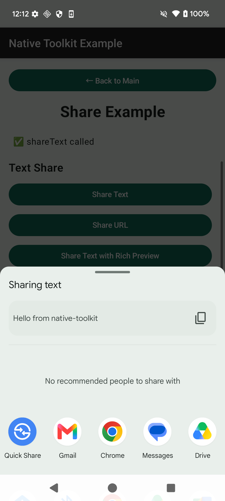
</p>

#### URL を共有

```kotlin
shareManager.shareText(
    ShareContent(text = "https://developer.android.com/", mimeType = "text/plain")
)
```

<p align="center">
    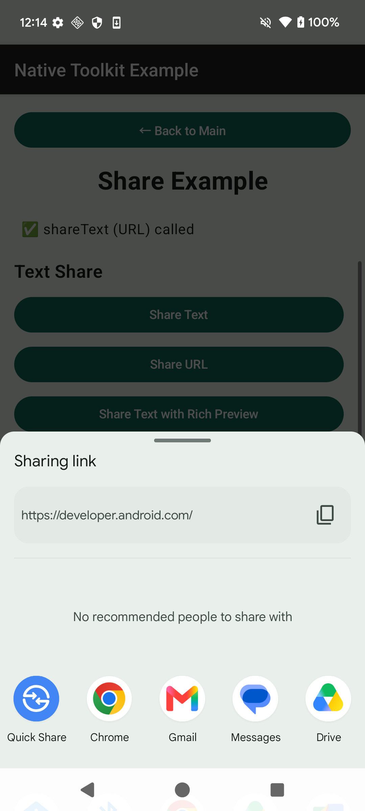
</p>

#### リッチプレビュー付きテキスト共有

`SharePreviewOptions` は Sharesheet のプレビューにタイトルとサムネイルを加えます。サムネイルは [FileProvider](#fileprovider) のディレクトリのいずれかにあるファイルでなければなりません。存在しない、またはディレクトリ外のサムネイルは logcat に警告を出して省かれ、テキストはそのまま共有されます。

```kotlin
val bmp = BitmapFactory.decodeResource(context.resources, android.R.mipmap.sym_def_app_icon)
val file = File(context.cacheDir, "share_preview.png")
file.outputStream().use { bmp.compress(Bitmap.CompressFormat.PNG, 100, it) }

shareManager.shareText(
    ShareContent(
        text = "https://developer.android.com/",
        mimeType = "text/plain"
    ),
    SharePreviewOptions(
        title = "Introducing content previews",
        thumbnailPath = file.absolutePath
    )
)
```

<p align="center">
    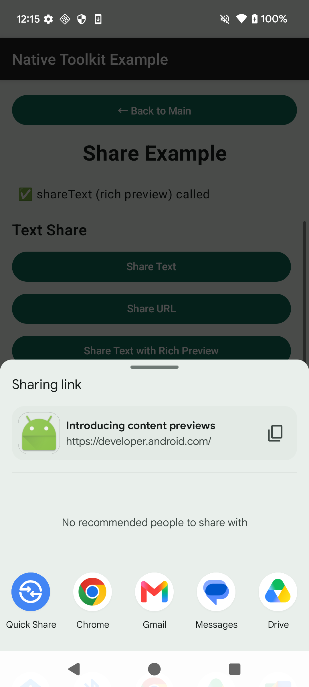
</p>

#### カスタムチューザーアクション付きテキスト共有

`shareTextWithActions` は Sharesheet に `ShareChooserAction` を追加します。アクションが表示されるのは Android 14 (API 34) 以降です。それより前のバージョンではアクションなしでテキストが共有されますが、アクションの検査は行われます。

| フィールド | 説明 |
|---|---|
| `id` | [`chooserActions` のイベント](#チューザーアクションのイベント) で返ります。空にできず、1 回の呼び出しの中で一意でなければなりません |
| `label` | アイコンの下に表示されるテキストです |
| `iconBytes` | `BitmapFactory` がデコードできる画像（PNG、JPEG、WebP）です |

呼び出すたびに、それまでの呼び出しのアクションは機能しなくなります。古い Sharesheet のアクションをタップしても通知されません。`InvalidChooserAction` で拒否された呼び出しでは、それまでのアクションは機能したままです。`BroadcastReceiver` やマニフェストへの記述は不要です。

```kotlin
val bmp = BitmapFactory.decodeResource(context.resources, android.R.drawable.ic_menu_edit)
val iconBytes = ByteArrayOutputStream().use { baos ->
    bmp.compress(Bitmap.CompressFormat.PNG, 100, baos)
    baos.toByteArray()
}

shareManager.shareTextWithActions(
    ShareContent(
        text = "Shared with a custom chooser action",
        mimeType = "text/plain"
    ),
    listOf(ShareChooserAction(id = "custom", label = "Custom", iconBytes = iconBytes))
)
```

<p align="center">
    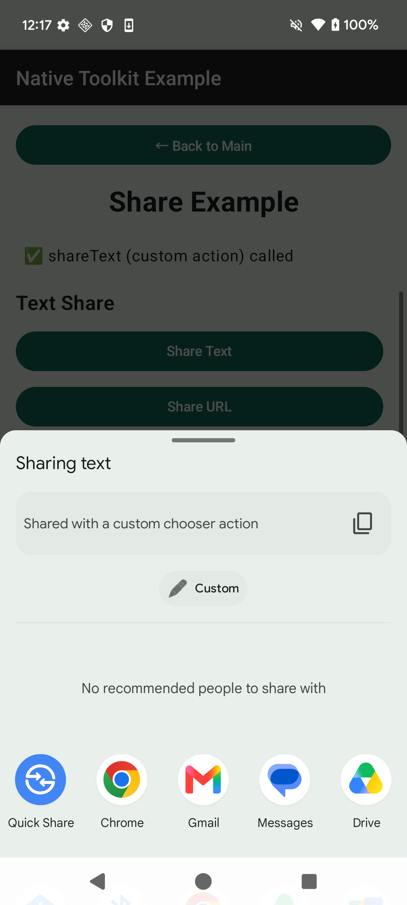
</p>

#### チューザーアクションのイベント

カスタムアクションのタップは、`chooserActions` を通じてアクションの `id` としてメインスレッドに届きます。サンプルは `MainActivity` が存在する間リスナーを登録しているため、どの画面を表示していてもタップを受け取れます。

```kotlin
class MainActivity : AppCompatActivity() {

    private var chooserActionRegistration: EventHub.Registration? = null

    override fun onCreate(savedInstanceState: Bundle?) {
        super.onCreate(savedInstanceState)
        val appContext = applicationContext
        val share = AndroidShareManager.getInstance(this)
        chooserActionRegistration = share.chooserActions.addListener { id, _ ->
            // id はタップされた ShareChooserAction.id です（上の例では "custom"）
            Toast.makeText(appContext, "Custom chooser action tapped", Toast.LENGTH_SHORT).show()
        }
    }

    override fun onDestroy() {
        chooserActionRegistration?.remove()
        chooserActionRegistration = null
        super.onDestroy()
    }
}
```

`EventHub` は `com.jonghyunkim.nativetoolkit.common.event.EventHub` です。リスナーの 2 番目の引数はそのリスナー自身の `Registration` で、リスナーの中から登録を解除できます。

#### 不正なアクション付きテキスト共有

`id` が同じアクションが 2 つあると、Sharesheet を開く前に `ShareDomainError.InvalidChooserAction` で拒否されます。空の `id` や、読み取れない画像のアイコンも同じように拒否されます。

```kotlin
val icon = ByteArrayOutputStream().use { out ->
    Bitmap.createBitmap(4, 4, Bitmap.Config.ARGB_8888).compress(Bitmap.CompressFormat.PNG, 100, out)
    out.toByteArray()
}

try {
    shareManager.shareTextWithActions(
        ShareContent(text = "This share is rejected"),
        listOf(ShareChooserAction("dup", "First", icon), ShareChooserAction("dup", "Second", icon))
    )
} catch (e: ShareDomainError.InvalidChooserAction) {
    // e.id == "dup"。何も開かず、前回の共有のアクションは機能したままです。
}
```

#### 件名・タイトル付き共有

`subject` はメールの件名（`Intent.EXTRA_SUBJECT`）として送られます。`title` は Sharesheet のタイトルを設定します。

```kotlin
shareManager.shareText(
    ShareContent(
        text = "Body text shared from native-toolkit",
        title = "Choose an app",
        subject = "Sample subject line",
        mimeType = "text/plain"
    )
)
```

<p align="center">
    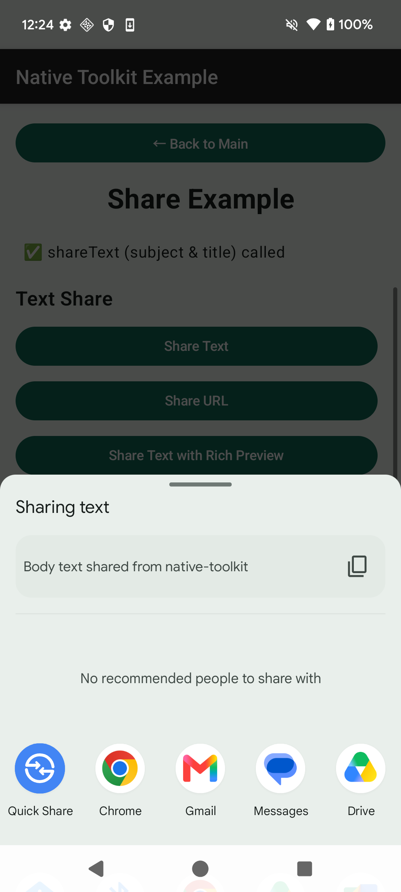
</p>

---

### 画像共有

ファイルは [FileProvider](#fileprovider) のディレクトリのいずれかになければなりません。

```kotlin
val bmp = BitmapFactory.decodeResource(context.resources, android.R.drawable.ic_menu_share)
val file = File(context.cacheDir, "share_sample.png")
file.outputStream().use { bmp.compress(Bitmap.CompressFormat.PNG, 100, it) }

shareManager.shareImage(file.absolutePath, "image/png")
```

<p align="center">
    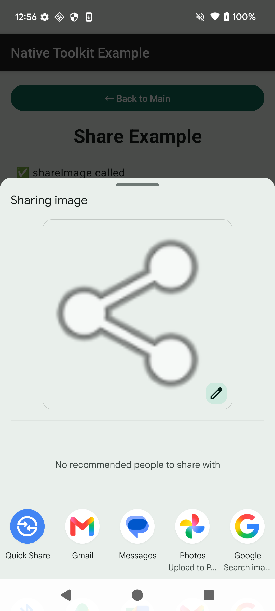
</p>

---

### 複数画像の共有

MIME タイプはファイルの拡張子から決まります。すべての画像のタイプが同じならそのタイプ、異なれば `image/*` です。

```kotlin
val bmp = BitmapFactory.decodeResource(context.resources, android.R.drawable.ic_menu_share)
val file1 = File(context.cacheDir, "share_sample_1.png")
val file2 = File(context.cacheDir, "share_sample_2.png")
file1.outputStream().use { bmp.compress(Bitmap.CompressFormat.PNG, 100, it) }
file2.outputStream().use { bmp.compress(Bitmap.CompressFormat.PNG, 100, it) }

shareManager.shareImages(listOf(file1.absolutePath, file2.absolutePath))
```

<p align="center">
    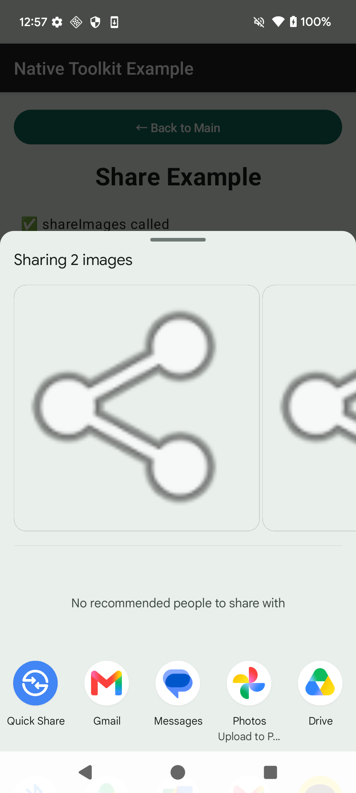
</p>

---

### ファイル共有

MIME タイプはファイルの拡張子から決まります（ライブラリが知らない拡張子なら `*/*` です）。

```kotlin
val file = File(context.cacheDir, "share_sample.txt")
    .apply { writeText("Share sample from native-toolkit") }

shareManager.shareFile(file.absolutePath)
```

<p align="center">
    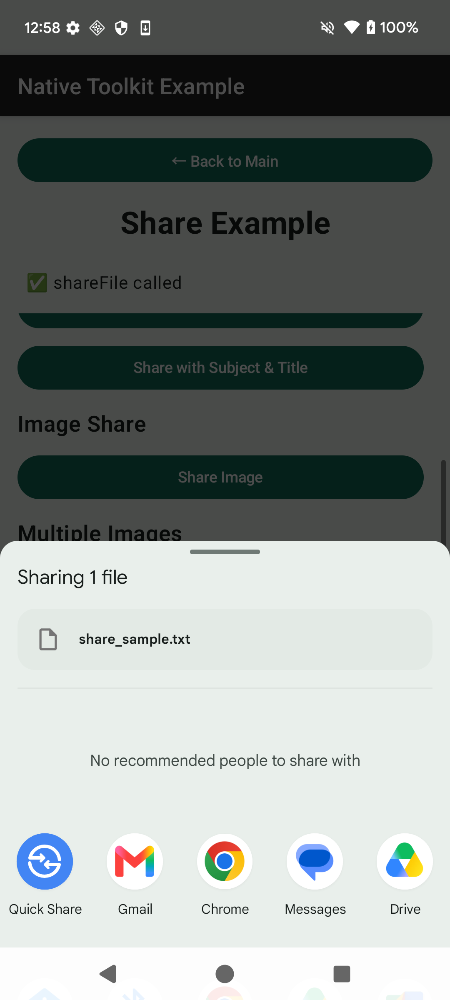
</p>

---

### 複数ファイルの共有

MIME タイプは、すべてのファイルのタイプが同じならそのタイプ、異なれば `*/*` です。

```kotlin
val file1 = File(context.cacheDir, "share_sample_1.txt")
    .apply { writeText("Share sample 1 from native-toolkit") }
val file2 = File(context.cacheDir, "share_sample_2.txt")
    .apply { writeText("Share sample 2 from native-toolkit") }

shareManager.shareFiles(listOf(file1.absolutePath, file2.absolutePath))
```

<p align="center">
    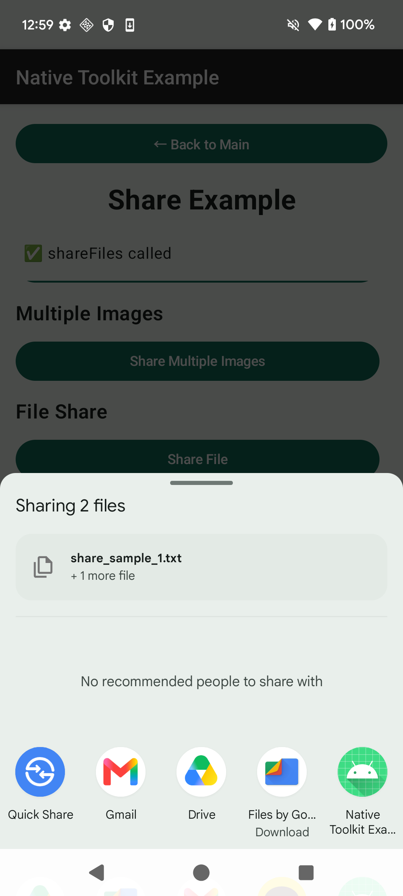
</p>

---

### Direct Share Target

Direct Share Target は、Sharesheet にアプリ内の推奨の宛先として表示されます。ライブラリは各ターゲットを長期間有効な動的ショートカットとして公開します。Sharesheet に表示させるには、サンプルと同じように、ターゲットの `category` と一致するカテゴリーの share target をアプリが宣言します。以下の `com.example.app.ShareReceiverActivity` は、マニフェストに登録されていて `ACTION_SEND` を受け取る自分の Activity に置き換えてください。

**AndroidManifest.xml**（共有を受け取る `<activity>` の中）:

```xml
<meta-data
    android:name="android.app.shortcuts"
    android:resource="@xml/shortcuts" />
```

**res/xml/shortcuts.xml:**

```xml
<?xml version="1.0" encoding="utf-8"?>
<shortcuts xmlns:android="http://schemas.android.com/apk/res/android">
    <share-target android:targetClass="com.example.app.ShareReceiverActivity">
        <data android:mimeType="text/plain" />
        <category android:name="android.shortcut.conversation" />
    </share-target>
</shortcuts>
```

#### Direct Share Target を登録

`iconBytes` は `BitmapFactory` がデコードできる画像です。同じ `id` をもう一度登録すると、そのターゲットが置き換わります。

```kotlin
val bmp = BitmapFactory.decodeResource(context.resources, android.R.mipmap.sym_def_app_icon)
val baos = ByteArrayOutputStream()
bmp.compress(Bitmap.CompressFormat.PNG, 100, baos)
val iconBytes = baos.toByteArray()

shareManager.registerDirectShareTarget(
    DirectShareTarget(
        id = "sample_1",
        label = "Sample User",
        category = "android.shortcut.conversation"
    ),
    iconBytes
)
```

<p align="center">
    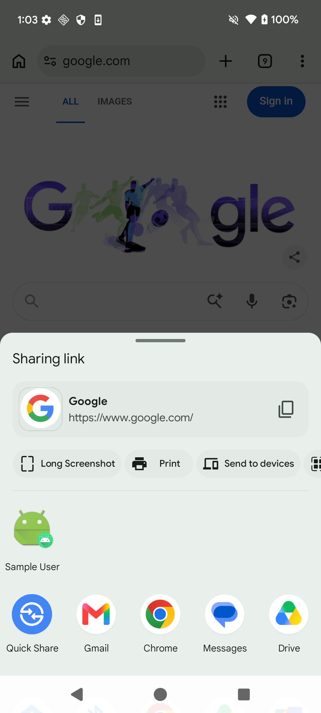
</p>

#### Direct Share Target を削除

```kotlin
shareManager.removeDirectShareTargets(listOf("sample_1"))
```

<p align="center">
    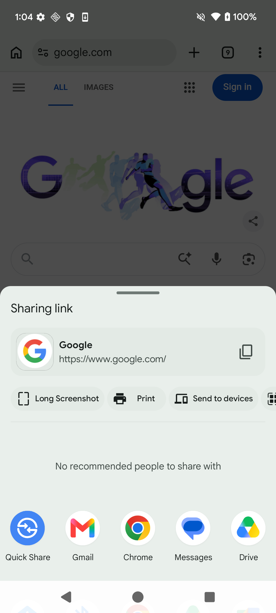
</p>

---

### コールバック付き共有

`shareWithCallback` はテキストの Sharesheet を開き、ユーザーが選んだアプリのパッケージ名を `onResult` に渡します。Android がパッケージ名を通知しなかった場合は `null` です。`onFinished` は、Sharesheet が通知した結果のあとに 1 回実行されます。Android 15 (API 35) 以降ではコピーと編集も結果に含まれ、`onResult` なしで `onFinished` が呼ばれます。それより前のバージョンで通知されるのは、選ばれたアプリだけです。何も選ばずに Sharesheet を閉じた場合は何も通知されず、どちらのコールバックも実行されません。

ライブラリが一度に待つ結果は 1 つで、この待機は [`shareForSelection`](#選択イベント) と共有されています。どちらかの関数で別の Sharesheet を開くと待機が置き換わります。置き換えられたコールバックは呼ばれず、古い Sharesheet での選択は新しい Sharesheet には届きません。`onResult` と `onFinished` がスローした例外は、ライブラリでは捕捉しません。

#### 基本コールバック

```kotlin
shareManager.shareWithCallback(
    ShareContent(text = "Hello with callback from native-toolkit"),
    onResult = { pkg ->
        // アプリが選ばれたときだけ呼ばれます。Android がパッケージ名を通知しなかった場合は pkg == null です
        val status = if (pkg != null) "Selected: $pkg" else "Shared (package unavailable)"
    }
)
```

<p align="center">
    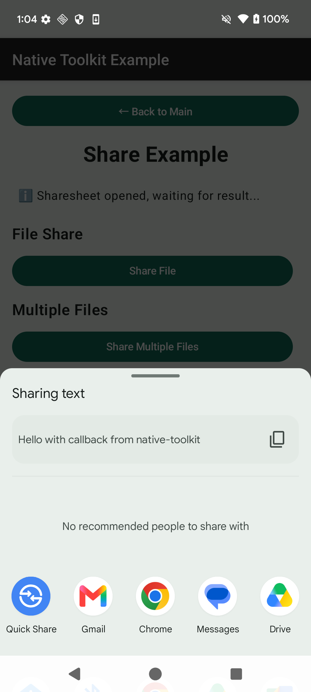
</p>

#### リッチプレビュー付きコールバック

```kotlin
val bmp = BitmapFactory.decodeResource(context.resources, android.R.mipmap.sym_def_app_icon)
val file = File(context.cacheDir, "callback_preview.png")
file.outputStream().use { bmp.compress(Bitmap.CompressFormat.PNG, 100, it) }

shareManager.shareWithCallback(
    ShareContent(
        text = "https://developer.android.com/",
        mimeType = "text/plain"
    ),
    SharePreviewOptions(
        title = "Callback with rich preview",
        thumbnailPath = file.absolutePath
    ),
    onResult = { pkg ->
        val status = if (pkg != null) "Selected: $pkg" else "Shared (package unavailable)"
    },
    onFinished = {
        // 結果を処理したあとに 1 回実行されます
    }
)
```

<p align="center">
    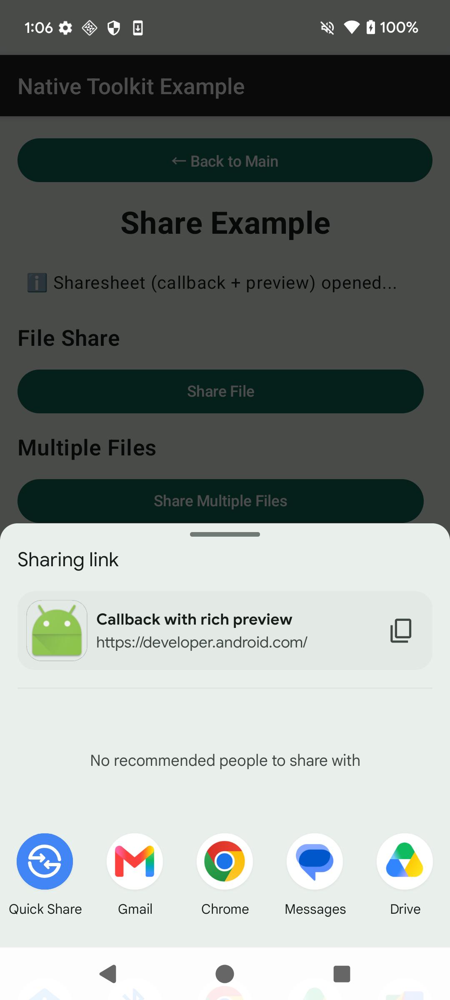
</p>

#### 保留中のコールバックをキャンセル

待機をやめます。以降はどちらのコールバックも実行されません。待機は共有されているため、`shareForSelection` が始めた待機もやめます。要求した画面がなくなるときに呼び出してください。そうすれば、遅れて届いた選択が、もう存在しない画面を更新することはありません。サンプルでは [選択イベント](#選択イベント) に示す `onDispose` で呼び出しています。

```kotlin
shareManager.cancelPendingCallback()
```

---

### 選択イベント

`shareForSelection` はテキストの Sharesheet を開き、トークン（プロセス内で再利用されない `Long`）を返します。ユーザーが選んだアプリは、そのトークンとパッケージ名（Android が通知しなかった場合は `null`）を持つ `ShareSelection` として `selections` に届きます。Sharesheet を閉じた場合や、アプリ以外の結果（コピー、編集）では何も届きません。`selections` のイベントを生むのは、`shareForSelection` で開いた Sharesheet だけです。

サンプルは Share 画面を表示している間、リスナーを登録しています。

```kotlin
@Composable
fun ShareSampleScreen(activity: AppCompatActivity) {
    val shareManager = remember(activity) { AndroidShareManager.getInstance(activity) }
    var statusText by remember { mutableStateOf("Result will be displayed here") }
    // shareForSelection で開いた Sharesheet のトークン。選択を待っている間だけ持ちます
    var selectionToken by remember { mutableStateOf<Long?>(null) }

    DisposableEffect(shareManager) {
        val registration = shareManager.selections.addListener { selection, _ ->
            if (selection.token == selectionToken) selectionToken = null
            statusText = "Selected (token=${selection.token}): ${selection.packageName ?: "(unknown package)"}"
        }
        onDispose {
            registration.remove()
            shareManager.cancelPendingCallback()
        }
    }

    // 以下にボタンが続きます
}
```

#### 選択イベント付き共有

```kotlin
try {
    val token = shareManager.shareForSelection(
        ShareContent(text = "Hello with a selection event from native-toolkit")
    )
    selectionToken = token
} catch (e: ShareDomainError) {
    statusText = e.javaClass.simpleName
}
```

<p align="center">
    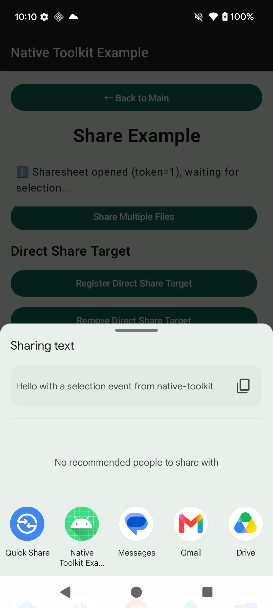
</p>

#### 共有の選択待ちをキャンセル

`token` の選択の待機をやめます。その後に別の Sharesheet が開かれていた場合は何もしません。

```kotlin
val token = selectionToken
if (token != null) {
    shareManager.cancelShareSelection(token)
    selectionToken = null
}
```

---

### 受信した共有コンテンツの処理

サンプルアプリは、他のアプリから `ACTION_SEND` と `ACTION_SEND_MULTIPLE` で共有されたコンテンツの受信も行います。これは Android の標準の仕組みで、ライブラリは使用しません。受信する `Activity` に intent-filter を宣言し、`onCreate` と `onNewIntent` で Intent を読み取ります。

```xml
<activity
    android:name=".MainActivity"
    android:exported="true"
    android:launchMode="singleTask">
    <intent-filter>
        <action android:name="android.intent.action.SEND" />
        <category android:name="android.intent.category.DEFAULT" />
        <data android:mimeType="text/plain" />
    </intent-filter>
    <intent-filter>
        <action android:name="android.intent.action.SEND" />
        <category android:name="android.intent.category.DEFAULT" />
        <data android:mimeType="image/*" />
    </intent-filter>
    <intent-filter>
        <action android:name="android.intent.action.SEND_MULTIPLE" />
        <category android:name="android.intent.category.DEFAULT" />
        <data android:mimeType="text/plain" />
    </intent-filter>
    <intent-filter>
        <action android:name="android.intent.action.SEND_MULTIPLE" />
        <category android:name="android.intent.category.DEFAULT" />
        <data android:mimeType="image/*" />
    </intent-filter>
</activity>
```

---

### エラー処理

各操作は `ShareDomainError` のサブタイプをスローします。メッセージは持たない（`message` は `null`）ため、型で区別し、プロパティを読み取ってください。

| エラー | スローする操作 | 原因 |
|---|---|---|
| `EmptyContent` | `shareText`、`shareTextWithActions`、`shareWithCallback`、`shareForSelection` | `text` が空白です |
| `InvalidMimeType(mimeType)` | `shareText`、`shareTextWithActions`、`shareImage` | MIME タイプが空白です |
| `InvalidChooserAction(id)` | `shareTextWithActions` | アクションの `id` が空か重複している、またはアイコンが読み取れる画像ではありません |
| `FileNotFound(path)` | `shareImage`、`shareImages`、`shareFile`、`shareFiles` | ファイルが存在しません |
| `IllegalFileAccess(path)` | `shareImage`、`shareImages`、`shareFile`、`shareFiles` | ファイルが [FileProvider](#fileprovider) のディレクトリ外にあります |
| `EmptyFileList` | `shareImages`、`shareFiles` | リストが空です |
| `NoShareTarget` | Sharesheet を開くすべての操作 | 共有を処理できる Activity がありません |
| `DirectShareRegistrationFailed(reason)` | `registerDirectShareTarget` | Android がショートカットを公開しませんでした |
| `InvalidBase64Icon(id)` | `registerDirectShareTarget` | アイコンが読み取れる画像ではありません。名前は、アイコンが Base64 だった 1.x のものを残しています |
| `EmptyIdList` | `removeDirectShareTargets` | リストが空です |

```kotlin
try {
    shareManager.shareText(ShareContent(text = "Hello"))
} catch (e: ShareDomainError.NoShareTarget) {
    // この共有を処理できるアプリがありません
} catch (e: ShareDomainError.EmptyContent) {
    // テキストが空白でした
} catch (e: ShareDomainError) {
    // その他のドメインエラー
}
```

---

### C ABI

- C から、そして共有ライブラリの C の関数を呼べる言語から、同じ共有を使うための API です。Kotlin と Java のコードは `AndroidShareManager` を呼び出します。
- `android-native-toolkit-capi-2.0.0.aar` には、`arm64-v8a` と `x86_64` 向けの `libntk.so` だけと、Prefab パッケージとしてのヘッダー `NativeToolkitC/*.h` が含まれます。32 ビットとしてインストールされたアプリには `libntk.so` がありません。
- C ABI は JNI を通じて Kotlin の API を呼び出すため、両方の AAR とその依存ライブラリをアプリの Gradle ビルドに含めます。C ABI はアプリの起動時に androidx.startup が初期化します。Startup を無効にしたアプリや、既定以外のプロセスから呼び出す場合は、先に `ntk_android_init(env, context)`（`<NativeToolkitC/Android.h>`）を呼び出します。それまでの間、操作は `NTK_SHARE_ERROR_NOT_INITIALIZED` を返します。
- どの関数もどのスレッドからでも呼び出せ、メインスレッドを待つことはありません。完了・イベント・受け付けられた呼び出しの `release` は Android のメインスレッドで届きます。その中でブロックせず、コールバックの外に例外を出さないでください。プロセスが終了します。
- Sharesheet を開く操作は非同期で、アプリがフォアグラウンドにある必要があります。戻り値は要求が受け付けられたかどうかを表します。その後、完了（`ntk_share_done_fn`）が 1 回実行されます。Sharesheet が開いた場合は `NTK_SHARE_ERROR_NONE`、開かなかった場合はその理由です。バックグラウンドから呼び出した場合は `NTK_SHARE_ERROR_NOT_FOREGROUND` です。完了はユーザーが何を選ぶかについては何も伝えません。選ばれたアプリは、あとから要求 ID を持つ選択イベントとして届きます。
- メインスレッド以外のスレッドから呼び出した場合、関数が戻る前に完了が届くことがあります。完了と要求の対応は `user_data` で取ってください。
- 受け付けの時点で拒否された呼び出し（`NULL` の引数、不正な UTF-8、空のリスト、空のテキスト、空または重複したチューザーアクション ID）はエラーを返し、完了は呼ばず、戻る前に呼び出し元のスレッドで `release` を 1 回呼びます。受け付けられた呼び出しの `release` は、完了のあとにメインスレッドで実行されます。`release` は `NULL` でも構いません。
- ライブラリはすべての入力（文字列、配列、アイコンのバイト列）を、呼び出しが戻る前にコピーします。
- コールバックに渡されるハンドル（`ntk_string*`）は受け取った側のものです。受け取った側が、コールバックの中でもあとでも、どのスレッドからでも `ntk_string_free` で解放します。
- 要求 ID は `uint64_t` で、プロセス内で再利用されることはありません。
- Direct Share の関数は同期的で、フォアグラウンドである必要はありません。
- Android では、`ntk_last_system_code()` とすべての完了の `system_code` は常に 0 です。

#### ビルド

**app/build.gradle.kts:**

```kotlin
android {
    defaultConfig {
        // libntk.so はこれらの ABI にだけ存在します。CMake も制限してください。AGP は CMake が
        // ビルドするすべての ABI について Prefab パッケージを確認し、欠けていると CXX1210 で失敗します。
        ndk { abiFilters += listOf("arm64-v8a", "x86_64") }
        externalNativeBuild {
            cmake { abiFilters("arm64-v8a", "x86_64") }
        }
    }
    buildFeatures { prefab = true }
}

dependencies {
    implementation("io.github.kimjh4941:android-native-toolkit-capi:2.0.0")
    // 自分の Kotlin や Java のコードから呼び出す場合は、Kotlin の API も宣言してください。
    // capi の POM はそれを実行時のみの依存としています。
    implementation("io.github.kimjh4941:android-native-toolkit:2.0.0")
}
```

**CMakeLists.txt:**

```cmake
find_package(ntk REQUIRED CONFIG)

add_library(myapp SHARED myapp.c)
target_link_libraries(myapp PRIVATE ntk::ntk)
```

設定の全体は index.ja.md の [C ABI](index.ja.md#c-abi) を参照してください。

androidx.startup を無効にした場合、または既定以外のプロセスの場合だけ、次のようにします。

```c
#include <NativeToolkitC/Android.h>

/* env: 呼び出し元のスレッドの JNIEnv*。context: 任意の Context（jobject）。Activity を渡すと、
   現在のフォアグラウンドの Activity としても扱われます。 */
static void initialize_native_toolkit(void* env, void* context)
{
    /* 待つことはなく、何度呼び出しても安全です。 */
    ntk_android_error init_error = ntk_android_init(env, context);
    if (init_error == NTK_ANDROID_ERROR_IN_PROGRESS || init_error == NTK_ANDROID_ERROR_JNI_FAILURE) {
        /* あとでもう一度呼び出します。NTK_ANDROID_ERROR_CLASS_NOT_FOUND は回復しません。AAR の
           クラスがありません（たとえば R8 で削除された）。 */
    }
}
```

#### Sharesheet を開く

パスは [FileProvider](#fileprovider) のディレクトリ（files、cache、external files）内のフルパスで、サムネイルも同じ規則に従います。`ntk_share_image` の MIME タイプが `NULL` の場合は `image/*` になります。

```c
#include <string.h>
#include <NativeToolkitC/Common.h>
#include <NativeToolkitC/Share.h>

static void NTK_CALL on_share_done(void* user_data, ntk_share_error error, uint32_t system_code)
{
    /* メインスレッドで、受け付けられた呼び出しにつき 1 回だけ呼ばれます。NONE: Sharesheet が開きました。 */
    (void)user_data; (void)system_code;
    if (error == NTK_SHARE_ERROR_NOT_FOREGROUND) {
        /* アプリがバックグラウンドにありました。何も開いていません。 */
    }
}

/* icon_png: PNG、JPEG、WebP のバイト列です。 */
static void open_sharesheets(const char* thumbnail_path, const uint8_t* icon_png, size_t icon_png_size,
                             const char* image_path_1, const char* image_path_2,
                             const char* file_path_1, const char* file_path_2)
{
    /* テキスト。0 のフィールドは既定値です。タイトル・件名・プレビューなしで "text/plain" です。 */
    ntk_share_text_content content;
    memset(&content, 0, sizeof(content));
    content.struct_size = (uint32_t)sizeof(content);
    content.text = "Hello from native-toolkit";

    ntk_share_error error = ntk_share_text(&content, NULL, 0, &on_share_done, NULL, NULL);

    /* 件名・タイトル・リッチプレビュー。 */
    content.title = "Choose an app";
    content.subject = "Sample subject line";
    content.preview_title = "Introducing content previews";
    content.preview_thumbnail_path = thumbnail_path;
    error = ntk_share_text(&content, NULL, 0, &on_share_done, NULL, NULL);

    /* カスタムチューザーアクション（API 34 以降で表示）。ntk_share_text を呼ぶたびに、アクションが
       なくても、それまでの Sharesheet のアクションは機能しなくなります。 */
    ntk_share_chooser_action actions[1];
    actions[0].id = "custom";
    actions[0].label = "Custom";
    actions[0].icon = icon_png;
    actions[0].icon_size = icon_png_size;
    memset(&content, 0, sizeof(content));
    content.struct_size = (uint32_t)sizeof(content);
    content.text = "Shared with a custom chooser action";
    error = ntk_share_text(&content, actions, 1, &on_share_done, NULL, NULL);

    /* 画像とファイル。 */
    error = ntk_share_image(image_path_1, "image/png", &on_share_done, NULL, NULL);

    const char* images[2];
    images[0] = image_path_1;
    images[1] = image_path_2;
    error = ntk_share_images(images, 2, &on_share_done, NULL, NULL);

    error = ntk_share_file(file_path_1, &on_share_done, NULL, NULL);

    const char* files[2];
    files[0] = file_path_1;
    files[1] = file_path_2;
    error = ntk_share_files(files, 2, &on_share_done, NULL, NULL);
}
```

#### 選択とチューザーアクションのイベント

```c
#include <string.h>
#include <NativeToolkitC/Common.h>
#include <NativeToolkitC/Share.h>

static void NTK_CALL on_share_done(void* user_data, ntk_share_error error, uint32_t system_code)
{
    /* 「Sharesheet を開く」と同じです。Sharesheet が開いた場合は NONE です。 */
    (void)user_data; (void)error; (void)system_code;
}

static void NTK_CALL on_selection(void* user_data, uint64_t request_id, ntk_string* package_name)
{
    /* メインスレッド。Android が通知しなかった場合 package_name は NULL です。受け取った側が解放します。 */
    (void)user_data; (void)request_id;
    if (package_name != NULL) {
        const char* name = ntk_string_data(package_name);   /* ntk_string_free まで有効です */
        size_t size = ntk_string_size(package_name);
        (void)name; (void)size;
        ntk_string_free(package_name);
    }
}

static void NTK_CALL on_chooser_action(void* user_data, ntk_string* action_id)
{
    /* メインスレッド。action_id はタップされた ntk_share_chooser_action の id です。 */
    const char* id = ntk_string_data(action_id);
    size_t size = ntk_string_size(action_id);
    (void)user_data; (void)id; (void)size;
    ntk_string_free(action_id);
}

/* 開く前に登録します。リスナーが登録されていない間、どちらのイベントも保持されません。 */
ntk_share_listener* selection_listener = NULL;
ntk_share_error error = ntk_share_add_selection_listener(&on_selection, NULL, NULL, &selection_listener);

ntk_share_listener* action_listener = NULL;
error = ntk_share_add_chooser_action_listener(&on_chooser_action, NULL, NULL, &action_listener);

/* Sharesheet を開きます。選択はこの要求 ID とともに on_selection に届きます。 */
ntk_share_text_content content;
memset(&content, 0, sizeof(content));
content.struct_size = (uint32_t)sizeof(content);
content.text = "Hello with a selection event from native-toolkit";

uint64_t request_id = 0;
error = ntk_share_text_for_selection(&content, &on_share_done, NULL, NULL, &request_id);

/* 選択の待機をやめます。待つことはなく、request_id が待機中の要求でなければ何もしません。
   取り消すのは選択の待機で、開く操作ではありません（開く操作に CANCELED はありません）。 */
error = ntk_share_cancel_selection(request_id);

/* リスナーを削除しても、削除されるのはリスナーだけです。選択の待機と現在のアクションは残ります。
   メインスレッドで削除すると、以降は何も届きません。それ以外のスレッドで削除すると、その release が
   実行されるまでイベントが届くことがあります。削除後のハンドルは無効です。 */
ntk_share_listener_remove(selection_listener);
ntk_share_listener_remove(action_listener);
```

- Kotlin の API と同じく、一度に待つ選択は 1 つだけです。`ntk_share_text_for_selection` で別の Sharesheet を開くと、前の Sharesheet の待機は終わります。
- Sharesheet を要求する前に失敗した要求（`NTK_SHARE_ERROR_NOT_FOREGROUND`、または空白だけのテキストでの `NTK_SHARE_ERROR_EMPTY_CONTENT`）では、前の要求の待機は残ります。要求したあとに失敗した要求（`NTK_SHARE_ERROR_NO_SHARE_TARGET`、`NTK_SHARE_ERROR_UNKNOWN`）では、前の待機は終わっています。
- `out_request_id` は `NULL` でも構いませんが、その場合は選択を要求と対応づけられません。
- アプリの Kotlin のコードが `shareForSelection` で開いた Sharesheet の選択は、C には届きません。

#### Direct Share Target の登録と削除

```c
#include <string.h>
#include <NativeToolkitC/Share.h>

/* icon_png: PNG、JPEG、WebP のバイト列です。 */
static void update_direct_share_targets(const uint8_t* icon_png, size_t icon_png_size)
{
    ntk_share_direct_target target;
    memset(&target, 0, sizeof(target));
    target.struct_size = (uint32_t)sizeof(target);
    target.id = "sample_1";
    target.label = "Sample User";
    target.category = NULL;              /* "android.shortcut.conversation" です */
    target.icon = icon_png;              /* NULL または空: NTK_SHARE_ERROR_INVALID_ICON */
    target.icon_size = icon_png_size;

    ntk_share_error error = ntk_share_register_direct_target(&target);

    const char* ids[1];
    ids[0] = "sample_1";
    error = ntk_share_remove_direct_targets(ids, 1);
}
```

アプリは [Direct Share Target](#direct-share-target) と同じく、`shortcuts.xml` で share target を宣言する必要があります。

#### エラー値

`ntk_share_error` です。0 から 5 は、C ABI のどの機能でも同じ意味です。

| コード | 名前 | 発生する場合 | 返し方 |
|---|---|---|---|
| 0 | `NTK_SHARE_ERROR_NONE` | 成功です。開く操作では Sharesheet が開いたことを表します | 両方 |
| 1 | `NTK_SHARE_ERROR_INVALID_PARAMETER` | `NULL` の引数やコールバック、不正な UTF-8、小さすぎる `struct_size` | 戻り値 |
| 2 | `NTK_SHARE_ERROR_NOT_INITIALIZED` | 初期化前の呼び出しです。引数の検査が先に行われ、`ntk_share_cancel_selection` は `NONE` を返します | 戻り値 |
| 3 | `NTK_SHARE_ERROR_NOT_SUPPORTED` | 構造体のうち、このバージョンが知らない部分に 0 以外の値があります | 戻り値 |
| 4 | `NTK_SHARE_ERROR_UNKNOWN` | その他すべてです。詳細は logcat（タグ `ntk`）にあります | 両方 |
| 5 | `NTK_SHARE_ERROR_OUT_OF_MEMORY` | メモリの確保に失敗しました | 両方 |
| 6 | `NTK_SHARE_ERROR_NOT_FOREGROUND` | アプリがフォアグラウンドにありません。何も開いていません | 完了 |
| 7 | `NTK_SHARE_ERROR_EMPTY_CONTENT` | テキストが空（戻り値）、または空白だけ（完了）です | 両方 |
| 8 | `NTK_SHARE_ERROR_NO_SHARE_TARGET` | 共有を処理できる Activity がありません | 完了 |
| 9 | `NTK_SHARE_ERROR_FILE_NOT_FOUND` | ファイルが存在しません | 完了 |
| 10 | `NTK_SHARE_ERROR_ILLEGAL_FILE_ACCESS` | ファイルが FileProvider のディレクトリ外にあります | 完了 |
| 11 | `NTK_SHARE_ERROR_INVALID_MIME_TYPE` | MIME タイプが空白です | 完了 |
| 12 | `NTK_SHARE_ERROR_DIRECT_SHARE_REGISTRATION_FAILED` | Android がショートカットを公開しませんでした | 戻り値 |
| 13 | `NTK_SHARE_ERROR_EMPTY_ID_LIST` | ID なしの `ntk_share_remove_direct_targets` | 戻り値 |
| 14 | `NTK_SHARE_ERROR_EMPTY_FILE_LIST` | パスなしの `ntk_share_images` または `ntk_share_files` | 戻り値 |
| 15 | `NTK_SHARE_ERROR_INVALID_ICON` | Direct Share のアイコンが `NULL`、空、または読み取れる画像ではありません | 戻り値 |
| 16 | `NTK_SHARE_ERROR_INVALID_CHOOSER_ACTION` | 空または重複したアクション ID、`NULL` または空のアイコン（戻り値）、読み取れる画像ではないアイコン（完了）です。前の Sharesheet のアクションは機能したままです | 両方 |

`CANCELED` はありません。開く操作は Sharesheet が開いた時点で完了し、選択の待機の取り消しはそれとは別です。

| Kotlin API | C ABI |
|---|---|
| `shareText` / `shareTextWithActions` | `ntk_share_text`（`ntk_share_text_content` と `ntk_share_chooser_action`） |
| `shareImage` / `shareImages` / `shareFile` / `shareFiles` | `ntk_share_image` / `_images` / `_file` / `_files` |
| `registerDirectShareTarget` / `removeDirectShareTargets` | `ntk_share_register_direct_target`（`ntk_share_direct_target`） / `ntk_share_remove_direct_targets` |
| `shareForSelection` / `cancelShareSelection` | `ntk_share_text_for_selection` / `ntk_share_cancel_selection` |
| `selections.addListener` | `ntk_share_add_selection_listener` |
| `chooserActions.addListener` | `ntk_share_add_chooser_action_listener` |
| `EventHub.Registration.remove` | `ntk_share_listener_remove` |
| `shareWithCallback` / `cancelPendingCallback` | ありません。`ntk_share_text_for_selection` を使用してください |
| `ShareDomainError` | `ntk_share_error` の 7 から 16（同じ順序） |

---

## iOS

システムの共有シート（`UIActivityViewController`）です。テキスト・URL・画像・ファイルを単独で、または 1 回の共有に混在させて共有でき、件名、リンクプレビューのタイトル、除外するアクティビティタイプを指定できます。iOS ライブラリ 2.0.0 は、1 つの実装を 2 つの公開 API から提供します。サンプルアプリ（`IosLibraryExample`）は Swift の API を使用しています。

| API | 名前 | モジュール / ヘッダー | 成果物 |
|---|---|---|---|
| Swift API | `IosShareManager` | `import IosLibrary` | `ios-native-toolkit-2.0.0.xcframework` |
| C ABI | `ntk_share_*` | `<NativeToolkitC/Share.h>` | `ios-native-toolkit-capi-2.0.0.xcframework` |

- 成果物: `dist/1.14.0/ios/` に、両方の xcframework と C のヘッダー（`include/NativeToolkitC/*.h`）があります。
- 最小 iOS: 18.0 です。ライブラリを呼ぶ Swift のコードは Xcode 26.3 以降でビルドします。
- 対応範囲: 送信のみです。共有の受信（Share Extension）は含まれません。
- 1.x から移行する場合: [iOS ライブラリを 2.0.0 へ移行する](index.ja.md#ios-ライブラリを-200-へ移行する) を参照してください。共有については、`ShareError` のケースが変わり（[エラー処理](#エラー処理-1) を参照）、完了ハンドラーは `@MainActor @Sendable` になり、`share` は `presenter` を受け取り（[表示元と結果](#表示元と結果) を参照）、共有シートが別の共有シートの上に表示されることはなくなりました（[同じターンでの 2 つの共有](#同じターンでの-2-つの共有) を参照）。`ShareRepository` を自分で実装しているアプリは、それを `Sendable` にし、`present(content:)` の代わりに `present(content:presenter:)` を実装します。

以下の節は、サンプルアプリの Share 画面の順序に沿っています。最後の [C ABI](#c-abi-1) では、同じ操作を C から行う方法を説明します。

---

### IosShareManager

`IosShareManager.shared` は共有の入口です。マネージャーは `Sendable` なので、どのスレッドからでも呼び出せます。

```swift
import IosLibrary

let shareManager = IosShareManager.shared
```

| メンバー | 説明 |
|---|---|
| `share(content:presenter:) async throws -> ShareResult` | 共有シートを表示し、どのように終わったかを返します。`presenter` の既定値は `.firstActiveScene` です |
| `share(content:presenter:completion:)` | 同じ操作で、`Result<ShareResult, ShareError>` を `completion` に通知します。`presenter` に既定値はありません |
| `share(content:completion:)` | 1.x のコールバック形式で、`(isSuccess, completed, activityType, errorMessage)` を通知します。常に `.firstActiveScene` を使用します |

モデルの型は `IosLibrary` モジュールにあります。

| 型 | 内容 |
|---|---|
| `ShareContent` | `items`（`[ShareItem]`、空は不可）、`subject`、`previewTitle`、`excludedActivityTypes`（生の識別子）。`items` 以外には既定値があります |
| `ShareItem` | `.text(String)`、`.url(String)`、`.imageFile(path:)`、`.file(path:)` |
| `ShareResult` | `completed`（ユーザーがシートを閉じた場合は `false`）と `activityType`（選ばれたアクティビティの生の識別子、または `nil`） |
| `ShareError` | [エラー処理](#エラー処理-1) を参照してください |
| `PresenterSelection` | 表示元のビューコントローラの選び方です。[表示元と結果](#表示元と結果) を参照してください |

<p align="center">
    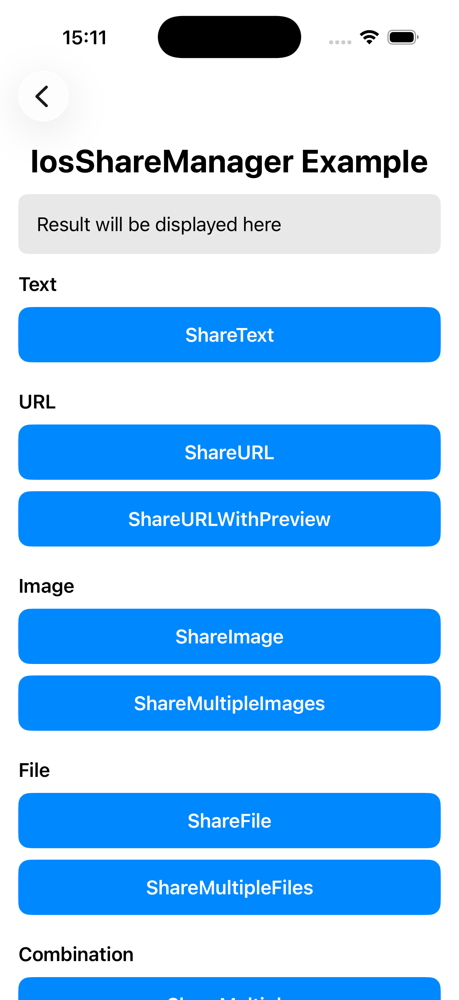
</p>

---

### セットアップ

#### ライブラリの追加

1. `ios-native-toolkit-2.0.0.xcframework` を Xcode プロジェクトに追加し、ターゲットの Frameworks, Libraries, and Embedded Content で "Embed & Sign" に設定します。
2. 共有を行うファイルでモジュールをインポートします。

```swift
import IosLibrary
```

共有に初期化は不要です。

#### スレッドと表示

- `share` はどのスレッドからでも呼び出せます。各コールバック形式の完了ハンドラーは、すべての経路（検証の失敗も含む）で、メインスレッドで 1 回だけ実行され、呼び出しの中で実行されることはありません。`async` 形式はシートが終わったときに戻ります。
- 共有は取り消せません。共有を待っている `Task` を取り消しても共有は終わらず、呼び出しはシートが終わったときに戻ります。
- ユーザーがシートを閉じることはエラーではありません。結果は `completed == false` になります。
- シートは `presenter` が選ぶビューコントローラから表示されます（[表示元と結果](#表示元と結果) を参照）。iPad では、そのビューコントローラのビューの中央を起点とするポップオーバーになります。起点を指定するパラメーターはありません。シートが現れる場所を選ぶには、`.viewController(_:)` でビューコントローラを渡してください。
- 共有シートが別の共有シートの上に表示されることはありません。[同じターンでの 2 つの共有](#同じターンでの-2-つの共有) を参照してください。
- アプリ自身が表示したビューコントローラ（たとえばアプリ独自の `UIActivityViewController`）がまだ表示中で、その `present` 呼び出しの完了ハンドラーが実行される前には、`share` を呼び出さないでください。UIKit がライブラリのシートの表示を拒否したうえでそれを保持することがあり、その場合、共有は終わりません。共有する前に、自分の `present` の完了ハンドラーを待ってください。
- シートの表示中にアプリがウィンドウ、そのルートビューコントローラ、またはシーンを置き換えた場合や、表示された `UIActivityViewController` をアプリが保持し続けた場合、またシステムがシートのシーンを切断したもののシートが解放されなかった場合は、結果は保証されません。

以下の例では、サンプルと同じく `share(content:)`（既定の presenter を使う `async` 形式）を使用します。SwiftUI の `Button` のアクションは同期的なため、各呼び出しは `Task` の中で実行します。

---

### テキスト共有

#### テキストを共有

```swift
Task {
    do {
        let result = try await IosShareManager.shared.share(
            content: ShareContent(items: [.text("Shared from IosLibraryExample")])
        )
        // completed == false: ユーザーがシートを閉じました
        print(result.completed, result.activityType ?? "nil")
    } catch {
        // エラー処理を参照
        print(error.localizedDescription)
    }
}
```

<p align="center">
    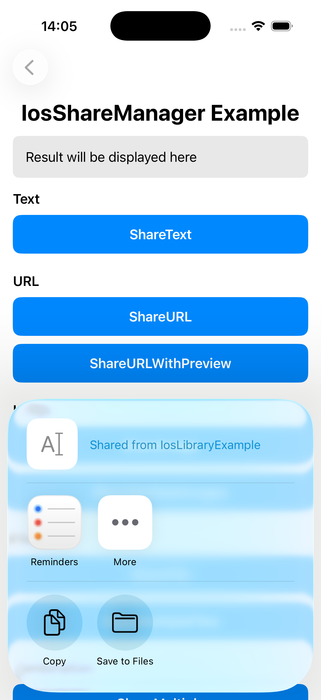
</p>

---

### URL 共有

#### URL を共有

URL は文字列として渡し、両端の空白を取り除いたうえでライブラリが検証します。`http` と `https` にはホストが必要で、`file` はファイル URL である必要があります。それ以外の文字列は、空文字列も含めて `ShareError.invalidURL` で失敗します。

```swift
Task {
    do {
        let result = try await IosShareManager.shared.share(
            content: ShareContent(items: [.url("https://www.apple.com")])
        )
        print(result.completed, result.activityType ?? "nil")
    } catch {
        print(error.localizedDescription)
    }
}
```

<p align="center">
    
</p>

#### プレビュー付き URL 共有

`previewTitle` を指定すると、リンクの取得を待たずに、共有シートのヘッダーにすぐタイトルが表示されます。このタイトルは最初のアイテムに適用されます。そのアイテムが URL の場合、プレビューには URL も含まれます。

```swift
Task {
    do {
        let result = try await IosShareManager.shared.share(
            content: ShareContent(
                items: [.url("https://www.apple.com")],
                previewTitle: "Apple"
            )
        )
        print(result.completed, result.activityType ?? "nil")
    } catch {
        print(error.localizedDescription)
    }
}
```

<p align="center">
    
</p>

---

### 画像共有

#### 画像を共有

`.imageFile(path:)` には、ローカルの画像ファイルのフルパスを渡します。ライブラリはそれを `UIImage` として読み込み、読み込めない場合は `ShareError.imageLoadFailed` で失敗します。

```swift
guard let imagePath = Bundle.main.url(forResource: "app-icon-attachment", withExtension: "png")?.path else {
    return
}

Task {
    do {
        let result = try await IosShareManager.shared.share(
            content: ShareContent(items: [.imageFile(path: imagePath)])
        )
        print(result.completed, result.activityType ?? "nil")
    } catch {
        print(error.localizedDescription)
    }
}
```

<p align="center">
    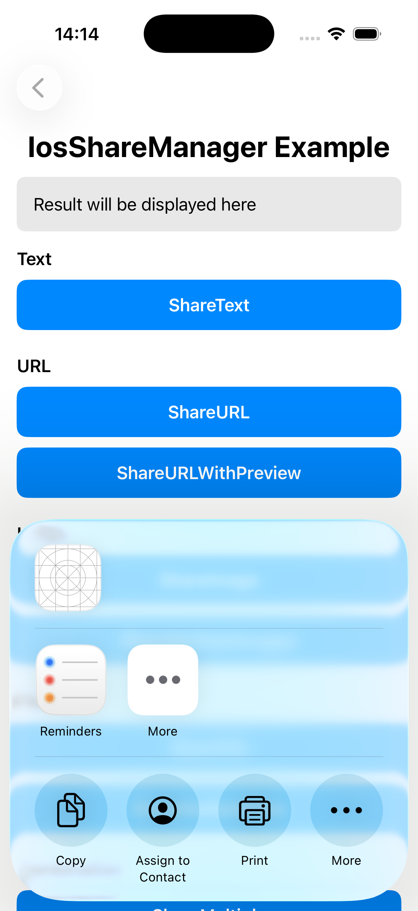
</p>

#### 複数画像を共有

`items` は複数の要素を受け付けるため、複数の画像を一度に共有できます。サンプルは、同梱の画像を一時ディレクトリの 2 つのファイルにコピーして使用しています。

```swift
let imagePaths: [String] = /* ローカルの画像ファイルのフルパス */

Task {
    do {
        let result = try await IosShareManager.shared.share(
            content: ShareContent(items: imagePaths.map { .imageFile(path: $0) })
        )
        print(result.completed, result.activityType ?? "nil")
    } catch {
        print(error.localizedDescription)
    }
}
```

<p align="center">
    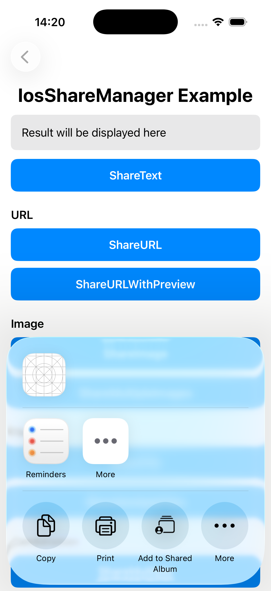
</p>

---

### ファイル共有

#### ファイルを共有

`.file(path:)` には、ローカルファイルのフルパスを渡します。ライブラリはファイルが存在することを確認し（存在しない場合は `ShareError.fileNotFound`）、ファイル URL として共有します。

```swift
let fileURL = FileManager.default.temporaryDirectory.appendingPathComponent("share-sample.txt")

Task {
    do {
        try "Shared from IosLibraryExample.".write(to: fileURL, atomically: true, encoding: .utf8)
        let result = try await IosShareManager.shared.share(
            content: ShareContent(items: [.file(path: fileURL.path)])
        )
        print(result.completed, result.activityType ?? "nil")
    } catch {
        print(error.localizedDescription)
    }
}
```

<p align="center">
    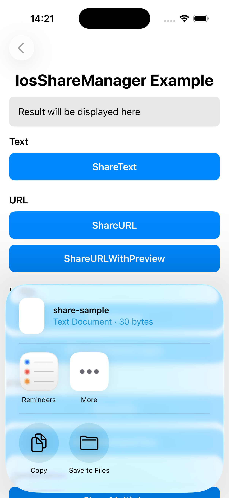
</p>

#### 複数ファイルを共有

```swift
let fileURLs: [URL] = /* ローカルファイルの URL */

Task {
    do {
        let result = try await IosShareManager.shared.share(
            content: ShareContent(items: fileURLs.map { .file(path: $0.path) })
        )
        print(result.completed, result.activityType ?? "nil")
    } catch {
        print(error.localizedDescription)
    }
}
```

<p align="center">
    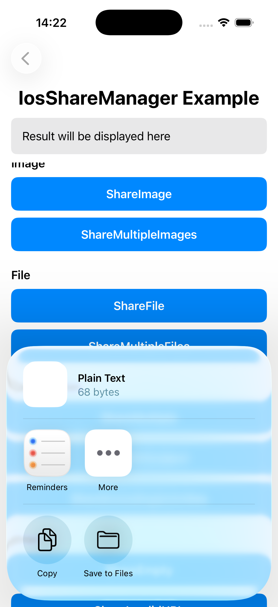
</p>

---

### 組み合わせコンテンツ

#### 複数アイテムを共有

テキスト・URL・画像・ファイルなど、異なる種類のアイテムを 1 回の共有に混在させられます。

```swift
Task {
    do {
        let result = try await IosShareManager.shared.share(
            content: ShareContent(items: [
                .text("Check this out"),
                .url("https://www.apple.com")
            ])
        )
        print(result.completed, result.activityType ?? "nil")
    } catch {
        print(error.localizedDescription)
    }
}
```

<p align="center">
    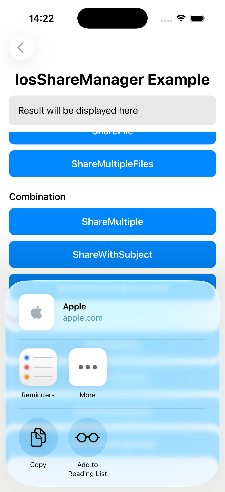
</p>

#### 件名付き共有

`subject` は、件名に対応するアクティビティ（たとえば Mail の件名欄）で使用されます。`previewTitle` と同じく、最初のアイテムに付けられます。

```swift
Task {
    do {
        let result = try await IosShareManager.shared.share(
            content: ShareContent(
                items: [.text("Body text")],
                subject: "Sample Subject"
            )
        )
        print(result.completed, result.activityType ?? "nil")
    } catch {
        print(error.localizedDescription)
    }
}
```

<p align="center">
    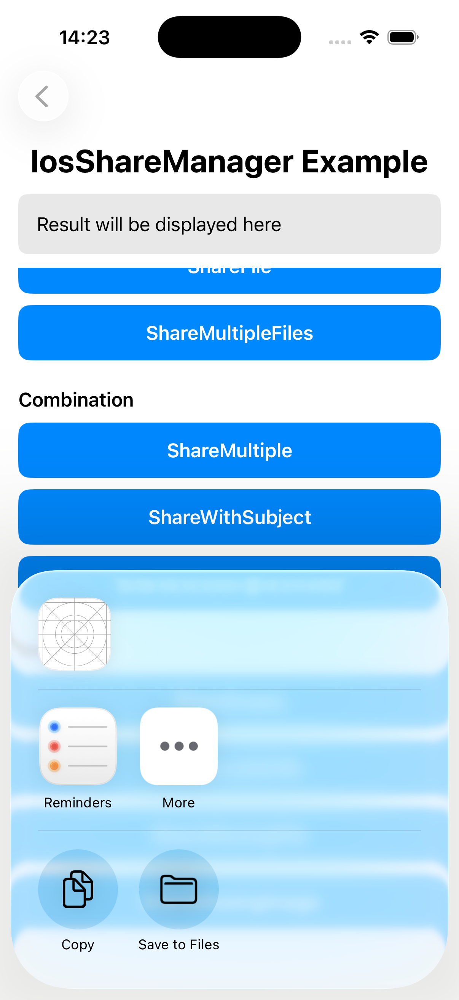
</p>

#### アクティビティタイプの除外

`excludedActivityTypes` に生のアクティビティタイプ識別子を渡すと、それらのアクティビティがシートに表示されなくなります。

```swift
Task {
    do {
        let result = try await IosShareManager.shared.share(
            content: ShareContent(
                items: [.url("https://www.apple.com")],
                excludedActivityTypes: [
                    "com.apple.UIKit.activity.CopyToPasteboard",
                    "com.apple.UIKit.activity.PostToFacebook"
                ]
            )
        )
        print(result.completed, result.activityType ?? "nil")
    } catch {
        print(error.localizedDescription)
    }
}
```

<p align="center">
    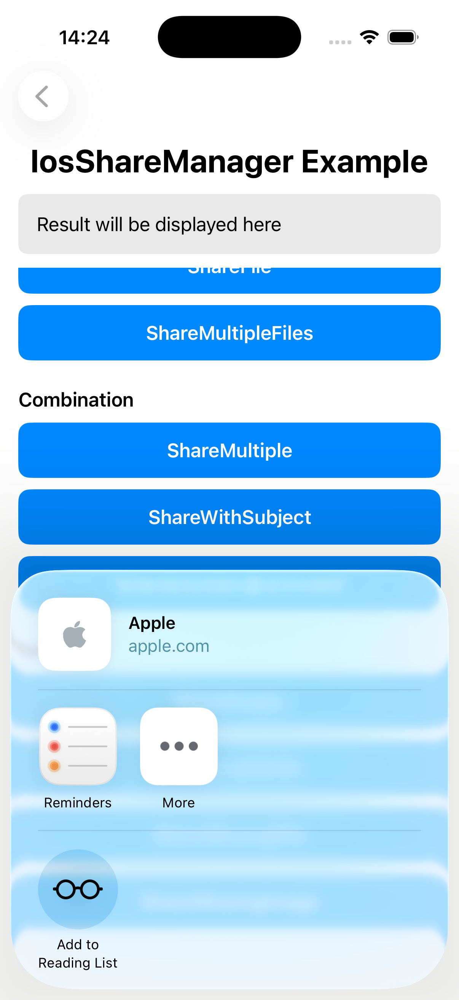
</p>

---

### エラー処理

`async` 形式は `ShareError` をスローし、`share(content:presenter:completion:)` はそれを `.failure` として通知します。ユーザーがシートを閉じることはエラーではありません（`completed == false`）。どのケースも安定しており、任意のシステムの `Error` を持つケースはありません。

| エラー | 発生する場合 | 説明（`localizedDescription`） |
|---|---|---|
| `noValidItems` | `items` が空です | `No shareable items were provided.` |
| `invalidURL(String)` | `.url` アイテムが有効な `http`、`https`、`file` の URL ではありません | `Invalid URL: <value>.` |
| `imageLoadFailed(path:)` | `.imageFile` アイテムの画像を読み込めません | `Failed to load image at path: <path>.` |
| `fileNotFound(path:)` | `.file` アイテムのファイルが存在しません | `File not found at path: <path>.` |
| `noRootViewController` | `.firstActiveScene` が表示元のビューコントローラを見つけられませんでした | `No root view controller available to present the share sheet.` |
| `notForeground` | `.foreground` または `.viewController(_:)` がフォアグラウンドのビューコントローラを見つけられませんでした | `The app has no view controller in the foreground to present the share sheet.` |
| `presentationFailed` | シートが表示されませんでした。表示元のビューコントローラが落ち着いていなかった、UIKit が表示を拒否した、表示し終わる前にシートが解放された、またはフォアグラウンドが共有シートだった（[同じターンでの 2 つの共有](#同じターンでの-2-つの共有) を参照）場合です | `Failed to present the share sheet.` |
| `dismissedBySystem` | シートが結果を通知せずに消えました。ライブラリの外から閉じられたか、シーンが切断されてシートが解放された場合です | `The share sheet was dismissed without a result.` |
| `activityFailed(FailureDetail)` | 選ばれたアクティビティがエラーを報告しました。`FailureDetail` はその `NSError` の `domain` と `code` を持ちます | `The share activity failed.` |

最初の 4 つでは、シートは表示されません。説明は固定の英文で、`invalidURL`、`imageLoadFailed`、`fileNotFound` の説明には渡された URL またはパスが含まれます。

1.x からの変更点: `presentationFailed` は `Error` を持たなくなり、`unknown(Error)` はなくなり、`notForeground`、`dismissedBySystem`、`activityFailed` が追加されました。1.x のケースに合わせて書いた `switch` はコンパイルできなくなります。ケースは追加されることがあるため、`@unknown default` の分岐を書いてください。

サンプルの Error セクションでは、空のリスト、不正な URL、存在しないファイル、存在しない画像を共有します。

```swift
Task {
    do {
        _ = try await IosShareManager.shared.share(
            content: ShareContent(items: [.url("not a valid url")])
        )
    } catch let error as ShareError {
        switch error {
        case .noValidItems, .invalidURL, .imageLoadFailed, .fileNotFound:
            // コンテンツを共有できません。シートは表示されていません
            break
        case .noRootViewController, .notForeground:
            // 表示元のビューコントローラがありません
            break
        case .presentationFailed:
            // シートは表示されませんでした
            break
        case .dismissedBySystem:
            // シートが結果なしで消えました
            break
        case .activityFailed(let detail):
            print(detail.domain, detail.code)
        @unknown default:
            break
        }
    } catch {
        // share(content:presenter:) がスローするのは ShareError だけです
    }
}
```

`share(content:completion:)` は、失敗を `isSuccess == false`、`completed == false`、`activityType == nil` と、`errorMessage` としての上記の説明で通知します。1.x と異なり、シートがライブラリの外から閉じられた場合も、その完了ハンドラーは 1 回呼ばれます（`"The share sheet was dismissed without a result."`）。

```swift
IosShareManager.shared.share(
    content: ShareContent(items: [])
) { isSuccess, completed, activityType, errorMessage in
    // isSuccess == false, errorMessage == "No shareable items were provided."
}
```

---

### 表示元と結果

`PresenterSelection` は、シートをどのビューコントローラから表示するかを決めます。

| 値 | ビューコントローラ | 表示する前 |
|---|---|---|
| `.firstActiveScene`（`async` 形式の既定値。`share(content:completion:)` は常にこれを使用） | 最初の `foregroundActive` のウィンドウシーンのキーウィンドウで、最も上に表示されているビューコントローラ | 待たずに 1 回だけ探します。見つからない場合は `noRootViewController` で、そのビューコントローラが表示中・閉じる途中、または何かを表示している場合は `presentationFailed` で失敗します |
| `.foreground` | `foregroundActive` または `foregroundInactive` のウィンドウシーンのキーウィンドウで、閉じる途中ではない最も上のビューコントローラ | 見つからない場合は `notForeground` で失敗します。そのビューコントローラが遷移中の場合は、遷移が終わるのを 1 回待ってから確認し直し、まだ落ち着いていなければ `presentationFailed` で失敗します |
| `.viewController(_:)` | クロージャが返すビューコントローラ。クロージャは、シートを表示する直前にメインスレッドで 1 回呼ばれます | クロージャが `nil` を返した場合は `notForeground` で失敗します。それ以外は `.foreground` と同じく 1 回だけ待ちます |

`foregroundInactive` は、アプリが見えているもののアクティブではない状態を指します。起動直後や、コントロールセンターや通知センターがアプリの上に引き出されている間です。iPad でアプリの 2 つのウィンドウを並べて表示している場合は両方がアクティブになり得るため、`.firstActiveScene` と `.foreground` はユーザーが見ていないウィンドウを選ぶことがあります。その場合は `.viewController(_:)` でビューコントローラを渡してください。

```swift
// ビューコントローラの中で: このビューコントローラが生きている間、ここから表示します。
let presenter: PresenterSelection = .viewController { [weak self] in self }
```

クロージャはシートが表示されるまで保持されるため、ビューコントローラは弱参照でキャプチャしてください。

#### フォアグラウンドから共有

```swift
Task {
    do {
        let result = try await IosShareManager.shared.share(
            content: ShareContent(items: [.text("Shared through the Swift API")]),
            presenter: .foreground
        )
        print(result.completed, result.activityType ?? "nil")
    } catch let error as ShareError {
        // アプリがバックグラウンドにある場合は notForeground
        print(error)
    } catch {
        // share(content:presenter:) がスローするのは ShareError だけです
    }
}
```

<p align="center">
    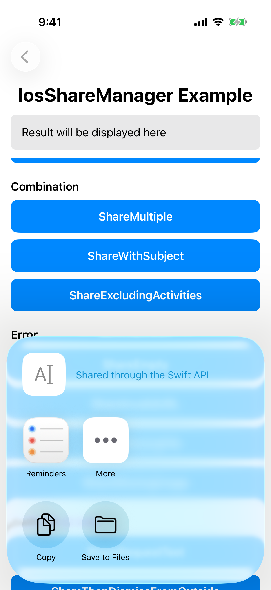
</p>

#### 結果のコールバック

`share(content:presenter:completion:)` は、同じ結果をメインスレッドで完了ハンドラーに通知します。サンプルはタップの 3 秒後にライブラリの外からシートを閉じます。その場合、完了ハンドラーは `.dismissedBySystem` で 1 回呼ばれます。

```swift
IosShareManager.shared.share(
    content: ShareContent(items: [.text("Dismissed from outside after 3 seconds")]),
    presenter: .foreground
) { result in
    switch result {
    case .success(let share):
        print(share.completed, share.activityType ?? "nil")
    case .failure(.dismissedBySystem):
        // シートが結果を通知せずに消えました
        break
    case .failure(let error):
        print(error)
    }
}

DispatchQueue.main.asyncAfter(deadline: .now() + 3) {
    let top = IosDialogManager.shared.foregroundViewController()
    top?.presentingViewController?.dismiss(animated: true)
}
```

<p align="center">
    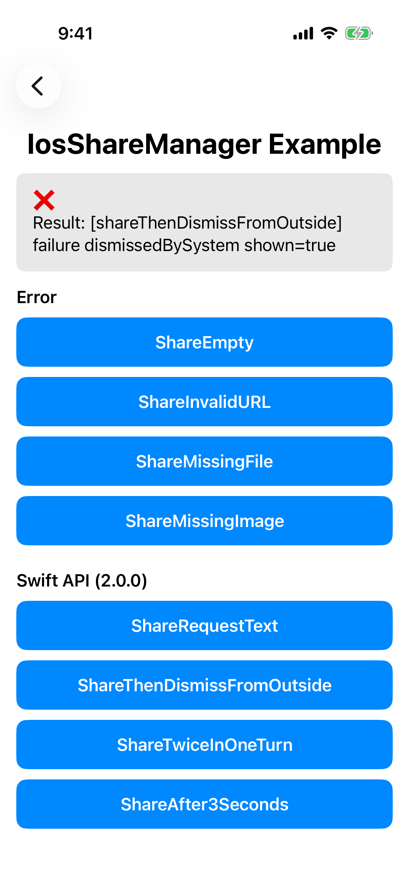
</p>

#### 同じターンでの 2 つの共有

共有シートが別の共有シートの上に表示されることはありません。共有が重なった場合は次のようになります。

- メインキューの同じターンで 2 つの共有を要求した場合: 1 つのシートが表示され、もう一方の共有はそのシートが表示し終わるまで（最大 10 秒）待ってから `presentationFailed` で終わります。どちらが表示されるかは決まっておらず、常に最初の呼び出しとは限りません。完了ハンドラーはそれぞれ 1 回だけ呼ばれます（1.x では、2 つのうち一方の完了ハンドラーが呼ばれませんでした）。
- フォアグラウンドが共有シート（ライブラリのものでもアプリ独自のものでも）のときに要求した共有は、`presentationFailed` で終わります。
- `.firstActiveScene` は待ちません。同じウィンドウでライブラリの共有シートがまだ表示途中のときに要求した共有は、すぐに `presentationFailed` で終わります。
- ライブラリの共有シートが表示し終わるまでに 10 秒より長くかかった場合（たとえばその間にアプリがバックグラウンドに移った場合）、それを待っている共有は `presentationFailed` で終わります。さらに、そのウィンドウでのライブラリのそれ以降の表示（共有と、`presenter` の API で表示するダイアログ）は、そのシートが表示し終わるか解放されるまで、すぐに `presentationFailed` で終わります。[スレッドと表示](#スレッドと表示) で避けるよう説明した、UIKit が拒否したシートを保持するケースのあとも同じです。

```swift
for number in 1...2 {
    IosShareManager.shared.share(
        content: ShareContent(items: [.text("Share \(number) of two in one turn")]),
        presenter: .foreground
    ) { result in
        // 2 つのうち一方は .failure(.presentationFailed) で終わります
        print(number, result)
    }
}
```

<p align="center">
    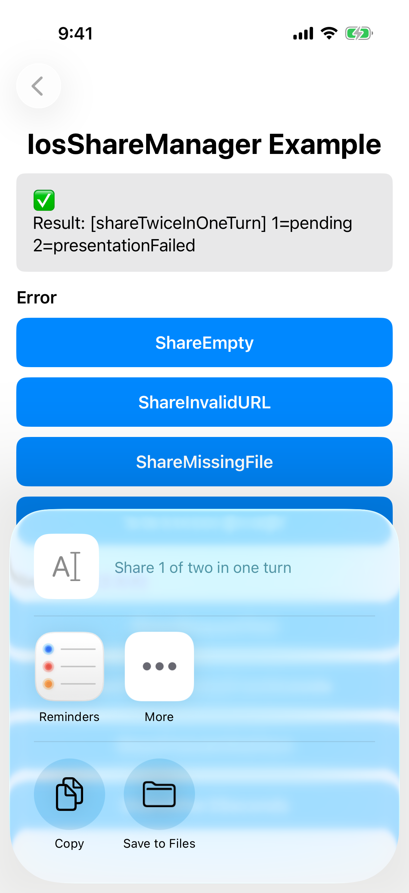
</p>

---

### C ABI

- C から、そしてフレームワークの C の関数を呼べる言語から、同じ共有を使うための API です。Swift のコードは代わりに `IosShareManager` を呼び出します。
- `ios-native-toolkit-capi-2.0.0.xcframework`（フレームワーク `IosLibraryCApi`）には、C ABI とそのヘッダー `NativeToolkitC/*.h` が含まれます。C ABI は Swift の API を呼び出すため、アプリには同じリリースの両方の xcframework を組み込みます。必要な条件と追加の手順はマニュアルトップの [対応プラットフォーム: iOS](index.ja.md#対応プラットフォーム-ios実機-arm64--simulator-arm64-x86_64) に、すべての機能に共通する規則は [C ABI](index.ja.md#c-abi-1) にあります。
- Android の `Share.h` にはコンテンツの種類ごとに関数があります。iOS には、Swift の API と同じく、種類の混在したアイテムの配列を受け取り、結果をハンドルとして返す関数 `ntk_share_content_async` が 1 つあります。
- どの関数もどのスレッドからでも呼び出せ、メインスレッドを待つことはありません。コールバックと、受け付けられた呼び出しの `release` はメインキューで実行され、メインスレッドで呼び出した場合に関数の中で実行されることはありません。それ以外のスレッドから呼び出した場合は、関数が戻る前にコールバックが届くことがあります。コールバックと要求の対応は `user_data` で取ってください。コールバックの中でブロックせず、コールバックの外に例外を出さないでください。
- `ntk_share_content_async` の `NTK_SHARE_ERROR_NONE` は、要求が受け付けられたことを表します。その後、コールバックが 1 回呼ばれ、続いて `release` が呼ばれます。それ以外の値は拒否を表します。コールバックは呼ばれず、`release` は呼び出し元のスレッドですでに実行されているため、`user_data` を自分で解放しないでください。`NULL` のコールバックは拒否されます。`release` は `NULL` でも構いません。
- ライブラリは要求（文字列、アイテム、除外するタイプ）を、呼び出しが戻る前にコピーします。文字列は NUL 終端の UTF-8 で、不正な UTF-8 は `NTK_SHARE_ERROR_INVALID_PARAMETER` で拒否されます。
- 0 で埋めて `struct_size` を設定した構造体は、すべてのフィールドが既定値です。`ntk_share_request` では、件名なし、プレビューのタイトルなし、除外なし（この場合 `excluded_activity_types` は `NULL` でも構いません）で、アイテムもないため、呼び出しは `NTK_SHARE_ERROR_EMPTY_CONTENT` で拒否されます。`items` と `item_count` を設定してください。`ntk_share_item` では `NULL` の `value` を持つ `NTK_SHARE_ITEM_TEXT` になり、これは `NTK_SHARE_ERROR_INVALID_PARAMETER` で拒否されます。どのアイテムにも `value` が必要です。予約フィールドは 0 にします。アイテムの配列の要素はすべて同じ `struct_size` を持ちます。
- 共有にはフォアグラウンドが必要です。C ABI は、Swift の `.foreground` と同じくフォアグラウンドのビューコントローラから表示します。バックグラウンドからの場合、コールバックには `NTK_SHARE_ERROR_NOT_FOREGROUND` が届きます。C ABI ではビューコントローラを選べません。アプリの複数のウィンドウを並べて表示している iPad では、どのウィンドウにシートが表示されるかは決まっていません。iPad では、シートは表示元のビューの中央を起点とするポップオーバーになります。
- 共有は取り消せません。取り消しの関数も `CANCELED` の値もありません。コールバックと `release`（そしてそれとともに `user_data`）は、シートが終わるまで保持されます。シートの表示中にホストがウィンドウやルートビューコントローラを置き換えた場合や、システムがシーンを切断してもシートが保持された場合は、それらが呼ばれないことがあり、`user_data` はリークします。
- 結果のハンドル（`ntk_share_result*`）は受け取った側のものです。受け取った側が、コールバックの中でもあとでも、どのスレッドからでも `ntk_share_result_free` で解放します。`ntk_share_result_activity_type` が返す文字列は、ハンドルを解放するまで有効です。`ntk_share_result_free(NULL)` は何もしません。
- iOS では、`ntk_last_system_code()` とコールバックの `system_code` は常に 0 です。

#### ビルド

1. `ios-native-toolkit-2.0.0.xcframework` と `ios-native-toolkit-capi-2.0.0.xcframework` をアプリのターゲットに追加し、両方を "Embed & Sign" に設定します。
2. フレームワークからヘッダーを `#include <IosLibraryCApi/NativeToolkitC/Share.h>` でインクルードするか、`dist/1.14.0/ios/include` を Header Search Paths に追加して `#include <NativeToolkitC/Share.h>` と書きます。`Share.h` は `Common.h` を自分でインクルードします。

#### コンテンツの共有

```c
static void NTK_CALL on_share_result(void* user_data, ntk_share_error error, uint32_t system_code,
                                     ntk_share_result* result)
{
    /* メインスレッドで、受け付けられた呼び出しにつき 1 回だけ呼ばれます。error が NONE 以外なら result は NULL です。 */
    (void)user_data; (void)system_code;   /* iOS では system_code は常に 0 です */
    if (error == NTK_SHARE_ERROR_NONE) {
        if (ntk_share_result_completed(result)) {
            size_t size = 0;
            const char* activity = ntk_share_result_activity_type(result, &size);   /* 不明な場合は NULL です */
            (void)activity;
        } else {
            /* ユーザーがシートを閉じました。エラーではありません。 */
        }
        ntk_share_result_free(result);   /* ここでもあとでも、どのスレッドからでも構いません */
        return;
    }
    switch (error) {
    case NTK_SHARE_ERROR_NOT_FOREGROUND:    /* アプリがバックグラウンドにありました。何も表示されていません */
    case NTK_SHARE_ERROR_SHOW_FAILED:       /* シートは表示されませんでした */
        break;
    case NTK_SHARE_ERROR_INVALID_URI:
    case NTK_SHARE_ERROR_FILE_NOT_FOUND:
    case NTK_SHARE_ERROR_IMAGE_LOAD_FAILED: /* 共有できないアイテムがあります。何も表示されていません */
        break;
    case NTK_SHARE_ERROR_CANCELED_BY_SYSTEM: /* シートが結果なしで消えました */
    case NTK_SHARE_ERROR_ACTIVITY_FAILED:    /* 選ばれたアクティビティがエラーを報告しました */
        break;
    default:
        break;
    }
}

static void NTK_CALL on_share_release(void* user_data)
{
    /* 1 回だけ呼ばれます。メインスレッドでコールバックのあとに、または呼び出しが拒否された場合は
       呼び出し元のスレッドで呼ばれます。user_data はここで解放します。 */
    (void)user_data;
}

/* テキストと URL を 1 回の共有で。件名、プレビューのタイトル、除外するアクティビティ付きです。 */
static ntk_share_error share_text_and_url(void* user_data)
{
    ntk_share_item items[2];
    memset(items, 0, sizeof(items));
    items[0].struct_size = (uint32_t)sizeof(items[0]);
    items[0].kind = NTK_SHARE_ITEM_TEXT;
    items[0].value = "Check this out";
    items[1].struct_size = (uint32_t)sizeof(items[1]);
    items[1].kind = NTK_SHARE_ITEM_URL;
    items[1].value = "https://www.apple.com";

    const char* excluded[1];
    excluded[0] = "com.apple.UIKit.activity.PostToFacebook";

    /* 0 のフィールドは既定値です。件名なし、プレビューのタイトルなし、除外なしです。 */
    ntk_share_request request;
    memset(&request, 0, sizeof(request));
    request.struct_size = (uint32_t)sizeof(request);
    request.items = items;
    request.item_count = 2;
    request.subject = "Sample Subject";      /* Swift と同じく、最初のアイテムに付けられます */
    request.preview_title = "Apple";
    request.excluded_activity_types = excluded;
    request.excluded_activity_type_count = 1;

    /* ライブラリは戻る前に要求をコピーします。items がスコープを外れても構いません。 */
    return ntk_share_content_async(&request, &on_share_result, user_data, &on_share_release);
}

/* 画像とファイルを、フルパスで。 */
static ntk_share_error share_image_and_file(const char* image_path, const char* file_path, void* user_data)
{
    ntk_share_item items[2];
    memset(items, 0, sizeof(items));
    items[0].struct_size = (uint32_t)sizeof(items[0]);
    items[0].kind = NTK_SHARE_ITEM_IMAGE_FILE;
    items[0].value = image_path;
    items[1].struct_size = (uint32_t)sizeof(items[1]);
    items[1].kind = NTK_SHARE_ITEM_FILE;
    items[1].value = file_path;

    ntk_share_request request;
    memset(&request, 0, sizeof(request));
    request.struct_size = (uint32_t)sizeof(request);
    request.items = items;
    request.item_count = 2;

    ntk_share_error error = ntk_share_content_async(&request, &on_share_result, user_data, &on_share_release);
    if (error != NTK_SHARE_ERROR_NONE) {
        /* 拒否されました。コールバックは呼ばれず、on_share_release はすでに実行されています。 */
    }
    return error;
}
```

- アイテムの `value` は、テキスト、URL、またはフルパスです。空文字列は呼び出しの時点では拒否されません。空または空白だけのテキストは、Swift の API と同じくそのまま共有されます（空のテキストが `NTK_SHARE_ERROR_EMPTY_CONTENT` になる Android とは異なります）。URL やパスはライブラリが検証し、空のものも含めて、Swift の API と同じく `NTK_SHARE_ERROR_INVALID_URI`、`NTK_SHARE_ERROR_FILE_NOT_FOUND`、`NTK_SHARE_ERROR_IMAGE_LOAD_FAILED` をコールバックで通知します。
- `item_count` が 0 の場合は `NTK_SHARE_ERROR_EMPTY_CONTENT` を返します。範囲外のアイテムの `kind`、`NULL` の `value`、0 以外の個数を伴う `NULL` の配列、`NULL` の除外タイプは `NTK_SHARE_ERROR_INVALID_PARAMETER` を返します。

#### 共有シートは一度に 1 つ

[同じターンでの 2 つの共有](#同じターンでの-2-つの共有) の規則は C にも当てはまります。

- メインキューの同じターンで 2 回 `ntk_share_content_async` を呼び出した場合、一方がシートを表示し、もう一方はそのシートが表示し終わるまで（最大 10 秒）待ってから、コールバックに `NTK_SHARE_ERROR_SHOW_FAILED` が届きます。どちらが表示されるかは決まっておらず、複数の共有のコールバックの順序も保証されません。受け付けられた呼び出しには、それぞれコールバックと `release` が 1 回ずつ届きます。
- フォアグラウンドが共有シートのときの呼び出しには `NTK_SHARE_ERROR_SHOW_FAILED` が届きます。
- ホスト自身が表示したビューコントローラ（たとえばホスト独自の `UIActivityViewController`）がまだ表示中で、その `present` 呼び出しの完了ハンドラーが実行される前には、`ntk_share_content_async` を呼び出さないでください。UIKit がライブラリのシートの表示を拒否したうえでそれを保持することがあり、その場合、コールバックと `release` が呼ばれないことがあります。ホストの `present` の完了ハンドラーのあとで呼び出してください。
- 共有シートが表示し終わるまでに 10 秒より長くかかった場合、待っている呼び出しには `NTK_SHARE_ERROR_SHOW_FAILED` が届き、そのウィンドウでのそれ以降の共有にも、そのシートが表示し終わるか解放されるまで `NTK_SHARE_ERROR_SHOW_FAILED` が届きます。

#### エラー値

`ntk_share_error` です。0 から 5 は、C ABI のどの機能でも同じ意味です。欠けている番号（8、10 から 16）は、iOS が使用しない Android の `Share.h` の値です。

| コード | 名前 | 発生する場合 | 返し方 |
|---|---|---|---|
| 0 | `NTK_SHARE_ERROR_NONE` | 受け付けられました（戻り値）。シートが結果とともに終わりました（コールバック） | 両方 |
| 1 | `NTK_SHARE_ERROR_INVALID_PARAMETER` | `NULL` の要求やコールバック、不正な UTF-8、小さすぎるか 4096 を超える `struct_size`、0 以外の予約フィールド、サイズの異なるアイテム、範囲外のアイテムの `kind`、`NULL` の値 | 戻り値 |
| 2 | `NTK_SHARE_ERROR_NOT_INITIALIZED` | iOS では返されません | - |
| 3 | `NTK_SHARE_ERROR_NOT_SUPPORTED` | 構造体のうち、このバージョンが知らない部分に 0 以外の値があります | 戻り値 |
| 4 | `NTK_SHARE_ERROR_UNKNOWN` | C ABI が知らない `ShareError` のケースです。両方の xcframework が同じリリースである限り返されません | コールバック |
| 5 | `NTK_SHARE_ERROR_OUT_OF_MEMORY` | iOS では返されません | - |
| 6 | `NTK_SHARE_ERROR_NOT_FOREGROUND` | アプリにフォアグラウンドのビューコントローラがありません。何も表示されていません | コールバック |
| 7 | `NTK_SHARE_ERROR_EMPTY_CONTENT` | `item_count` が 0 です | 戻り値 |
| 9 | `NTK_SHARE_ERROR_FILE_NOT_FOUND` | `NTK_SHARE_ITEM_FILE` アイテムのファイルが存在しません | コールバック |
| 17 | `NTK_SHARE_ERROR_INVALID_URI` | `NTK_SHARE_ITEM_URL` アイテムが有効な `http`、`https`、`file` の URL ではありません | コールバック |
| 18 | `NTK_SHARE_ERROR_IMAGE_LOAD_FAILED` | `NTK_SHARE_ITEM_IMAGE_FILE` アイテムの画像を読み込めません | コールバック |
| 19 | `NTK_SHARE_ERROR_SHOW_FAILED` | シートが表示されませんでした。フォアグラウンドのビューコントローラが落ち着いていなかった、UIKit が拒否した、またはフォアグラウンドが共有シートだった場合です | コールバック |
| 20 | `NTK_SHARE_ERROR_CANCELED_BY_SYSTEM` | シートが結果なしで消えました。ライブラリの外から閉じられたか、シーンが切断されてシートが解放された場合です | コールバック |
| 21 | `NTK_SHARE_ERROR_ACTIVITY_FAILED` | 選ばれたアクティビティがエラーを報告しました。その domain と code は C には渡されません | コールバック |

`CANCELED` はありません。共有は取り消せず、ユーザーがシートを閉じた場合は `NTK_SHARE_ERROR_NONE` で、`ntk_share_result_completed` が 0 を返します。

| Swift API | C ABI |
|---|---|
| `share(content:presenter:completion:)`（`.foreground`） | `ntk_share_content_async`（`ntk_share_request`） |
| `ShareItem` の `.text` / `.url` / `.imageFile(path:)` / `.file(path:)` | `ntk_share_item`（`NTK_SHARE_ITEM_TEXT` / `_URL` / `_IMAGE_FILE` / `_FILE`） |
| `ShareContent.subject` / `previewTitle` / `excludedActivityTypes` | `subject` / `preview_title` / `excluded_activity_types` と `excluded_activity_type_count` |
| `ShareResult.completed` / `activityType` | `ntk_share_result_completed` / `ntk_share_result_activity_type`。そのあと `ntk_share_result_free` |
| `ShareError` | `ntk_share_error`: `noRootViewController` と `notForeground` は 6、`noValidItems` は 7、`fileNotFound` は 9、`invalidURL` は 17、`imageLoadFailed` は 18、`presentationFailed` は 19、`dismissedBySystem` は 20、`activityFailed` は 21 |
| `PresenterSelection` | ありません。C ABI は常にフォアグラウンドから表示します |

---

## macOS

- ライブラリ: `mac-native-toolkit-1.3.0.xcframework`
- 最小デプロイメントターゲット: macOS 15
- 対応範囲: 送信のみ。ピッカー（`NSSharingServicePicker`）と個別サービスの直接実行（`NSSharingService`）を提供します。受信は対象外です。
- macOS には共有方法が 2 つあります。ユーザーが共有先を選ぶ **ピッカー**（`NSSharingServicePicker`）と、ピッカーを表示せず特定のサービスを直接実行する **個別サービスの直接実行**（`NSSharingService`。例: `recipients`/`subject` を設定した状態で Mail を起動）です。

### MacShareManager

`MacShareManager` は、macOS でシステム共有ピッカーの表示と個別サービスの直接実行を行うシングルトンクラスです。

**重要:** ピッカーの表示は、ボタン押下などユーザー操作に起因する処理の中でのみ行ってください。`NSSharingServicePicker.show(...)` は `mouseDown` イベントの文脈での呼び出しを要求しますが、ピッカーの呼び出し経路は内部で `Task { @MainActor in ... }` を経由するため、この文脈が保持されることは仕様上厳密には保証されていません。本ツールキット付属のサンプルアプリでは、実際のクリックで起動した場合にピッカーが正しく表示・解決（表示・キャンセル・完了）することを確認済みです。個別サービスの直接実行（`shareViaService` / `share(content:serviceName:completion:)`）は `mouseDown` の文脈に依存しないため、確実性が求められる場面ではこちらの方が堅牢です。

<p align="center">
    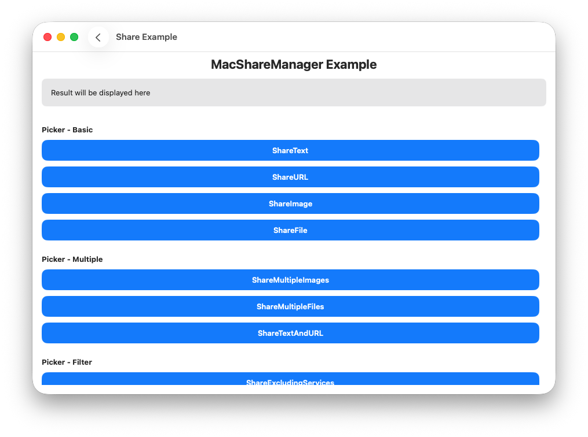
</p>

### セットアップ

1. `mac-native-toolkit-1.3.0.xcframework` を Xcode プロジェクトに追加します（プロジェクトにドラッグし、ターゲットの Frameworks, Libraries, and Embedded Content で "Embed & Sign" に設定します）。
2. 共有ピッカーやサービスを実行するファイルでライブラリをインポートします。

```swift
import MacLibrary
```

追加の初期化は不要です。

`MacShareManager` は、各操作に対して 2 つの呼び出し方式を提供します。

- `async throws`（ネイティブ Swift 呼び出し元に推奨）: 型付きの `ShareResult` を返し、失敗時は `ShareError` を throw します。
- コールバック（Unity Bridge が使用。Swift でも利用可）: `(isSuccess, completed, serviceName, errorMessage)`。

```swift
// async throws（Swift 呼び出し元に推奨）
Task {
    do {
        let result = try await MacShareManager.shared.share(
            content: ShareContent(items: [.text("Hello")])
        )
        // result.completed == false はユーザーがキャンセルしたことを示します（エラーではありません）
        print(result.completed, result.serviceName ?? "nil")
    } catch {
        print(error.localizedDescription)
    }
}

// コールバック（同等の処理）
MacShareManager.shared.share(
    content: ShareContent(items: [.text("Hello")])
) { isSuccess, completed, serviceName, errorMessage in
    print(isSuccess, completed, serviceName ?? "nil", errorMessage ?? "nil")
}
```

以降のサンプルは `async throws` 方式を使用します。SwiftUI の `Button` の action は同期処理のため、各呼び出しを `Task { ... }` でラップしています。

### ピッカー - 基本

#### テキストを共有

```swift
Task {
    let result = try await MacShareManager.shared.share(
        content: ShareContent(items: [.text("Shared from MacLibraryExample")])
    )
    print(result.completed, result.serviceName ?? "nil")
}
```

<p align="center">
    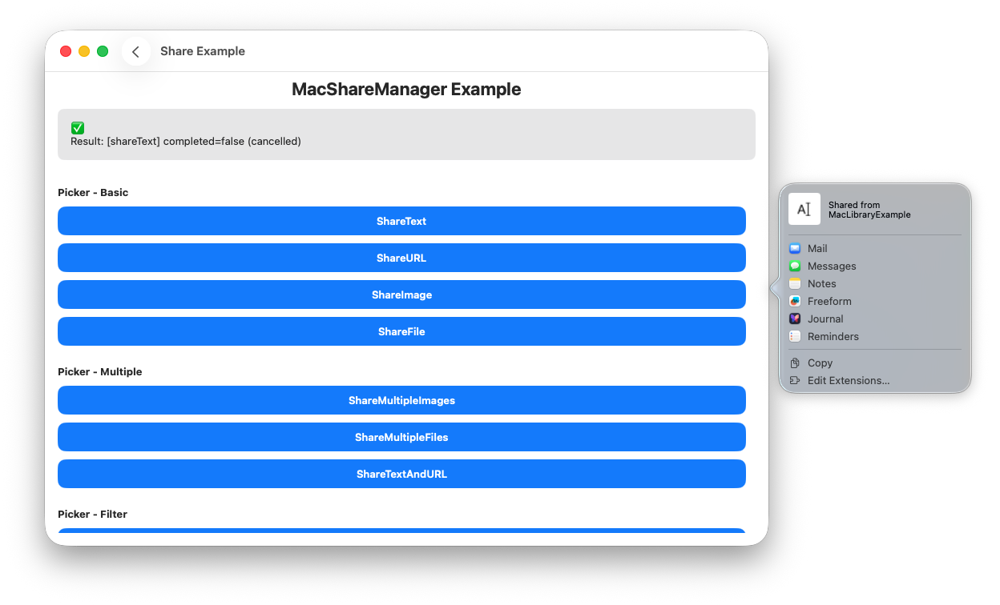
</p>

#### URL を共有

URL は文字列として渡します。ライブラリ内で検証され、`http` / `https` / `file` スキームでホストが有効なもののみが許可されます（それ以外は `ShareError.invalidURL` が throw されます）。

```swift
Task {
    let result = try await MacShareManager.shared.share(
        content: ShareContent(items: [.url("https://www.apple.com")])
    )
    print(result.completed, result.serviceName ?? "nil")
}
```

<p align="center">
    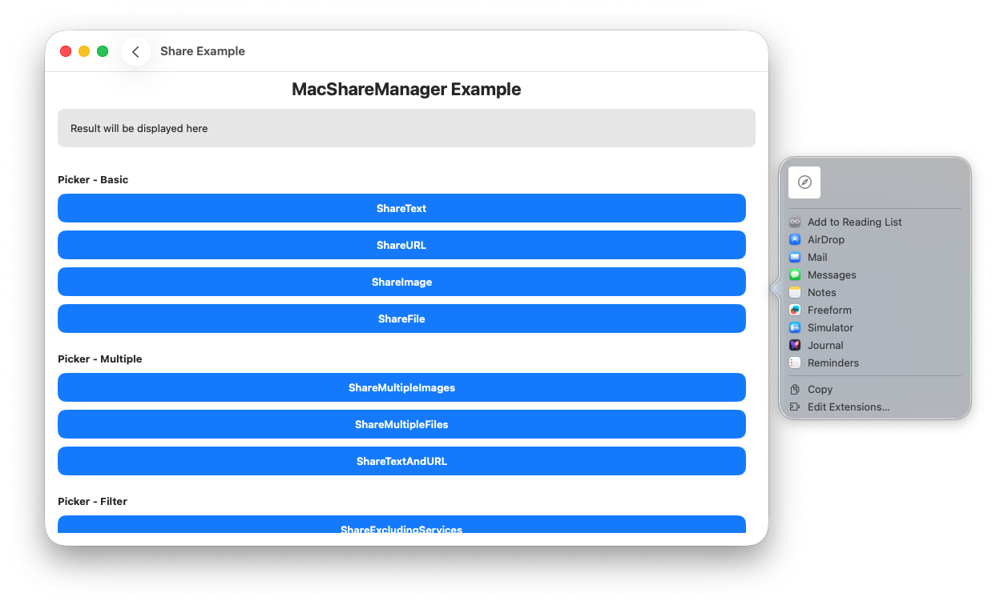
</p>

#### 画像を共有

`.imageFile(path:)` に画像のローカルファイルパスを渡します。ライブラリは `NSImage` として読み込みます（読み込めない場合は `ShareError.imageLoadFailed` が throw されます）。

```swift
guard let image = NSImage(named: "test-image") else { return }
guard let tiffData = image.tiffRepresentation,
      let bitmap = NSBitmapImageRep(data: tiffData),
      let pngData = bitmap.representation(using: .png, properties: [:])
else { return }

let imageURL = FileManager.default.temporaryDirectory.appendingPathComponent("share-sample-image.png")
try pngData.write(to: imageURL)

Task {
    let result = try await MacShareManager.shared.share(
        content: ShareContent(items: [.imageFile(path: imageURL.path)])
    )
    print(result.completed, result.serviceName ?? "nil")
}
```

<p align="center">
    
</p>

#### ファイルを共有

`.file(path:)` にファイルのローカルパスを渡します。ライブラリはファイルの存在を確認します（存在しない場合は `ShareError.fileNotFound` が throw されます）。

```swift
let fileURL = FileManager.default.temporaryDirectory.appendingPathComponent("share-sample.txt")
try "Shared from MacLibraryExample.".write(to: fileURL, atomically: true, encoding: .utf8)

Task {
    let result = try await MacShareManager.shared.share(
        content: ShareContent(items: [.file(path: fileURL.path)])
    )
    print(result.completed, result.serviceName ?? "nil")
}
```

<p align="center">
    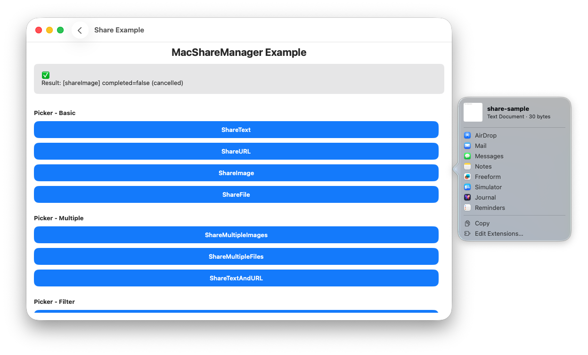
</p>

### ピッカー - 複数アイテム

#### 複数画像を共有

`ShareContent.items` は複数のエントリを受け付けるため、一度に複数の画像を共有できます（サンプル画像は 1 枚のみバンドルされているため、複数の一時ファイルへコピーして使用します）。

```swift
let imagePaths: [String] = /* ローカル画像ファイルパスの配列 */

Task {
    let result = try await MacShareManager.shared.share(
        content: ShareContent(items: imagePaths.map { .imageFile(path: $0) })
    )
    print(result.completed, result.serviceName ?? "nil")
}
```

<p align="center">
    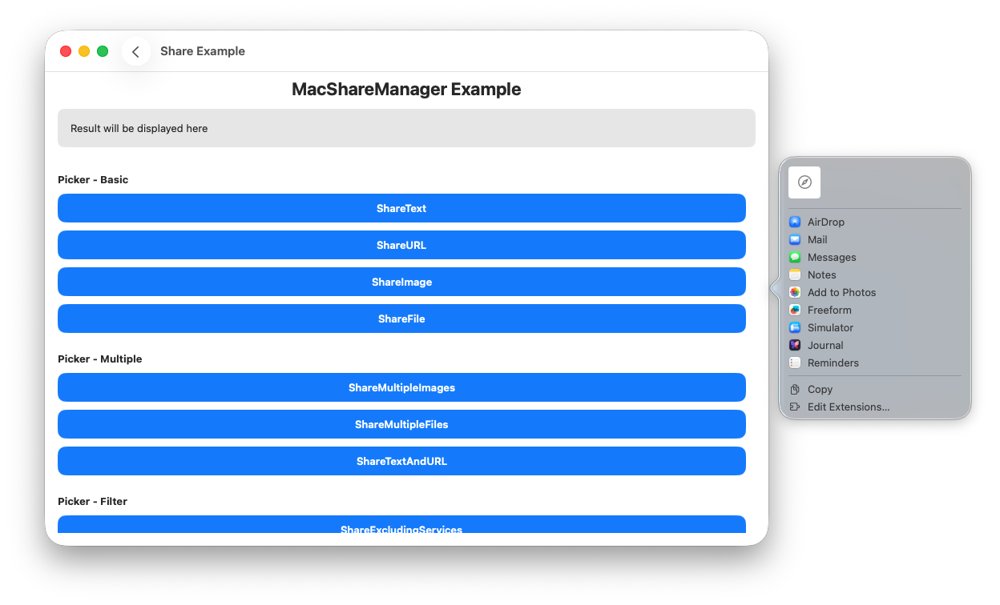
</p>

#### 複数ファイルを共有

```swift
let fileURLs: [URL] = /* ローカルファイルの URL 配列 */

Task {
    let result = try await MacShareManager.shared.share(
        content: ShareContent(items: fileURLs.map { .file(path: $0.path) })
    )
    print(result.completed, result.serviceName ?? "nil")
}
```

<p align="center">
    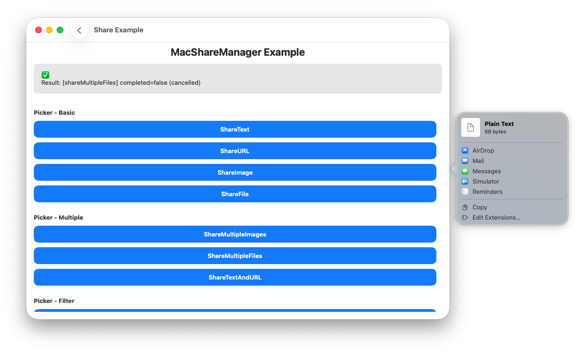
</p>

#### テキストと URL を共有

テキスト・URL・画像・ファイルなど異なる種類のアイテムを 1 回の共有にまとめて指定できます。

```swift
Task {
    let result = try await MacShareManager.shared.share(
        content: ShareContent(items: [
            .text("Check this out"),
            .url("https://www.apple.com")
        ])
    )
    print(result.completed, result.serviceName ?? "nil")
}
```

<p align="center">
    
</p>

### ピッカー - フィルタ

#### 特定サービスを除外して共有

`excludedServiceTitles` にサービスの表示名を渡すと、ピッカーからそのサービスを非表示にします。これは **ベストエフォート** です。`NSSharingService` は呼び出し元に安定した raw identifier を公開しないため、比較はローカライズされ得る表示名（`title`）に対して行われ、環境によっては一致しない場合があります。確実な制御が必要な場合は、個別サービスの直接実行（`shareViaService`）を使用してください。

```swift
Task {
    let result = try await MacShareManager.shared.share(
        content: ShareContent(
            items: [.url("https://www.apple.com")],
            excludedServiceTitles: ["Add to Reading List"]
        )
    )
    print(result.completed, result.serviceName ?? "nil")
}
```

<p align="center">
    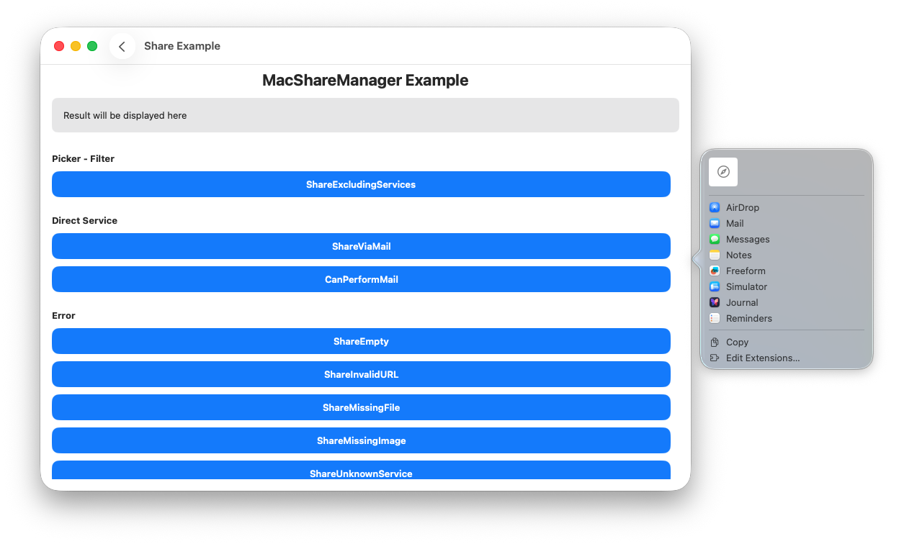
</p>

### 個別サービスの直接実行

#### Mail を直接実行して共有

ピッカーを表示せず、指定した 1 つのサービスを直接実行します。`serviceName` には raw な `NSSharingService.Name` の値（例: `"com.apple.share.Mail.compose"`）を渡します。`recipients` と `subject` はサービス実行前に設定されます。ピッカー方式では効果がありません。

```swift
Task {
    let result = try await MacShareManager.shared.shareViaService(
        content: ShareContent(
            items: [.text("Body text")],
            recipients: ["test@example.com"],
            subject: "Sample Subject"
        ),
        serviceName: "com.apple.share.Mail.compose"
    )
    print(result.completed, result.serviceName ?? "nil")
}
```

<p align="center">
    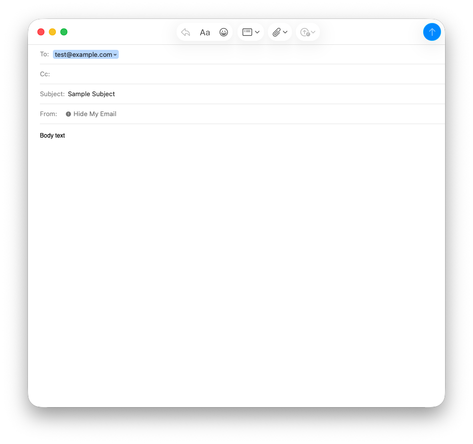
</p>

#### サービスが実行可能か確認

指定したサービスが渡したコンテンツを共有できるかを照会します。例えば、ボタンをタップする前に有効/無効を切り替える際に使用します。

```swift
Task {
    let canPerform = try await MacShareManager.shared.canPerform(
        content: ShareContent(items: [.text("Body text")]),
        serviceName: "com.apple.share.Mail.compose"
    )
    print(canPerform)
}
```

### エラー処理

`async throws` API は失敗時に `ShareError` を throw します。ユーザーによるキャンセルはエラーではなく、`ShareResult.completed == false` として通知されます。

| エラー | 原因 | エラーメッセージ |
|---|---|---|
| `noValidItems` | `items` が空 | `"No shareable items were provided."` |
| `invalidURL(String)` | URL 文字列が有効な `http`/`https`/`file` URL でない | `"Invalid URL: <value>."` |
| `imageLoadFailed(path:)` | 指定パスの画像を読み込めなかった | `"Failed to load image at path: <path>."` |
| `fileNotFound(path:)` | 指定パスのファイルが存在しない | `"File not found at path: <path>."` |
| `noAnchorView` | ピッカーの表示基準となる key window が取得できなかった | `"No key window available to anchor the sharing picker."` |
| `serviceUnavailable(name:)` | 指定したサービス名が不明、またはコンテンツを共有できない | `"Sharing service unavailable: <name>."` |
| `alreadyInProgress` | 別の共有処理が既に進行中 | `"A share operation is already in progress."` |
| `presentationFailed(Error)` | 表示に失敗した、またはシステムがエラーを報告した | `"Failed to share: <detail>."` |
| `unknown(Error)` | 予期しないエラーが発生した | `"An unknown share error occurred: <detail>."` |

```swift
Task {
    do {
        let result = try await MacShareManager.shared.share(
            content: ShareContent(items: [.text("Hello")])
        )
        if result.completed {
            // result.serviceName で共有成功
        } else {
            // ユーザーがキャンセル
        }
    } catch let error as ShareError {
        // 型付きエラー。errorCode / errorMessage を持つ（例: .noValidItems, .invalidURL, .fileNotFound）
        print(error.errorCode, error.errorMessage)
    } catch {
        // その他のエラー
    }
}
```

コールバック API を使う場合、失敗は `isSuccess == false` と非 nil の `errorMessage` で通知されます。

```swift
MacShareManager.shared.share(
    content: ShareContent(items: [])
) { isSuccess, completed, serviceName, errorMessage in
    // isSuccess == false, errorMessage == "No shareable items were provided."
}
```
